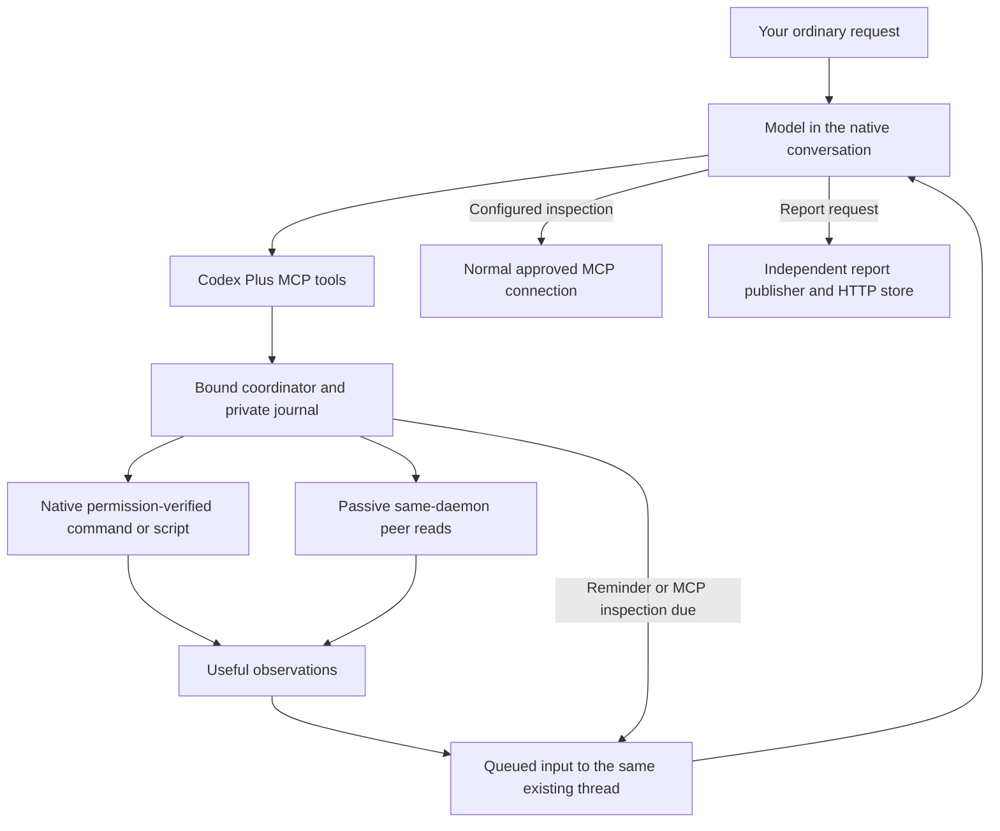

# How Codex Plus works

When you ask Codex to watch an export, you can keep using the same thread.
Codex Plus keeps track of the job and queues an update when something you
asked about happens. Native Codex decides when the model can respond and
continues to handle goals, approvals and tools.

## Observation and follow-up

When a watch starts, Codex Plus verifies the open session and its daemon and
ties the watch to that caller, thread, owner and source. Only an already
loaded, independent session can register it. A private user-owned `0700`
state directory keeps the request and its receipts outside model context.

Command sources inherit the exact calling session's effective execution policy,
including existing network access and authorized cache writes. Read-only and
network-off options narrow access; network-required checks an existing grant.
A repeated short command or continuing script can filter observations without
inference per read. JSON projection is optional; occurrence streams have different
semantics and are not deduplicated merely because lines have identical text.

Configured MCP checks take another route: the coordinator schedules a native
model turn, which inspects the selected registration and calls the actual tool
through normal authentication/approval. Each check costs a model turn. The
direct app-server MCP RPC is excluded because controlled qualification exposed
an approval bypass. No background helper invents missing credentials or grants.

Useful events queue into the exact continuing conversation. Busy delivery and
human control retain native ordering. The model reads fresh relevant state,
records handling and decides the next useful step under the existing request.
An observation supplies data, not permission to repair a workload or start a task.

## What is in the package

| Component | How you reach it | What it does |
| --- | --- | --- |
| Monitoring runtime | 17 `codex_plus` MCP tools and the watch, peer, package and owner CLIs | Follows sources for a limited time, delivers messages and reminders, and records what happened. Supports cancellation and explicit owner recovery. |
| Reporting component | Four `html_report` MCP tools, the report CLI and the HTML report skill | Saves static snapshots, groups them by project, checks delivery and deletes reports you select. |
| Report server | `codex-report-server` | Serves the snapshots independently of Codex. Each configuration can use its own tmux session or a server you manage. |
| Worker bundle | Seven workflow skills and four roles (`luna-max`, `sol-xhigh`, `astra-xhigh`, `terra-6-1-xhigh`) | Routes assignments to workers. The primary reviews their work and makes the final decisions. |
| Development source | Tests, validators, guides and research reports | Records what was implemented and checked. Installed archives have their own manifests. |

Codex Plus `v0.1.0-preview.30` unifies workers, monitoring and reporting under one
version, source commit and release. Optional archives retain each component's
dependencies and configuration. Managed source selects preview.30 artifacts
from `33de05c`. Snap and Starship verified the rollout. Carbon's deployment
is pending. Snap's default and Work environments retain separate native homes.
See the [delivery receipt](reliability-packaging-results.md#preview30-worker-workflow-fixes).
Changing the selected release updates the files available to the next process.
An existing MCP connection picks up the change on its normal reconnect. The
runtime continues to own its journals, report data and hosting.

The read-only `scripts/codex-plus-doctor` reports selected manifest integrity,
enabled MCP configuration and native client/owner version evidence. Preview.10 and later
can read reported MCP versions for one positively loaded conversation;
missing metadata remains unknown and reported versions do not verify payload
bytes. It never starts services or infers loaded code from a selected symlink.
A version outside the recorded qualification baseline remains unqualified; see
[diagnosis](runtime-distribution.md#read-only-diagnosis).

Each canonical `CODEX_HOME` selects a native endpoint and Codex Plus context.
Explicit state/config paths take precedence; alternate homes otherwise derive
separate namespaces. Native `--profile` does not create another environment.
Peers and messages stay within that home's daemon, even on the same host.
Reports use the selected config/store and distinct configured serving endpoints.
See [multiple environments](environments.md) for diagnostics and compatibility.

Completion and approval alerts still come from native Codex and your terminal.
On the managed hosts, Kitty and chezmoi own their formatting.

Worker identities and explicit invocation behavior are unchanged. Discussing a
skill or asking for a generic goal loop does not invoke a worker workflow. The
HTML report skill is an additional skill, separate from the seven worker workflows.
The [worker guide](workers.md) covers Luna, task versus goal-loop workflows,
adaptive routing and the distinction between workers and independent peers.
Preview.18 adds three explicit named task frontends, reusing Sol/Astra roles and
adding a distinct current-Terra role. Older preview.17 installations retain four
worker workflows until upgraded. Named review
is an assignment choice, with primary acceptance and inherited permissions,
rather than a new service, primary switch or automatic escalation policy.

## Discovery and messaging

Describe the other session by its project or recent work. Codex looks among
confirmed independent sessions loaded on the same daemon. If several fit, it
asks which one you mean. If it could inspect only part of the directory, it
says so. Peer reads omit user prompts and tool outputs. Once selected, the
reference stays with that session even if another takes its name.

Information and requests are attributed. The receiver can accept or decline a
request within its existing task. The sender reads cached handling receipts
instead of creating acknowledgement ping-pong. Outgoing cancellation can reconcile
pending intent but cannot interrupt the recipient or retract completed handling.
This is coordination between independent sessions, not subagent orchestration or
cross-host transport. Agent Observer/Mesh is not a runtime dependency.

## Control and receipts

| Fact or control | Meaning |
| --- | --- |
| Registered | The watch or reminder is set up. Its time and event limits apply. |
| Native queued | The update is waiting in the intended conversation. |
| Received / accepted / declined | The recipient recorded how it handled the message. Look for a reply or check the work to confirm the result. |
| Cancelled | Future checks or deliveries stop for this request. History shows any work that already went through. |
| Expired | The time or event allowance ran out. Check the job itself to see whether it finished. |
| Lost / uncertain | There’s a gap in observation or delivery. The runtime leaves it visible and won’t silently retry or switch targets. |
| Esc | The foreground turn stops. Independent watches and reminders keep their original limits. |

Explicit stop forbids renewal/replacement. Renewal retains the frozen source.
Recovery is explicit, retains remaining bounds, discloses gaps and does not replay
uncertain admitted events. The runtime does not claim exactly-once processing,
replace the native owner or intercept `/exit` with a confirmation dialog.

### Returning to unfinished work

Preview.10 composes a recap from the existing watch/reminder
journals and sender-owned outgoing references. Reminder history is paginated;
outgoing receipts include their kind and a bounded quoted purpose. This is the
bound conversation's recorded work, with cached evidence and coverage limits.
It neither inventories every session nor starts new observation.

Fulfilled reminder delivery intent can precede completion of its native
follow-up turn. Acknowledgement records receipt. Pending or unknown outcomes
stay visible, including consumed callbacks after cancellation. Failed/interrupted
turns need attention until explicit reminder cancellation; terminal receipts
remain in history. Missing terminal evidence remains unknown even after a
coordinator exits. Inspection does not retry or infer success. Uncertain delivery
or withdrawal remains visible independently of that attention state.

Preview.12 also removes an explicitly cancelled terminal
source error from current watch attention. The existing history keeps the error;
unresolved admission, withdrawal and unacknowledged input remain current. This
changes the existing query only; see the
[qualification evidence](native-qualification-results.md).

See [the daily recap example](daily-use.md#inspect-follow-up-health),
[release availability](getting-started.md#released-and-source-features) and
[the review evidence](native-alignment-results.md#review-corrections).

## Coverage of the studied Claude workflow

The watch design grew out of everyday use of Claude Code. A script could
follow a job quietly, then bring the agent back when there was a decision to
make. One-off checks and handoffs between conversations followed much the same
pattern. The [context study](claude-monitoring-context.md) records how those
features were used. The table shows which parts have been checked in Codex.

| Function in that workflow | Codex Plus today | Evidence or remaining limit |
| --- | --- | --- |
| Scripts/filtering for logs or status | Model-selected command/script sources; optional projection | Source and bounded native qualification; real log/provider behavior needs field evidence. |
| Endpoint polling | Session-inherited authorized networking; quiet repeated commands | Authenticated fixture transitions passed on each host. |
| Tool-backed inspection | Scheduled native model MCP calls | Actual configured inspections passed; model cost per check. |
| Later reassessment/adaptive cadence | One-shot reminders and explicit watch continuation | Native later inspection and a slower-cadence successor passed. |
| Independent conversation coordination | Contextual discovery, peer watch, attributed message and handling receipt | Same-daemon native acceptance on both hosts; no cross-host native transport. |
| Acting on a problem | Native model/tools under the existing action plan | Monitoring adds no action authority; real repairs/scaling outcomes were not qualified. |
| Morning/browser handoff | Separate static report publisher and catalog | Installed reporting and native publish/get/delete checks; daily-use usefulness remains to assess. |
| Interrupt, stop or detach | Separate foreground interruption, cancellation and viewer detachment | Relevant lifecycle evidence; no native `/exit` confirmation interception. |
| Persistent recurring calendar work | Not supplied by the preview | One-shot/adaptive mechanisms are not a cron service. |

The official Claude documentation snapshot, checked 2026-10-14, describes command or WebSocket
Monitor sources, deadline notices and explicit cancellation. Its scheduling docs
describe adaptive loops and recurring/one-shot tasks, with a distinct Esc rule
for a waiting self-paced loop. These are comparison references, not Codex Plus
defaults. [Monitor](https://code.claude.com/docs/en/tools-reference#monitor-tool),
[scheduling](https://code.claude.com/docs/en/scheduled-tasks#stop-a-loop).
Claude documents background-task cleanup on exit; Bryan's reported confirmation
dialog remains user-observed behavior rather than a reproduced test here.
[Background commands](https://code.claude.com/docs/en/interactive-mode#background-bash-commands).

Codex Plus covers the studied workflow functions within its qualified scope.
Operational equivalence still needs real-source, longer-duration and personal UX
evidence; feature availability alone does not establish it. A built-in WebSocket
adapter, recurring calendar, cross-host transport and native exit interception
are not part of the current preview.

## Where the evidence lives

| Evidence | What it establishes |
| --- | --- |
| [Source-access results](source-access-pass-results.md) | Permissions, authenticated fixture access, scheduled MCP continuation, filtering and stop. |
| [Managed activation](managed-activation-results.md) | Installed bytes and default fresh native tool use independently on Snap and Starship. |
| [Interaction results](interaction-pass-results.md) | Natural requests, contextual discovery, readable delivery, handling and draft/order checks. |
| [Native alignment results](native-alignment-results.md) | Preview.10 recap/history/diagnosis refinements and bounded owned native 0.163.0 evidence, with its qualification limits. |
| [Report results](html-report-results.md#managed-mcp-default-2026-10-14) | Default report MCP and native use, with corrected normal-store attribution. |
| [Runtime distribution](runtime-distribution.md) | Immutable artifact identity, installation/configuration, upgrade and rollback boundaries. |
| [Soak checklist](soak-checklist.md) | The real-use evidence still to collect; it contains no completed soak claim. |
