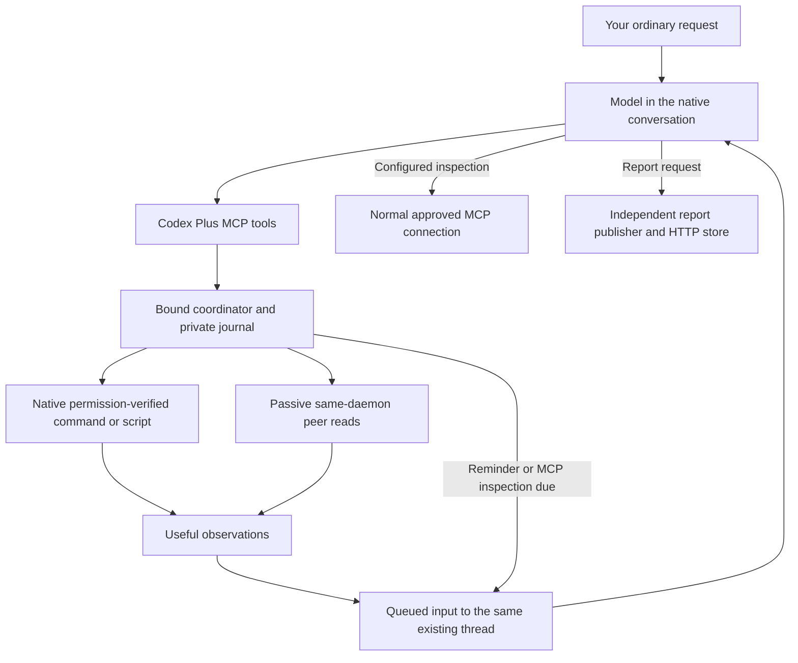

# How Codex Plus works

Codex Plus augments the native Codex CLI/TUI and continuing conversation. The
existing daemon owns model turns, goals, approvals and native tools. The watch
coordinator owns bounded observation, timers, event admission and receipts.

## What is in the package

| Component | Surface | Responsibility |
| --- | --- | --- |
| Monitoring runtime, preview.2 | 15 `codex_plus` MCP tools; watch/peer/package CLIs | Peer discovery and passive reads, bounded sources, messages, reminders, cancellation and receipts. |
| Reporting component, preview.7 | Four `html_report` MCP tools; report CLI; HTML report skill | Immutable static snapshots, project catalog, delivery checks and selected deletion. |
| Report server | `codex-report-server` | Independent HTTP hosting in its shared tmux session; publish can start/reuse it. |
| Worker bundle | `luna-max`, `sol-xhigh`; four worker workflow skills | Explicitly selected execution workflows; primary retains decisions and acceptance. |
| Development source | Tests, validators, guides and research reports | Implementation and acceptance evidence; distinct from installed immutable artifacts. |

The current monitoring artifact is `v0.1.0-preview.2` from `2274f4b`; the report
artifact is `v0.1.0-preview.7` from `fb24aa1`. Both are installed on Snap and
Starship, with optional MCP availability enabled. Chezmoi owns managed files and
pins. Journals, report data and hosting remain runtime-owned. Current GitHub docs
can advance without repinning those qualified artifacts.

Worker identities and explicit invocation behavior are unchanged. Discussing a
skill or asking for a generic goal loop does not invoke a worker workflow. The
HTML report skill is an additional skill, separate from the four worker workflows.

## Observation and follow-up

Registration freezes the caller, thread, owner and source identity. The runtime
positively verifies the loaded independent caller and native listener; it does
not launch another daemon or cold-resume a target. A private user-owned `0700`
state root holds intent and event receipts outside model context.

Command sources inherit the exact calling session's effective execution policy,
including existing network access and authorized cache writes. Read-only and
network-off options narrow access; network-required checks an existing grant.
A repeated short command or continuing script can filter observations without
inference per read. JSON projection is optional; occurrence streams have different
semantics and are not deduplicated merely because lines have identical text.

Configured MCP checks take another route: the coordinator schedules a native
model turn, which inspects the selected registration and calls the actual tool
through normal authentication/approval. Each check costs a model turn. The
direct app-server MCP RPC is excluded because controlled qualification exposed
an approval bypass. No background helper invents missing credentials or grants.

Useful events queue into the exact continuing conversation. Busy delivery and
human control retain native ordering. The model reads fresh relevant state,
records handling and decides the next useful step under the existing request.
An observation supplies data, not permission to repair a workload or start a task.

## Discovery and messaging

Ordinary peers are positively classified independent, loaded sessions within the
same daemon. Known children and unknown classification are excluded from ordinary
selection. Project/recent agent context helps resolve a description; ambiguity
or incomplete coverage is exposed. Peer reads omit user prompts and tool outputs.
Stable references never retarget when a name is reused.

Information and requests are attributed. The receiver can accept or decline a
request within its existing task. The sender reads cached handling receipts
instead of creating acknowledgement ping-pong. Outgoing cancellation can reconcile
pending intent but cannot interrupt the recipient or retract completed handling.
This is coordination between independent sessions, not subagent orchestration or
cross-host transport. Agent Observer/Mesh is not a runtime dependency.

## Control and receipts

| Fact or control | Meaning |
| --- | --- |
| Registered | The runtime has bounded intent; this does not prove a useful update will occur. |
| Native queued | Input was admitted to the bound conversation, not necessarily handled. |
| Received / accepted / declined | The model recorded handling; neither receipt nor acceptance proves an external effect. |
| Cancelled | Future observation/admission is stopped for the selected intent; already consumed work is reported honestly. |
| Expired | A lease or allowance ended; it is not a task-success signal. |
| Lost / uncertain | Coverage or delivery is incomplete; no blind replay or silent retargeting. |
| Esc | Foreground interruption, without cancellation of independent registrations. |

Explicit stop forbids renewal/replacement. Renewal retains the frozen source.
Recovery is explicit, retains remaining bounds, discloses gaps and does not replay
uncertain admitted events. The runtime does not claim exactly-once processing,
replace the native owner or intercept `/exit` with a confirmation dialog.

## Coverage of the studied Claude workflow

Bryan's sampled Claude histories supplied the sequence: observe, wake, inspect,
decide, take an authorized action, continue and report. They included repeated
script-based watches, later checks and independently inspectable conversations.
That is historical mechanism evidence, not an audited production-outcome sample.
The [context study](claude-monitoring-context.md) retains the sanitized counts.

| Function in that workflow | Codex Plus today | Evidence or remaining limit |
| --- | --- | --- |
| Scripts/filtering for logs or status | Model-selected command/script sources; optional projection | Source and bounded native qualification; real log/provider behavior needs field evidence. |
| Endpoint polling | Session-inherited authorized networking; quiet repeated commands | Authenticated fixture transitions passed on each host. |
| Tool-backed inspection | Scheduled native model MCP calls | Actual configured inspections passed; model cost per check. |
| Later reassessment/adaptive cadence | One-shot reminders and explicit watch continuation | Native later inspection and a slower-cadence successor passed. |
| Independent conversation coordination | Contextual discovery, peer watch, attributed message and handling receipt | Same-daemon native acceptance on both hosts; no cross-host native transport. |
| Acting on a problem | Native model/tools under the existing action plan | Monitoring adds no action authority; real repairs/scaling outcomes were not qualified. |
| Morning/browser handoff | Separate static report publisher and catalog | Installed reporting and native publish/get/delete checks; daily-use usefulness remains to assess. |
| Interrupt, stop or detach | Separate foreground interruption, cancellation and viewer detachment | Relevant lifecycle evidence; no native `/exit` confirmation interception. |
| Persistent recurring calendar work | Not supplied by the preview | One-shot/adaptive mechanisms are not a cron service. |

Current official Claude docs, checked 2026-10-14, describe command or WebSocket
Monitor sources, deadline notices and explicit cancellation. Its scheduling docs
describe adaptive loops and recurring/one-shot tasks, with a distinct Esc rule
for a waiting self-paced loop. These are comparison references, not Codex Plus
defaults. [Monitor](https://code.claude.com/docs/en/tools-reference#monitor-tool),
[scheduling](https://code.claude.com/docs/en/scheduled-tasks#stop-a-loop).
Claude documents background-task cleanup on exit; Bryan's reported confirmation
dialog remains user-observed behavior rather than a reproduced test here.
[Background commands](https://code.claude.com/docs/en/interactive-mode#background-bash-commands).

Codex Plus covers the studied workflow functions within its qualified scope.
Operational equivalence still needs real-source, longer-duration and personal UX
evidence; feature availability alone does not establish it. A built-in WebSocket
adapter, recurring calendar, cross-host transport and native exit interception
are not part of the current preview.

## Where the evidence lives

| Evidence | What it establishes |
| --- | --- |
| [Source-access results](source-access-pass-results.md) | Permissions, authenticated fixture access, scheduled MCP continuation, filtering and stop. |
| [Managed activation](managed-activation-results.md) | Installed bytes and default fresh native tool use independently on Snap and Starship. |
| [Interaction results](interaction-pass-results.md) | Natural requests, contextual discovery, readable delivery, handling and draft/order checks. |
| [Report results](html-report-results.md#managed-mcp-default-2026-10-14) | Default report MCP and native use, with corrected normal-store attribution. |
| [Runtime distribution](runtime-distribution.md) | Immutable artifact identity, installation/configuration, upgrade and rollback boundaries. |
| [Soak checklist](soak-checklist.md) | The real-use evidence still to collect; it contains no completed soak claim. |
