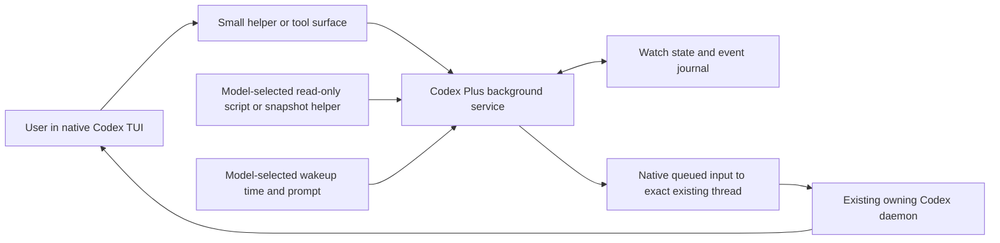

# Codex Plus implementation plan

Draft revised 2026-10-12 with a proposed research/spike pass using simulated work,
following the 2026-10-11 Claude Code and selected Snap history review.
Bryan is keeping Codex CLI/TUI as the daily interface. Background monitoring and
model-controlled wakeups come first, coordination next, and Agent Observer is
an integration decision for that later stage. The research-to-candidate loop has
now produced a tested local helper on Snap; see the
[current results](coordinator-loop-results.md) and [candidate guide](watch-candidate.md).
The published/installed bundle remains the worker agents and skills. Earlier
draft sections below preserve the planning sequence, not the latest completion state.

Read the [Claude monitoring context](claude-monitoring-context.md) for the latest
request, evidence and open decisions. The earlier JSON-snapshot-only scope has
been broadened. The local CLI now supplies sources, projection, one-shot wakeups,
renewal, cancellation and explicit recovery; broader integrations remain draft.

## Product contract

Use the ordinary Codex conversation to ask for a watch, inspect it, or cancel it.
Keep native planning, goals, approvals, context handling and TUI access. The model
chooses the task strategy and what deserves attention.

Give the model options for sources, scripts, filtering, cadence, renewal and
follow-up. Use fixed rules for broadly applicable runtime boundaries rather than
task strategy. Claude's Monitor plus adaptive wakeup behavior is the reference;
reuse its useful separation of responsibilities without copying product limits
or assuming every historical mechanism is robust.

Example: “Watch this run; tell me when it finishes or fails.” Codex registers a
bounded observer, receives a receipt and can continue working or become idle.
Quiet observation avoids accidental model turns. A meaningful emitted event
arrives in the same conversation; Codex decides the appropriate follow-up using
the task's existing scope. It can also deliberately schedule reassessment when
reasoning is needed later. Count scheduled wakeups separately from watch events.

The watcher owns observation and notification. It does not restart the watched
job, repair code, change capacity or grant new action permissions.

## Proposed first scope and source options

Start with **one host, one existing thread and model-selected background follow-up**.
Snap is the intended development and first-pilot host. Investigate two small
primitives together: a Monitor-style background command/event source and a
model-controlled one-shot wakeup carrying a bounded follow-up prompt.

The model can prepare a read-only script that emits useful events, select a
structured snapshot helper, or schedule a later inspection. Filtering, polling
and source-specific conditions can live in the script or helper. Do not require
every source to return JSON or every watch to wait only for a terminal job state.
Line/event output and optional JSON projection are modes to settle during planning.

Capture the command or script invocation, working directory, exact destination
and effective execution/output/lifetime bounds. Show the model those bounds and
allow it to choose within them. Qualify the source's actual read access; a separate
service does not automatically inherit Codex's sandbox, approvals or managed MCP
credentials. Keep observation commands within the authorized read-only scope.

For a snapshot helper, explicit projection should suppress irrelevant timestamp
churn. An already-satisfied condition should emit a useful result without waiting
for a change. Distinguish source failure from the watched job's failure. Completion
and renewal policy should follow the selected task rather than a universal rule.

Model-prepared scripts can read logs or other existing sources in the first pilot;
a catalogue of dedicated adapters, WebSocket transport, full recurring calendar
scheduling, fleet discovery and cross-host delivery can follow demonstrated need.

## Runtime shape

The runtime below is a candidate. First complete the
[research and spike pass](#research-and-spike-pass) to decide how much native
process execution and scheduling can be reused and what Codex Plus must own.



A small background service starts or is reused when follow-up is requested. It
owns source lifetime, event admission, timers and receipts outside inference.
Scripts/helpers can own source-specific polling and filtering. The service is
separate from the existing Codex daemon, which retains conversation and agent
execution ownership. Closing a TUI alone should not cancel a watch while the
destination runtime remains available; expiry and explicit cancellation bound
its lifetime.

Python and the existing native `codex queue` route are proposed starting points.
The installed CLI supports an explicit endpoint, thread and message; earlier
same-host and cross-host replies exercised this mechanism. Freeze the exact
thread ID and owning endpoint at registration. Resolve current identity from
validated calling-session metadata or require an explicit destination; do not
select a destination repeatedly from saved names or launch a second app-server
over the conversation.

Keep source observation, filtering, state storage and native delivery as small
modules. The first implementation can use the standard library and a helper CLI.
Choose a supported MCP library only if a typed MCP interface becomes useful;
MCP packaging is not the background service itself. Native task tools remain a
candidate for later coordination rather than an assumed external-service API.

The [app-server API](https://learn.chatgpt.com/docs/app-server#api-overview)
distinguishes stored inventory, loaded threads and runtime status. Positive
loaded membership can validate a current binding; absence or a failed probe
does not establish that a thread is parked. Preserve unavailable/unknown facts.

## Small operational surface

Names below are proposed contracts, not installed commands or tools:

| Operation | Result |
| --- | --- |
| `watch_start` | Watch ID, bound destination, initial observation and effective bounds |
| `watch_list` / `watch_status` | Active/completed watches, last observation, source health and delivery state |
| `watch_cancel` | Stops future observation/admission and reports any already queued event |
| `watch_ack` | Records handling of a specific event ID without claiming the requested external effect succeeded |
| `wake_schedule` / `wake_cancel` | Schedule or stop one future follow-up; expose time, prompt, destination and delivery state |

Finalize names, whether status/list/cancel share IDs across source types, and the
renew/update operation before implementation. Fixed recurring scheduling is a
possible later extension; an adaptive loop can choose its next wakeup after each
iteration. Expiry can deliver a bounded notice so the model can decide on renewal
within the existing scope and bounds. A human cancellation must remain effective.

Expose the operations through a helper CLI first, then one focused watch skill.
Add an MCP facade over the same implementation if it improves daily use. No
mandatory planning or worker-routing workflow belongs in the watch skill.

Event envelopes identify their source, watch/wakeup ID, event ID, bounded emitted
observation or timed prompt, and requested follow-up. Keep detail in the local
journal and allow bounded retrieval. Model-prepared script output need not conform
to one job-state schema.
Treat incoming observations as data and retain the existing authorization scope.

## Milestones and acceptance

| Milestone | Deliverable | Acceptance |
| --- | --- | --- |
| 0. Finish planning on Snap | Representative scenario, smallest monitoring/wakeup surface, lifecycle choices and implementation slices | Review the real-use example and short acceptance checks before implementation |
| 1. End-to-end background follow-up | Model-prepared event source plus one-shot wakeup, native same-thread delivery, status/cancel/expiry | A bounded local scenario produces useful event and timed follow-up turns in its ordinary TUI; a quiet source produces no accidental watch turns |
| 2. Daily reliability | Persisted watch intent/baseline, event IDs and receipt states; bounded source failures and delivery recovery | Busy delivery waits correctly; cancel/expiry stop future admission; interrupted or ambiguous delivery remains inspectable without blind retries or duplicate actions |
| 3. Usable installation | Helper/service plus a thin skill, supported checks and scoped chezmoi distribution | Installed bytes match the published pin; existing worker agents/skills remain intact; one normal coding session can start, inspect and cancel a watch naturally |

Milestone 1 includes basic bounded source errors and clear unavailable-target
status. Milestone 2 adds restart/reconnect qualification before daily rollout.
The first pilot is single-host on Snap. Moving the development checkout there
does not install the runtime. Other-host rollout remains separate work after
the first path is accepted.

## Lifecycle and receipts

- Persist watch/wakeup intent, source state where applicable, deadlines, event
  IDs and delivery state outside the model context.
- Distinguish pending, native-queued and acknowledged events. Native enqueue
  proves admission, not recipient handling or completion of a job/repair.
- A busy native thread uses queued follow-up. Do not default to interrupting a
  user's active turn.
- If the owner disappears or the destination becomes unavailable, retain
  pending evidence and report delivery suspension. Reconcile exact identity
  before resuming; do not create or silently resume another conversation.
- After a service restart, restore intent only after validating the source and
  destination. A transport failure after submission can be ambiguous: do not
  automatically replay it as though nothing happened.
- Use stable event IDs, bounded retries and a visible finite admission budget.
  Coalescing is useful for snapshots; do not deduplicate occurrence events solely
  because their text is identical. Let the model choose appropriate source policy.
  Cancellation cannot promise to retract an event already admitted to Codex.
- Stop owned observation commands on timeout/cancel. Canceling a watch does not
  terminate the job being observed.

Use a simple durable store behind one service owner first. A transactional
database/outbox is a subsequent choice if recovery needs it, not a prerequisite
for the first successful watch. Do not claim exactly-once delivery.

## Validation approach

Use short tests driven by state transitions rather than elapsed-time gates:

1. Quiet emitted-event source and optional irrelevant-field filtering: no
   accidental event admission or watch-triggered model turn.
2. Useful event, already-satisfied snapshot condition and model-selected source
   output: bounded delivery with stable identity and truthful lifecycle state.
3. Timeout, malformed output and repeated source errors: bounded failure and
   truthful status, without notification storms.
4. Cancel/expiry races and busy delivery: clear boundaries for already admitted
   input and no new admission afterward.
5. One-shot wakeup, reschedule and cancellation: explicit timing and one future
   follow-up without overlapping or replayed missed intervals.
6. Service/transport restart and unavailable targets: retained evidence, exact
   binding and explicit handling of uncertain delivery.
7. One bounded native TUI pilot: visible event processing, preserved user input
   and normal ongoing coding. Do not infer UI acceptance from a transcript alone.

Offline tests should cover state/filtering/lifecycle cases. Native checks should
cover only the actual delivery and user-control boundary. No six-hour/overnight
study is required. Watcher-triggered inference is measured separately from
unrelated goal/tool work already occurring in the destination conversation.

## Chezmoi and existing worker bundle

Keep the current agent names, skill identities and installation paths. Preserve
the existing managed archive location during this first addition unless a later
runtime-path migration is explicitly scoped.

When implementation is ready, publish and validate one release, then update
`.chezmoiexternals/codex-plus.toml`, the revision/URLs/checksums and matching
dotfiles checks together. Add any runtime launcher or service wiring through
canonical chezmoi source. Review a scoped dry-run, apply only when requested and
verify the actual installed files. Do not copy over managed targets or include
unrelated dotfile drift.

The current public inventory checker must grow deliberately as runtime files
are added. Keep worker-bundle validation separate from watch behavior checks;
do not weaken validation merely to allow new files.

## Coordination after watches

First qualify the currently exposed native task list/read/send/wait operations
for independent ordinary sessions, idle/busy delivery and correlated replies.
Use native operations wherever they meet the need. Add conventions or a thin
adapter only for missing behavior.

Revisit Agent Observer when cross-host discovery, freshness and uncertainty
become necessary. Assess its accepted public contract and readiness at that
time; it is not a dependency of the first watcher. Observer remains passive,
and operational actions remain external. Multi-host picker/attachment work is
later scope.

## Research and spike pass

Planning specification, revised 2026-10-12. Bryan subsequently requested execution
through an ordinary goal loop. The [initial results](monitoring-spike-results.md)
record the completed bounded batch, prototype source and remaining acceptance
gates. The recipes below retain the planning contract; they do not authorize
automatically rerunning the finished batch. Bryan selected simulated work while
Claude Code continues the actual work.

The question is: **what is the smallest reliable capability that lets the model
observe quietly, wake deliberately, and continue in its native thread?**
The primary owns planning, execution and acceptance. Existing worker skill
identities and activation behavior are unchanged; the generic goal-loop request
did not activate a worker workflow.

### Scope and research questions

Use one host, a controllable local simulation, one explicitly selected native
test conversation and the existing owning daemon. Study a command/event monitor
and a one-shot wakeup together. Preserve room for the model to choose scripts,
cadence, conditions, renewal and follow-up; the fixture's fields and thresholds
are examples, not a universal job contract.

| Question | Decision this pass must support |
| --- | --- |
| How does a helper discover and verify the current owner and thread? | A binding procedure that rejects ambiguous or unavailable targets and freezes identity after selection. |
| What does queued input do in idle, busy and interrupted threads? | A delivery route that preserves ordinary input and a precise policy for human stops. |
| Can native command execution host an observer? | A qualified runner with explicit read access, output bounds, lifetime and owned-child cancellation. |
| Is there a suitable native timed-wakeup primitive? | Reuse it if qualified; otherwise choose a minimal external timer. |
| Can the model adapt the watch naturally? | A small interface that supports useful emission, a quiet interval, reassessment, renewal and stopping. |
| What must be recorded before delivery? | Minimal durable intent/events and honest handling of uncertain submission. |

Real workload access, fleet discovery, cross-host delivery, recurring calendar
scheduling, broad provider/framework comparisons and installed lifecycle are
later scope. A full daily restart/reconnect qualification belongs to milestone 2.
Use the closed study and sanitized Claude context as references; retrieve a named
archive file only to answer a specific question, without rerunning old recipes.

### Phase 1: resolve the native capability map

Start from current official docs, local help, the actual exposed tool surface and
schemas generated by the installed binary. Recheck versions when executing the
pass. Record whether each candidate is documented, experimental, present in the
installed schema, and actually exercised. A method appearing in a schema is not
proof of usable lifetime or delivery behavior.

The documentation refresh on 2026-10-12 supplies these starting points:

- The [app-server guide](https://learn.chatgpt.com/docs/app-server#command-execution)
  describes sandboxed command execution, output streaming and termination without
  creating a conversation. Observer suitability and disconnect behavior require
  a probe. Its main API guide omits the queue methods used by the archived probes;
  qualify the installed CLI route and inspect protocol details only as needed.
- [Scheduled-task documentation](https://learn.chatgpt.com/docs/automations)
  places schedule management in web/desktop surfaces. This does not establish
  whether an installed timer can serve the CLI-owned thread.
- [Claude Monitor](https://code.claude.com/docs/en/tools-reference#monitor-tool)
  and [adaptive scheduling](https://code.claude.com/docs/en/scheduled-tasks)
  provide reference choices for scripts, useful events, renewal and explicit
  stopping. Their product limits are not selected Codex Plus limits.

Read a relevant implementation only if docs/schema leave a consequential question
unanswered. The output is a table of capability, source/version, available evidence,
remaining question and smallest probe. End desk research once every question has
an actionable candidate or a concrete gap to test.

### Phase 2: build a controllable fixture and draft the calls

Use a small standard-library simulator in a task-owned temporary directory.
It writes synthetic status/metrics and an append-only log; observation scripts
read them. Explicit controls advance the state, so most checks need no elapsed
time. A short timed script is reserved for native timer/delivery qualification.

Provisional fixture controls are `init`, `advance`, `stall`, `recover`, `complete`,
`fail`, `noise` and `append-event`. Synthetic metrics can include remaining work,
progress, throughput and error count. Commands and fields are fixture conveniences.
Simulator updates should publish complete snapshots atomically so a test of
malformed source data can be deliberate rather than an accidental fixture race.

| Fixture change | What the observer/model should be able to demonstrate |
| --- | --- |
| Repeated noise updates with unchanged selected facts | Read or poll quietly, with no event admitted and no accidental model turn. |
| Useful progress or a selected error | Emit a bounded observation and receive it in the same native conversation. |
| Two identical log entries | Preserve two occurrence identities; snapshot equality does not erase occurrences. |
| Progress stalls while status remains running | Choose a timed reassessment or adjust the script; do not require a terminal-state change. |
| Recover, complete or fail | Adapt, summarize, renew or stop according to the request and observations. |
| Observer exits/errors while the job is still running | Report source health separately from job outcome. |

Draft calls and receipts before writing an engine. Use the existing operation
names as placeholders, not installed tools:

```text
watch_start(command=[...], cwd=..., duration=..., event_limit=...,
            followup="Inspect this observation and report useful changes")
wake_schedule(after=..., prompt="Reassess the simulated run and choose the next step")
watch_status(id) / watch_list()
watch_cancel(id) / wake_cancel(id)
```

Binding is established before these calls and is returned with the effective
bounds. Registration, source-running status, native admission and handling are
different receipts. A quiet line source need not return an initial observation.

Propose line output for the first monitor: each non-empty UTF-8 record is a
separate occurrence, with framing across transport chunks and a bounded final
record at EOF. stderr is diagnostic and does not automatically become a job event.
Invalid or oversized output must be explicit; do not silently truncate a complete
snapshot and pretend it is valid. Exercise projection as an optional helper with
the same fixture, rather than requiring JSON from every source.

Expiry or unexpected source exit can produce one bounded lifecycle notice when
requested. Reaching an event/output limit stops future admission and is visible
in status. The model chooses terminal conditions, emission and task-specific
renewal policy. The spike must choose an explicit default for lifecycle notices
before a native recipe is run, and count any notices in its admission budget.

For the spike, renewal can create a new watch ID linked to its predecessor after
the previous source is confirmed stopped. This avoids overlapping observers and
allows renewal to use a changed script. Test whether that interface is natural;
an in-place renewal/update operation remains an alternative to decide from use.
Cancel invalidates that registration; renewal must not resurrect it silently.

An event envelope needs source/watch or wakeup ID, a stable event ID, event kind,
bounded observation or timed prompt, and the original follow-up request. Treat
observations as data. Acknowledgement can record that a particular event was
handled; it does not establish an external effect. Decide whether a separate
`watch_ack` operation is useful from the actual walkthrough.

### Phase 3: qualify binding, delivery and control first

Before implementing a general monitor, select a dedicated ordinary TUI test
conversation on the existing daemon. Save its destination in private test state.
Resolve the endpoint's listener owner and verify positive loaded-thread membership.
Reject a mismatched thread, inaccessible endpoint or ambiguous owner. Do not
infer a complete live census from missing inventory or a failed probe.

| Native recipe | Observation required |
| --- | --- |
| Idle destination | Submit one tagged synthetic event and correlate native admission, turn processing and the response rendered in the test TUI. |
| Busy destination | Submit during a bounded ordinary coding/tool turn; it processes after that turn settles. Existing user input and the original result remain usable. |
| Explicit watch/timer cancel | Cancel before a controlled event/deadline, then trigger it. No new admission occurs. If already admitted, report that boundary without promising retraction. |
| Esc interruption | Observe interruption of the current turn and later queued/event processing. Do not infer cancellation of independent observation or a persistent pause from Esc. |

Bryan clarified that Esc interrupts the current turn; stopping supervision is an
explicit message such as “stop watching this run.” Keep existing monitors and
independent scheduled follow-ups registered across Esc. Check native processing
after interruption without force-starting a paused goal. Claude's self-paced
`/loop` has a separate Esc-while-waiting rule; do not apply it to every monitor.
Goal/budget stop is a separate control boundary; never automatically resume a
paused goal to deliver an observation.

Stop this phase if exact binding is unreliable or the selected human-stop
behavior cannot be enforced. The outcome can be a narrower interface with an
explicit cancellation control, but that limitation must be resolved before
claiming the accepted stop semantics or shipping automatic follow-up.

Do not keep the receiving turn busy polling for its own queued message. Let it
finish and observe the following turn. Do not send to working conversations,
launch a second daemon over existing history or restart the current daemon.

### Phase 4: run the two representative workflows

| Workflow | Controlled sequence | Acceptance |
| --- | --- | --- |
| Event-driven supervision | Ask the model to watch the simulated run and report useful progress/trouble. It prepares a script and receives a registration receipt. Apply noise while it is idle or doing unrelated bounded work, then a useful change and a terminal outcome. | Noise causes zero admissions. Emitted observations reach the bound thread. The model can inspect, adapt or stop the watch and retain normal human input. |
| Adaptive reassessment | Keep the simulated run running but stall progress. Ask for a later reassessment. After one timed follow-up, let the model choose whether to renew observation, revise its source or schedule another inspection. Apply recovery/completion or failure. | A deliberate wakeup works without a source event. The model makes a follow-up choice within scope and can bring the supervision to an explicit end. |

The requests specify the reporting/supervision objective and the experiment's
effective bounds. They do not prescribe the exact script, threshold, cadence or
follow-up action. The test driver controls fixture changes; it does not fake the
model's choice or force a particular renewal route. Record unexpected choices
and their reasons. Any intervention is a recommendation about the simulation;
observation never grants authority over an actual job.

Qualify native command execution for streaming, read access, timeout, source exit,
child termination and loss of its observer connection. A separately owned
subprocess is the fallback candidate if the native path lacks a necessary property.
Neither route is assumed to inherit the calling thread's approvals or credentials;
record effective access and use only the synthetic source in this pass.

Check for a native timer first; otherwise use the smallest temporary external
timer needed for the walkthrough. Reschedule must invalidate the previous pending
timer. A due timer waits for a busy thread, and the one-shot registration admits
at most one event. Specify lateness/expiry behavior in the recipe; missed time
must not create a backlog of repeated prompts. Tests use a controllable clock
offline and a short real delay for the native case.

### Phase 5: add only the edge checks needed for the decision

Most failure checks should use a fake delivery sink and explicit fixture steps:
line framing, repeated occurrences, optional projection/already-satisfied state,
invalid/oversized output, source failure, event limits, cancel/expiry races,
timer replacement and service-crash points. Record baseline changes and their
pending events together. A submission with an unknown outcome remains uncertain
and must not be automatically replayed.

Use native evidence for transport behavior: a non-responsive test endpoint can
demonstrate unavailability without changing the existing daemon. Closing and
reattaching only the test viewer can establish the distinction between viewer
and runtime lifetime, if that affects the chosen design. Run such a check only
when it answers a remaining architecture question. Complete daemon replacement,
full daily restart recovery and longer-duration operation remain later acceptance.

### Execution bounds and evidence

Before each native recipe, record its selected destination, expected transitions,
effective limits and stop condition. Proposed starting bounds are:

| Resource | Initial experiment bound |
| --- | --- |
| Protocol/delivery attempt | 10 seconds; a timeout after possible submission records uncertainty. |
| Source/timer lifetime | 120 seconds per recipe; native wakeup delays of 10–30 seconds. |
| Source output | 4 KiB per event, 64 KiB stdout and 16 KiB diagnostic stderr per recipe; limits stop the source explicitly. |
| Admission | At most two source events and one lifecycle notice per watch; one event per one-shot wakeup. |
| Native model turns | Six follow-up-triggered turns for the initial batch, including source/error/expiry notices. |
| Native scenario | Approximately 2–5 minutes, including manual TUI checks. |

These are experiment defaults to expose in each recipe, not chosen product limits
or a token budget. The six-turn allowance is shared across the native recipes,
not six per case. End the batch when it is exhausted, preserving uncovered cases.
Additional runs require a named uncertainty and an explicit revised batch plan;
there is no overnight or six-hour gate. Do not create a new active goal during
planning.

Keep records small: probe ID, version, fixture steps, bound target alias, event ID,
expected/actual transitions, monotonic timing, receipt state and conclusion.
Record quiet-period admissions, source events, scheduled wakeups and attributable
model turns separately. Record usage only when the runtime actually supplies it;
do not infer total inference cost from event counts or prices.

Document source/schema, offline, native and human-viewed evidence separately.
Rendered output can be checked mechanically, but normal input and human-stop
acceptance need Bryan's direct TUI observation; report that check as pending if
it has not occurred. Preserve failures and mark each question supported,
unsupported or unresolved. A synthetic success establishes mechanisms, not
production effects or long-duration reliability.

Reusable fixture/probe code and the sanitized evidence summary can live in
`spikes/monitoring/` and `docs/monitoring-spike-results.md` during execution.
Add those exact files to the inventory deliberately; keep worker metadata tests
separate. Runtime state, generated schemas and raw captures stay outside committed
source. Track owned child processes/files and clean up only those. Planning adds
no runtime files or deployment changes.

### Decisions and completion

The pass ends with a short decision record covering:

1. Exact destination binding and the supported native queue/stop behavior.
2. Native versus separately owned source execution and the effective access model.
3. Native versus external timing, including reschedule and late-event behavior.
4. The smallest useful calls, source modes, receipts and renewal/cancel semantics.
5. The minimal recording and recovery obligations of the first implementation.

Choose the smallest implementation that meets the qualified behavior. A small
persistent coordinator is a candidate if timers, source ownership or recording
need it; do not equate native command reuse with a complete watch service.
Python is a practical spike candidate, with helper/skill packaging following
demonstrated use. MCP is a later facade decision.

Completion requires an answer or an explicit limitation with a chosen response
for each question, plus concrete acceptance checks and implementation slices.
Keep deferred recovery and real-source qualification visible. If binding or
required stop behavior remains unresolved, the result is a design blocker to
resolve, not a successful end-to-end watch. Revise the implementation milestones
from the final evidence rather than silently retaining disproven assumptions.

## Next spike: conversation control and complete supervision

Planning draft, 2026-10-12, following review of the initial results. This is a new
bounded proposal for the named gaps below; the initial batch remains closed.
No new native trials or product implementation have been started for this draft.

The next question is: **can monitoring complete a useful supervision loop in an
ordinary conversation while preserving native goals and human control?** Source
streaming, basic idle/busy delivery and one-shot timing already have evidence.
Repeat those mechanics only where a new integration case requires them.

### Decisions to settle before extraction

| Decision | Candidate and acceptance boundary |
| --- | --- |
| Esc interruption | Interrupt the current turn; independent monitoring and scheduled follow-up remain registered. Qualify when later events process through native control state. Esc does not create a blanket follow-up pause or require an explicit monitor resume. |
| Explicit supervision stop | A message such as “stop watching this run” causes cancellation of the selected sources/timers and ends their renewal. Persist cancellation and report any in-flight/already-admitted boundary. It does not stop the job being observed. |
| Viewer detach and owner shutdown | Closing a viewer preserves bounded background work while its owner is available. A requested shutdown that would terminate owned work must disclose the affected registrations/processes and require confirmation. Qualify native exit controls before promising interception of `/exit`. |
| Native goals | Support active goals without changing their objective, budget or lifecycle. Paused, budget-stopped, unavailable or unknown control state suspends automatic delivery. Determine which states the installed runtime exposes before promising this contract. |
| Renewal | Stop and confirm the predecessor source, then create a linked registration with the model's new invocation and bounds. Reject renewal of a cancelled registration; a fresh explicit request is a separate operation. |
| Handling receipt | Keep native admission, correlated turn outcome and explicit event acknowledgement separate. A completed turn alone does not establish that a particular event was handled; an acknowledgement does not prove an external effect. |
| Permission boundary | Keep source execution read-only. Qualify coordinator control access under the calling session's actual permissions. Restricted sandbox support needs its own narrow access path; it cannot be inferred from full-access success. |

These choices concern runtime boundaries. Scripts, filtering, polling cadence,
timing, useful observations and task-specific follow-up remain model decisions.
Provisional renewal and acknowledgement names are contract questions, not
additional installed commands. Prefer unified controls for watches and timers.

Turn interruption, observation lifetime and cancellation are separate controls.
Esc does not cancel a source or install a durable conversation-wide pause.
Deadlines, source/output bounds and explicit cancellation still apply. An explicit
stop remains authoritative after callbacks or reconnect; cancelled supervision
must not be renewed without a fresh user request. A separately requested pause
can be considered if useful; it is not implicit in Esc.

The initial spike helper's suspension on every observed interruption is a study
guard, not the desired product behavior. The next spike must qualify a narrower
control policy. Preserve native paused/budget-stopped goals without automatically
resuming them, and expose any resulting delivery suspension separately from
the still-running observation source.

Bryan also reports Claude's confirmation before exit kills background shells/tasks.
The [Claude lifecycle note](claude-monitoring-context.md#exit-protection-reported-2026-10-12)
separates that observed UI protection from documented cleanup on exit. Carry the
protection into shutdown planning: declining a destructive exit leaves owned work
active; confirming stops only the affected owned work and records the result.
An already-explicit instruction to stop selected work supplies that authorization.
Native Codex owns its own background shells/tasks; the coordinator must not turn
its watch inventory into authority to terminate other native or external jobs.
If the native TUI has no usable exit interception, preserve viewer-detach behavior
and expose explicit coordinator status/cancel/shutdown instead of promising a
confirmation it cannot implement. Abrupt owner loss is a recovery event, not
evidence that the user confirmed cancellation.

### Slice A: native goals and human control

Use a dedicated synthetic conversation created through the ordinary CLI/TUI on
the existing daemon. Revalidate the owner and positively loaded thread; do not
copy the previous API-created test binding. Record actual creation and attachment
paths so this closes the earlier destination-qualification gap.

First inspect current local schemas/help for goal states, queue-to-turn correlation,
interruption notifications and pending-input controls. Native behavior and the
chosen product behavior are separate findings. A preflight state read is not an
atomic guarantee against a stop arriving during submission.

| Case | Controlled check | Required result |
| --- | --- | --- |
| Active native goal | A small synthetic goal is doing bounded useful work; submit one tagged observation through the candidate route. | Correlate its handling and read goal state before/after. Objective, allowance and lifecycle are preserved; there is no second goal or goal-resume workaround. |
| Paused or budget-stopped goal | Put only the test goal into each supported stopped state, then make a synthetic event ready. | Coordinator suspends delivery and records the reason. No automatic goal resume, queue start or new recipient turn. Unsupported state detection remains an explicit gate. |
| Esc interruption | Interrupt a test turn with a source event and timer pending; later emit a useful event. | Independent registrations remain active within their bounds. Inspect subsequent native processing without installing a blanket pause or automatically resuming a stopped goal. |
| Explicit supervision stop | Ask the model to stop the selected supervision, then trigger the source/deadline; also inspect an already-admitted test event. | Confirm cancellation of the selected source/timer and no future admission or renewal. Report any in-flight/admitted boundary; do not promise retraction. |
| Viewer closure | Close only the test viewer, emit a useful observation, then reattach. | Establish actual handling with the viewer closed, or identify the native limitation. The initial quiet-source lifetime check does not establish this. |
| Exit protection | Inspect native viewer-exit behavior and available hooks. Exercise the proposed owned-work shutdown boundary offline, then on task-owned runtime resources if supported. | Viewer exit does not silently cancel coordinator work. A destructive shutdown presents affected work; declining preserves it and confirmed cancellation has truthful cleanup receipts. Unsupported native interception stays explicit. |

Use offline race checks for explicit cancellation immediately before, during and
after dispatch. Reconnect with a previous explicit stop is a later recovery case, but an unknown prior
control state must not be treated as permission to wake. If the required stop
policy cannot be enforced, resolve the limitation before extracting the final
conversation adapter. An extra automatic-start call is not a fix for a stopped
goal or cancelled supervision.

### Slice B: complete model-controlled supervision

Run the following only after Slice A gives a viable conversation-control contract.
Use new event IDs and registrations; failed events from the initial batch are
historical evidence rather than a retry queue.

| Scenario | Sequence | Acceptance |
| --- | --- | --- |
| Useful event through completion | Model prepares a source; driver applies irrelevant changes, meaningful progress and completion or failure. | Quiet updates cause zero admissions. The model actually inspects each delivered observation and reports the outcome; final status exposes source cleanup and handling receipts. |
| Executed adaptation | Continued synthetic work requires supervision beyond one registration. After a useful event or reassessment, let the model choose a changed source, linked renewal or another wakeup. | At least one chosen continuation is actually registered and exercised. Predecessor termination and successor bounds are visible, with no overlapping replacement source or resurrected cancellation. |
| Timed reassessment | No source event occurs; one deliberate wakeup causes inspection and a model-chosen continuation or stop. Driver then supplies recovery or a terminal outcome. | Distinguish timed admission from source admission. Complete the chosen continuation and bring supervision to an explicit end; describing a future registration is insufficient. |

The driver supplies fixture transitions, not predetermined model decisions. If a
choice avoids renewal, record that valid choice and leave the renewal case open;
do not manufacture a successful adaptation claim. Source failure and watched-job
failure must remain distinct, including when a lifecycle notice is requested.

Record delivery and handling as separate dimensions: a submission can be known
not submitted, native-admitted or uncertain; handling can be unobserved, started,
completed, failed or explicitly acknowledged. Only use native turn correlation
when it is established. Otherwise keep the handling state unknown and test an
explicit event-ID acknowledgement. Preserve error reasons and useful partial work.

A provider-capacity failure ends that workflow attempt. Retain the admitted
event and failed/unknown handling outcome. Do not silently resubmit, switch the
model or count admission as success. A later attempt must be a fresh named case.

### Slice C: calling permissions and human acceptance

Qualify setup/status/cancel from the intended ordinary conversation. Full-access
helper success is an initial supported case, not proof of restricted access. For
a restricted sandbox, compare a narrow host-side tool or coordinator IPC path;
use only the smallest surface needed to register, inspect and cancel bounded
observation. Do not broadly relax configuration or transfer managed credentials.
Record effective source and control permissions independently.

Bryan then performs a short native TUI walkthrough: start a watch in conversation,
continue typing ordinary input while a useful event arrives, inspect the result,
press Esc to redirect the current turn, observe a later event, then explicitly
ask to stop watching. Verify a human draft and the continuing conversation remain
usable. Automated captures can
support this check but cannot replace Bryan's acceptance; keep it pending until
it occurs.

### New experiment allowance and stop conditions

Before execution, make a private recipe ledger with target alias, expected states,
owned resources and the allocation below. These are proposed research limits,
not product defaults or a token budget.

- At most twelve native follow-up admissions across the new batch: four for
  Slice A, six for Slice B and two for Slice C. Source, timer and lifecycle notices
  all count. Rejected preflight attempts are recorded separately.
- At most twenty started model turns overall, including setup, foreground probes,
  follow-up and native goal continuation. Give the synthetic goal a finite native
  allowance and an independent stop condition before starting it. Stop when either
  ceiling is reached; do not replenish a failing scenario automatically.
- Keep each source/timer registration at or below 120 seconds, native delays at
  10–30 seconds, and each scenario approximately 2–5 minutes. A model-chosen
  successor may continue the scenario within the shared ceiling.
- Retain the initial protocol/output bounds: 10-second attempt, 4 KiB event,
  64 KiB stdout, 16 KiB diagnostic stderr, at most two events per source and
  one per timer. Explicitly terminate a truncated source.
- Stop a slice on ambiguous binding, unobserved required control state, unexpected
  goal mutation or an unenforceable human-stop policy. A provider failure leaves
  that workflow incomplete. Preserve the finding and move only to independent work.

Record counts and receipt evidence even when a scenario fails. Clean up only
task-owned registrations, pending test inputs, sources and viewers. Preserve the
existing daemon, working conversations and unrelated configuration. Raw captures,
bindings and journals remain private and outside committed source.

### Deliverables and the implementation gate

The result is a sanitized decision table with evidence for each case, a compact
operation/lifecycle contract and a revised milestone-1 acceptance record. Every
open case keeps its reason and next action; exceeding an allowance is not success.

Extract a small coordinator only once binding, goal/stop behavior, control access
and the successful supervision path are settled. Reuse the framing, recording
and native-runner mechanics; avoid copying fixture strategy or treating one worker
per registration as a frozen service architecture. Keep worker validation separate.

Then qualify coordinator restart and connection loss before daily use: restore
intent, expose stopped sources and uncertain submissions, revalidate the owner
and prior human/goal stop, and avoid blind replay or revival. Test coordinator
recovery without restarting the user's owning daemon. Daemon replacement is a
separate explicitly scoped case. A cheap accessible real source and scoped
release/chezmoi installation follow synthetic and human acceptance.

## Large goal loop: research to a reviewed local candidate

Planning contract, 2026-10-12. Bryan is stepping away for the night and selected
this finish line: **qualify the research gates, then build and review a local
coordinator candidate if they pass; installation comes later.** This extends the
next-spike proposal into a substantial execution pass. Planning this loop did
not start it or reopen either completed research goal. Bryan subsequently
requested execution with incremental commits. The fresh ordinary goal is active;
[current results](coordinator-loop-results.md) track it.

### Goal and deliverable

Resolve native conversation-control and access questions using short synthetic
checks on Snap. When the required gates pass, implement the smallest local
coordinator that supports model-selected observation and one-shot wakeups in
the same ordinary native conversation. Review its code and qualify cancellation,
receipts, executed adaptation and coordinator recovery. Leave a reproducible
local candidate, a sanitized evidence report and a morning handoff with human
acceptance and installation explicitly pending.

The ordinary primary owns this loop. Generic goal-loop wording does not activate
worker skills or authorize delegation. Existing agents, skill identities and
invocation policies remain intact. Strategy stays with the model; the coordinator
owns binding, lifetimes, process ownership, recording and bounded delivery.

### Execution sequence

| Stage | Work | Acceptance and next step |
| --- | --- | --- |
| 1. Establish baseline and finish the contract | Recheck checkout/concurrent work, installed versions, owning endpoint and current native schemas. Pin the source/output, registration, renewal, cancel and receipt contracts from the existing evidence. | Record a private resource ledger and a short decision table. Exact binding, accepted control semantics and effective permissions have concrete checks. |
| 2. Qualify conversation integration | Execute Slice A of the next spike using an ordinary CLI-created synthetic thread on the existing daemon. Distinguish active/stopped goals, Esc, explicit supervision stop, viewer detach and owner shutdown. Qualify calling permissions from Slice C where independently possible. | Preserve native goal objective/lifecycle/allowance. Esc leaves independent registrations active; explicit cancellation ends selected supervision. State unknowns suspend delivery without stopping the observed job. Native exit-interception support is recorded honestly. |
| 3. Complete the supervision path | Execute Slice B with new fixture runs/events. Obtain complete event handling and actually register/exercise a model-chosen continuation. Qualify a deliberate timer and an explicit end. | Quiet changes have zero admissions; useful events are inspected; adaptation is executed; final cleanup and delivery/handling receipts are visible. Capacity failures remain failed attempts. |
| 4. Build the local candidate | After the required integration/access/supervision gates pass, extract useful mechanics from the spike into small source, coordinator, journal, native-delivery and CLI modules. Choose the layout from the settled contract; update exact inventory entries as files are added. | One coordinator owns its native command connection and bounded registrations. Start/list/status/cancel, one-shot timing and linked renewal work through the same implementation. Worker validation remains separate. |
| 5. Qualify failure and recovery | Exercise coordinator restart, connection loss, dispatch crash points, source failure and cancel/renewal races. Use controlled offline sinks first; use short task-owned native checks only for unresolved transport/owner behavior. | Persist intent and pending evidence. Uncertain submissions are not replayed; cancellation stays authoritative; recovery validates owner/control state and prevents competing source owners. No native daemon restart is required. |
| 6. Review and hand off | Review the final code/diff and address concrete defects. Run required checks, inspect owned-resource cleanup, synchronize handoff/status docs and prepare the short morning walkthrough. | Report supported/unresolved/unsupported cases with evidence, exact validation outcomes and remaining human acceptance. Candidate scope matches its qualified behavior. |

Source scripts and optional filtering helpers remain model-selectable. Avoid
turning fixture thresholds, polling intervals or terminal-state rules into product
strategy. Renewal must stop/confirm its predecessor before replacement; a callback
cannot revive explicitly cancelled supervision.

### Gate outcomes and productive fallback

Treat native binding, goal/control behavior, a usable control access path and
successful supervision as implementation gates. Use narrowly scoped spike changes
or direct qualified probes to resolve them; do not simply remove the initial
helper's all-goals/interruption guards and assume compatibility.

- If a gate fails, capture the exact limitation and its practical implication.
  Investigate one concrete alternative that preserves native conversation ownership
  and the accepted controls. Do not bypass stopped goals, broaden global sandbox
  permissions or install a replacement frontend to force a result.
- Continue independent work: receipt/state contracts, meaningful race and recovery
  tests, isolated framing/journal components, fixture coverage, control-channel
  design, source/access diagnostics and a precise implementation handoff. These
  can be useful before the final adapter is qualified, but remain prototype work.
- A missing native exit interception does not imply viewer closure should kill
  work. Evaluate the documented explicit coordinator control fallback. Keep its
  native-UI limitation visible; do not pretend to have implemented a `/exit` dialog.
- If provider capacity prevents complete handling, stop that workflow attempt.
  A second capacity failure in a distinct planned case ends native inference
  testing for this pass. Continue offline and read-only work; do not wait all night,
  replay admitted events or silently change models/providers.
- If meaningful work remains possible, keep progressing. If an external/user-only
  blocker remains after independent work is finished, record what is needed next.
  A failed gate is not accepted product behavior, and unfinished viable candidate
  work is not completion merely because morning is approaching.

### Shared native allowance

This larger pass has two finite native batches. This section replaces the
next-spike allowance for this execution only; the completed initial batch stays
closed. It is a research allowance, not a token budget for the primary goal.

| Batch | Allocation | Boundary |
| --- | --- | --- |
| Integration and full supervision | Up to 12 follow-up admissions and 20 started model turns | Use the next-spike recipes. Count setup, foreground probes and native goal continuations as well as recipients. Human-only checks stay pending. |
| Candidate acceptance and recovery | Up to 12 additional follow-up admissions and 20 additional started model turns | Open only for named candidate/recovery questions after relevant gates pass. Write each recipe and expected transitions before launching it. |

Total ceilings are **24 follow-up admissions and 40 started native test turns**.
These counts exclude the primary's coding/research turns, but include every model
turn started in the dedicated native test conversation. Source, timer and
lifecycle notices consume the admission ceiling. Record attempts rejected before
submission separately. Do not replenish a batch automatically after failure.

Keep the existing short experiment bounds: 120 seconds per source/timer
registration, 10–30-second native wakeups, 10-second protocol/delivery attempts,
4 KiB records, 64 KiB stdout, 16 KiB diagnostic stderr, at most two events per
source and one per timer. Each scenario should take approximately 2–5 minutes.
Any synthetic goal has a finite native allowance and an independent stop condition
defined in its recipe. Tests of longer product deadlines use an injected clock.

The night provides room for substantial work; it is not a minimum-duration test.
Finish when the deliverables are ready. Avoid idle waiting and repeated checks
without new evidence. No overnight soak, fleet benchmark or expensive real job
is necessary. Direct human TUI acceptance cannot be completed while Bryan is away.

### Ownership and scope

All native test destinations and resources are task-owned and synthetic. Reuse
the existing owning daemon, positively validate loaded membership and freeze
identity before registration. Keep the requesting conversation and any active
Claude work outside the test-control surface. Do not start another writer over
existing native history or shut down the user's owning daemon.

Closing the owned test viewer may exercise detach. Cancelling task-owned watches,
sources, pending test inputs and temporary coordinators is part of test cleanup.
Use exact identity and private ownership records. Preserve unrelated processes,
working-tree edits and runtime configuration; restore only temporary fields that
this pass changed, accounting for concurrent drift.

This pass prepares source and local acceptance. It does not publish, push, deploy,
apply chezmoi, repin managed bundles, register persistent scheduled jobs or act
on actual workloads. Identify a cheap real-source pilot for morning review using
already-accessible information; keep overnight supervision synthetic. A focused
watch skill or MCP facade can follow a working CLI if it provides demonstrated
value; neither replaces background lifetime or permission qualification.

### Morning report and completion

Provide one concise overview with:

1. What now works, what failed and what was proved/disproved, distinguishing
   offline, installed-schema, native and human-observed evidence.
2. The chosen control/access/renewal/receipt contracts and any unsupported scope.
3. Candidate entry points and a short reproducible synthetic walkthrough; only
   publish commands whose behavior was actually checked.
4. Validation results, native admission/turn counts, resource cleanup and any
   retained private evidence. Keep credentials, bindings and transcripts out of
   committed source and the public report. Include primary goal time/token usage
   when available, separately from native test-turn usage; do not infer a bill
   from admission counts.
5. The few decisions or human checks needed next, especially the TUI walkthrough,
   a real-source pilot and separate installation approval.

Completion means the supported local candidate is implemented, reviewed and
checked, with required automated cases resolved and the human/installation
boundary clear. If integration cannot be qualified, finish all useful independent
research and deliver the blocker evidence and next action; do not call an
unsupported coordinator accepted or claim milestone 1 complete. Record unresolved
viable work as remaining work rather than hiding it in a successful summary.

Before marking an executed goal complete, confirm the actual agreed objective is
achieved, required checks pass and task-owned resources are cleaned up. Execution
has been requested and started; the completed prior goals remain closed.

## Immediate next work

The agreed research-to-local-candidate pass is complete in source. Both native
batches are closed at 17 admissions and 30 started turns overall, below their
shared limits; all task-owned resources were cleaned up. The
[current report](coordinator-loop-results.md) records the qualifying checks,
corrected failures, review, usage checkpoint and preservation evidence.

Review the candidate with Bryan in the native TUI: preserve draft/human input,
interrupt a foreground turn, handle a fresh observation, explicitly stop selected
supervision and preview destructive coordinator shutdown. Then select a cheap
already-accessible real source and qualify its permissions and outcome handling.
Longer lifetime, native-daemon restart and managed packaging remain separate work.
No additional trial is authorized by this handoff alone.

The desktop audit is complete for the interface decision. Native scheduling
overlap remains a reference; the local CLI-owned path has the bounded native
qualification recorded in the current report.

Planning changes do not launch a service, create a watch, change chezmoi pins,
activate a worker workflow or restart the closed research goal.
