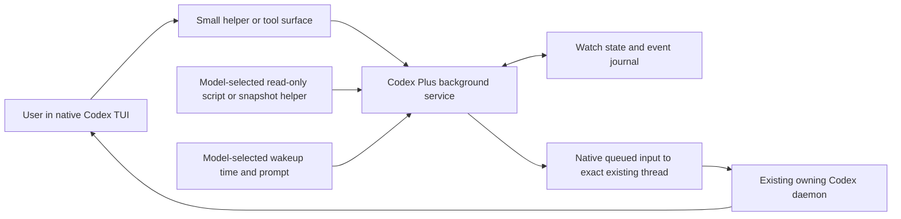

# Codex Plus implementation plan

Updated 2026-10-29. Codex CLI/TUI remains the daily interface and its existing
native daemon retains ownership. Monitoring, wakeups, same-daemon coordination
and reporting are implemented; the qualified monitoring/report artifacts are
installed and enabled on Snap, Starship and Carbon. Current sources are reconciled.
Real-source soak and personal UX acceptance remain separate from synthetic proof.

Read the [implementation handoff](implementation-handoff.md) for current state,
[managed activation](managed-activation-results.md) for host-specific acceptance,
and [Claude context](claude-monitoring-context.md) for the historical design input.

## Owner recovery: clean rollover and inspectable history

The subsequent authorized release pass completed independent review, corrected
boot-evidence and journal-state refusal gaps, and passed all 351 fixtures and
required source gates. The closed native sample is retained with its original
revision limits. Publication and managed rollout proceed as separate gates;
no incident reset or native daemon restart is included.

Execution selected through the Luna goal loop on 2026-10-29 after read-only
investigation. The [bounded contract](owner-recovery.md) distinguishes correct
fail-closed ownership from the missing supported lifecycle recovery path.

The local source loop is complete: 348 fixture tests, package reproducibility,
relocated installation, required source gates and bounded native acceptance pass.
Seven completed turns cover two clean rollovers and two new handled messages;
owned actors/helpers are closed. The recovery document retains the actual native
and loaded-code limits. The candidate is committed locally, not published/applied.

The unreleased preview.11 candidate supplies bootstrap diagnosis, explicit
clean rollover for the same exact positively loaded thread, persistent reference
identity and read-only historical receipts. Each endpoint is recovered separately.
Live helpers, active/replacing jobs and uncertain/unacknowledged delivery refuse
rollover; quarantine and intent migration are outside this first slice. Unknown
native turn completion remains unknown even after acknowledged handling.

Keep candidate work isolated from the older Starship report checkout and other
worktrees. Meaningful fixtures, archive/idempotency/concurrency review, relocated
package checks and the bounded fresh-actor MCP recipe precede source acceptance.
No release publication, managed pin/apply, real-session reset or native daemon
restart belongs to this loop. Installed preview.10 remains selected.

## Preview.10 publication and deployment

Completed 2026-10-22. Unified preview.10 from `078c630` is published with matching
reproducible/fetched artifacts. Pages and Python 3.11/3.14 CI pass. Dotfiles main
selects all three component archives through `49cfc41`; scoped script-excluded
applies converge on Snap (OSS/work), Starship and Carbon. Private configuration,
older releases and all 39 recorded native/MCP/report processes are preserved.
See the [acceptance receipt](refinement-results.md#preview10-publication-and-managed-rollout).
Existing connections keep their captured code until normal reconnect.

## Documentation and presentation follow-up

Completed 2026-10-22 after the recap fixes. README, setup, daily-use, architecture
and release guides distinguish released preview.9 from the unreleased source
candidate. A fifth illustrative scene shows returning to unfinished work,
receipt freshness and explicit cancellation. Luna/adaptive worker coverage,
guide routes and the legacy refinement-plan anchor are preserved. The candidate
passes generated-site checks and actual browser checks for all 20 scene states
across four viewport widths, including controls and availability labels. See
[polish results](site-polish-results.md#source-documentation-follow-up-2026-10-22).
This local pass preserved runtime/agent/skill bytes, private state and services.
The subsequent preview.10 publication includes its documentation and source
refinements; release and deployment acceptance are tracked in the handoff.

## Next pass: native alignment and natural follow-up

Review fixes completed 2026-10-22: acknowledged reminder callbacks stay in the
current view while their native turn is pending or its outcome is unknown.
Failed/interrupted follow-ups need attention until explicitly cancelled; closing
attention retains receipts and does not retry or interrupt native work. Outgoing
receipts include the stored message kind and a bounded, quoted purpose after
verifying sender ownership. Both gaps failed new regression fixtures before the
fixes; the candidate now passes 317 tests. Watch cursors, native ownership and
the installed release are preserved. No new tool, schema or service was needed.

Completed 2026-10-22 after Bryan's project review and goal-loop request; see
[the decisions, candidate and evidence limits](native-alignment-results.md).
The plan below records the research gates used. The source candidate preserves
the native workflow and adds no tool or service. Installed preview.9 remains the
baseline; this pass does not deploy or restart services.

The question is whether daily coordination and returning to unfinished work can
become easier with the existing primitives, and whether native capabilities can
reduce custom code. A documented decision to keep an existing mechanism is a
valid outcome. Success does not require a new tool or runtime feature.

### User experience to test

Use one coherent packaging/CI example across two owned independent conversations
in the same existing daemon. The observer chooses its sources and timing from
ordinary intent. A small controlled source supplies known transitions; it does
not run a real release or modify an active worker. Drive the walkthrough so Bryan
can watch it without copying exact names, JSON or detailed polling prompts.

| Ordinary request | Behavior to establish | Existing starting point |
| --- | --- | --- |
| "Watch the packaging session and tell me if it gets blocked." | Resolve the intended independent peer from context, clarify actual ambiguity, return promptly and report a known useful transition. | Peer discovery, passive reads and bounded peer watch. |
| "Tell it the checksum changed." | Preserve the previously selected identity; attribute the message and distinguish admission, handling and acceptance. | Peer message and handling receipts. |
| "Check CI again in a little while." | Choose a suitable existing command or configured MCP source, explain unavailable access and distinguish a reminder from quiet observation. | Native command sources, scheduled MCP inspection and one-shot reminder. |
| "What am I still waiting on?" | Give a short account of active follow-ups, unresolved delivery and relevant ended checks; state stale information and coverage limits. | Watch/reminder inspection plus known message references. |
| "Stop watching that." | Stop only the selected supervision and its continuation; preserve the observed work and report already consumed delivery honestly. | Frozen watch references and cancellation receipts. |

These examples describe behavior, not universal defaults. The model chooses
cadence, duration, filtering and useful follow-up for the task. Existing explicit
worker invocation and native goal controls retain their meanings.

### Research questions and decision gates

| Question | Short probe | Decision gate |
| --- | --- | --- |
| What should remain native, and can any custom mechanism be retired? | Compare the exact client/owner versions and supported API with our discovery, reads, delivery, goals and command execution. Investigate native communication only after establishing its scope. | Preserve exact ownership, permissions, cancellation and receipts with less custom machinery. Communication candidates must cover independent same-daemon conversations and passive reads. An experimental flag or documentation entry alone is insufficient. |
| Can ordinary requests compose the existing tools reliably? | Review source/guidance with ambiguous-peer and child-exclusion fixtures first, then try the example above in short owned synthetic conversations. | The intended peer is selected or a useful clarification is requested; no UUID/JSON/polling recipe is required, and setup returns without foreground waiting. |
| Can a useful recap be composed without a new store or tool? | Inspect a small fixture containing active, expired, cancelled, lost and unresolved registrations, including reminder history and known outgoing messages. Try a natural recap request after shortening model context. | The answer identifies what this conversation knows, separates source freshness from job outcome, follows or discloses pagination, and exposes missing coverage. Add an API only for a reproduced information gap. |
| What happens when the caller is interrupted or returns later? | In owned synthetic sessions, exercise a known transition during foreground work, Esc, explicit stop, expiry and a source/coordinator interruption. Reconnect only an owned test client; record owner replacement separately. | Esc preserves independent monitoring; explicit stop forbids replacement. Gaps and uncertain delivery remain visible. Same-thread inspection does not create duplicate intent, silently recover a lost owner or replay ambiguous messages. |
| Can diagnosis explain an update accurately? | Compare selected manifest versions with the information actually exposed by existing MCP/native interfaces. | Report selected, loaded and unknown facts separately. Add a small diagnostic field only if existing evidence cannot answer an observed question. |

The official [app-server API overview](https://learn.chatgpt.com/docs/app-server#api-overview),
checked 2026-10-22, documents passive thread reads, loaded-thread inventory,
native goals, status events and command execution. It does not establish that an
event subscription can observe another conversation without changing its
lifecycle. Qualify that boundary before replacing passive polling. Do not replace
the existing native owner or assume current documentation matches the installed
build. The [skill guidance](https://developers.openai.com/plugins/build/skills)
also supports trying instructions and existing tools before adding scripts.

### Recap contract and known questions

The initial recap covers the bound conversation and the follow-ups visible in
its existing context/store. It is not a complete inventory across other
conversations, homes or hosts. A new conversation cannot assume that it inherited
another conversation's pending work. Inspect the actual store/reference scope
before claiming coverage across reconnect or context compaction.

Prefer a few plain sentences: what is still being observed, what needs attention,
what was last confirmed, and whether any evidence is stale or missing. Include
ended checks when relevant to the question; do not equate an expired lease, a
queued message or missing acknowledgement with job completion or failure. A
recap is inspection and does not silently create, renew, recover or cancel work.
This contract does not alter handling of an independently delivered event under
the user's existing request.

Initial source review identified three questions. Their measured outcomes and
selected changes are recorded in the results:

- Watch history is bounded and paginated; `wake_list` currently walks the full
  registration/event history. Measure reminder output with a representative
  settled history before deciding whether it needs the same bounded behavior.
- `message_status` requires a known message reference. Establish whether native
  conversation context and existing reference state provide sufficient discovery
  after compaction; expose omissions instead of inventing a complete inbox.
- The doctor distinguishes selected files from loaded code and explicitly leaves
  loaded-process checking unestablished. Determine what can be proved using
  existing interfaces before designing another diagnostic tool.

### Execution order and evidence

1. Record a read-only baseline and a small native/custom responsibility map.
   Recheck client and owning-daemon versions, selected versus loaded code, and
   current source changes. The recorded native baseline is 0.162.1; installed
   0.163.0 requires separate qualification. Keep the map with this pass's results,
   rather than creating another capability registry or runtime service.
2. Use existing fixtures and focused source review to answer scope, pagination,
   stale-state and uncertain-delivery questions. Only then select short native
   probes for behaviors that fixtures and documentation cannot establish.
3. Exercise the ordinary requests in owned synthetic sessions with known state
   changes and a finite lease/event allowance. Keep a quiet interval to measure
   avoidable updates and model turns. Configured MCP checks have model cost;
   missing access is a reported result, not a reason to obtain new credentials.
   Stop each probe after its observation or failure is captured. Repeat only to
   diagnose or validate a change; do not create a general evaluation framework.
4. Record each finding as retain, simplify, instructions/formatting change,
   runtime change, or defer, with its trigger, evidence and smallest proposed fix.
   A runtime addition needs a reproduced gap that existing tools or native
   behavior cannot adequately cover. Keep native replacement experiments separate
   from user-facing refinements so their effects can be assessed independently.
5. If a candidate change is selected, validate focused regressions and the existing
   suite, then repeat only affected native scenarios. Commit validated slices
   when execution is authorized. Release/pin preparation follows only if shipped
   behavior changes; managed deployment is a separate scope decision.
6. Use the [soak checklist](soak-checklist.md) on relevant ordinary work. Passive
   real sources may be inspected within the user's request; real peer writes or
   interruptions require specific task authority. Keep longer duration, provider
   recovery and Bryan's UX acceptance open until actually observed.

The research deliverable is a concise results record with exact versions,
scenario outcomes, measured output/cost where available, source/artifact/native
evidence boundaries, and a decision for each candidate. Keep transcripts, actual
session IDs, credentials and journals private. Add a results file and update the
explicit inventory when there are actual results; do not pre-fill acceptance.

Execution uses the existing daemon and only owned test actors. Preserve active
work, native owners, report hosting, worker identities, private state and unrelated
edits on both hosts. Do not toggle experimental features globally or restart,
refresh, deploy or run historical trials as part of this research plan.

Native plugin packaging, cross-host routing, recurring calendar work, new source
adapter frameworks and a separate command center stay deferred until an actual
workflow demonstrates a gap. The immediate pass is complete when these questions
have evidence-backed decisions and any selected small candidate has appropriate
validation; it need not expand the package's feature count.

<a id="current-pass-daily-use-refinement-and-unified-releases"></a>

## Completed pass: daily-use refinement and unified releases

Selected 2026-10-21 after read-only review and Bryan's request for one overall
Codex Plus version and release. Use an ordinary primary goal loop; worker skills
and delegation remain explicitly invoked. Commit validated slices to main.

| Slice | Deliverable | Acceptance |
| --- | --- | --- |
| Watch status | Shared freshness handling, visible source/control failures and bounded delivery/handling receipts. | Offline coordinators never leave inspection claiming a live source; synthetic failures are visible without executing sources. |
| Reminders | Default expiry accommodates the requested delay and a delivery window inside configured limits. | Ten-minute reminders work without an extra duration; invalid bounds admit no job; explicit expiry and busy delivery retain their semantics. |
| History | Bounded default watch output prioritizes active and unresolved work; explicit paginated history retains stable references. | Hundreds of ended watches cannot flood a normal status response; uncertainty and renewals remain discoverable. |
| CI | Automatic full source/runtime/report validation, separate from Pages deployment. | Existing fixture tests run on supported Python versions without real model sessions or shared services. |
| Diagnosis | Read-only selected-install, enabled-tool and native compatibility summary; current host facts reconciled. | Missing/invalid/mixed installs and unqualified native versions are visible; selected files are distinguished from loaded processes. |
| Unified release | One version, source revision, tag and release for workers, monitoring and reporting; component archives and checksummed release manifest. | Reproducible artifacts agree, relocated installs work, old releases remain verifiable, worker identities are unchanged, and fetched published bytes match. |

Publish through the personal github.com repository after validation. Prepare
scoped chezmoi URL/revision/checksum and validator changes together after release
verification; live applies are deferred. Preserve private journals, worker
identities, unrelated drift, existing immutable artifacts, native owners and
report servers on both hosts. No real watches, reminders or peer writes are
needed for the fixture regressions. A new native client version is reported as
unqualified unless separate evidence establishes its compatibility.

Record results and remaining evidence limits in
[the refinement results](refinement-results.md). Source, CI, published artifacts,
managed selection and loaded processes remain separate acceptance layers.

Completed 2026-10-21: all six slices are implemented, reviewed and published as
`v0.1.0-preview.9` from `0ec803d`. The full 303-test suite passes locally and in
Python 3.11/3.14 CI. Fetched release assets match reproducible candidates; the
public guides pass HTTP/browser checks. Chezmoi's verified upgrade is prepared
in draft PR #5, preserving concurrent canonical desktop work. That initial pass
left host selection, active processes and the native qualification baseline unchanged.

Follow-up completed 2026-10-22 at Bryan's request: dotfiles commit `4598b2a`
publishes the pins directly to main; PR #5 is closed. Snap and Starship now select
preview.9 for workers, monitoring and reporting after scoped, script-excluded
chezmoi applies. All manifests and scoped convergence pass. Existing native/MCP
processes, report serving, configuration, worker bytes and unrelated source work
are preserved. This updates installed selection without a service restart or new
native compatibility qualification; see the [rollout receipt](refinement-results.md#managed-rollout-2026-10-22).

## Previous pass: repository discovery and presentation

Make the public HTML site a prominent README entry point. Put setup, Luna/worker
workflows and daily use beside it, keep the browser and source editions easy to
choose, and move host-specific deployment details out of the introductory path.
Align the repository description/topics and the site's guide/source navigation.

Keep this follow-up focused on reader paths. Preserve existing guide URLs,
README anchors, runtime/worker/skill bytes, installed state, active sessions and
pre-existing untracked bytecode. Use the personal github.com repository. Accept
the pass after source/link checks, actual desktop/mobile navigation checks,
reviewed commits, successful Pages publication and public delivery verification.
Record the outcome in [the polish results](site-polish-results.md).

Completed 2026-10-21. The README entry points, eight-guide directory and GitHub
metadata are published. Source checks, actual GitHub and Pages desktop/mobile
navigation, successful Pages CI and byte-for-byte public delivery passed.
The results retain the scope and runtime-evidence limits.

## Previous pass: documentation and site polish

Run an ordinary primary goal loop to refine the docs, site, presentation and
publication. The exit gate is a coherent setup path for workers, monitoring and
reporting; visible coverage of all capabilities; navigable and accessible guides;
validated public links/metadata; successful Pages publication; and actual
desktop/mobile browser checks. Commit validated slices directly to main.

1. Audit the reader paths and record the smallest changes needed.
2. Add a component-based setup guide and reconcile README/daily-use entry points.
3. Refine the landing page, include a Luna example and improve guide navigation.
4. Strengthen builder checks and validate candidate content and browser behavior.
5. Publish through the personal github.com repository, verify the deployed bytes
   and interactions, and close the handoff with evidence and remaining limits.

Preserve runtime/worker/skill bytes, installed pins, credentials, native owners,
report stores and pre-existing untracked bytecode. Do not activate a worker skill,
create observation intent or perform a managed apply. Existing immutable reports
retain their historical identities. See [the polish results](site-polish-results.md).

This pass is complete. The published candidate passed source, link, metadata,
desktop/mobile and public delivery checks. The results record the scope and
remaining real-use evidence; this closed pass authorizes no automatic trials.

## Previous pass: reconciliation, refinement and presentation

The user requested an ordinary goal loop after multi-environment deployment and
notification retirement. Reconcile current-facing docs and continuation state,
make environment selection visible in the public guides/walkthrough, and add
meaningful presentation/link checks. Preserve runtime/worker bytes, installed
pins, auth, native owners and live serving state. Commit directly to main and
verify the Pages publication. No worker skill, new observation or native model
trial is activated. See [the pass results](reconciliation-results.md).

The earlier completed contracts below are historical. Current installed facts
and continuation boundaries live in the [handoff](implementation-handoff.md).

## Selected pass: documentation, presentation and daily-use readiness

Bryan selected an ordinary goal loop to complete the documentation/presentation
plan while retaining qualified runtime pins, active work and explicit worker
invocation. No worker skill or delegation is activated. No real watches, reminders,
peer messages, daemon restarts or managed live applies belong to this pass.

| Slice | Deliverable | Acceptance |
| --- | --- | --- |
| 1. Current story | README, handoff and technical guides agree on installed preview status; history is labeled. | Claims traced to code, installed identities and named acceptance reports. |
| 2. Daily use | Short natural-language guide with setup, useful follow-up, status and stop examples. | No routine UUID/JSON/polling recipe; actual tool surface supports each request. |
| 3. Package explanation | Component map, source/permission/cost routes, discovery, receipts, lifecycle and Claude-workflow comparison. | Coverage and unresolved real-use/transport/exit limits are distinct. |
| 4. Presentation | Self-contained browser walkthrough with three illustrative scenes and public evidence links. | Desktop/mobile rendering and scene, keyboard, copy/download controls pass; published HTTP bytes and actual browser delivery verify. |
| 5. Soak handoff | Small private-note template and review criteria for ordinary use. | No completed-soak claim or automatic trial; private data stays outside published source/reports. |

Commit and push validated slices. Update the explicit inventory for new files;
run `rtk proxy scripts/check`, the existing metadata tests, `git diff --check`,
and local-link checks. Browser validation uses only fresh owned tooling; it never
operates an active session or shared browser profile. Publish through the shared
report component and leave its existing host/server running. Keep publication,
HTTP delivery and browser acceptance separate. Record completion in the
[documentation pass report](documentation-pass-results.md).

A documentation update does not rebuild or repin preview.2/preview.7. The soak
checklist supports later real-use evidence; completing this pass does not qualify
long unattended operation, provider recovery or personal UX.

This selected pass is complete: guides and the browser presentation were
published and verified. The [pass report](documentation-pass-results.md) records
source checks, actual HTTP/browser delivery, fixes and preservation. Real-use soak
is the next evidence step; no new automatic trials are authorized by this plan.

## Product contract

The [operational source-access pass](source-access-pass-results.md) and
[two-host managed activation](managed-activation-results.md) are complete.
Endpoint polling and MCP-backed inspection are implemented within the session's
existing authorized scope. Earlier offline restrictions below belong to historical
contracts and preview.1; they are not the current product boundary.

Use the ordinary Codex conversation to ask for a watch, inspect it, or cancel it.
Keep native planning, goals, approvals, context handling and TUI access. The model
chooses the task strategy and what deserves attention.

Give the model options for sources, scripts, filtering, cadence, renewal and
follow-up. Use fixed rules for broadly applicable runtime boundaries rather than
task strategy. Claude's Monitor plus adaptive wakeup behavior is the reference;
reuse its useful separation of responsibilities without copying product limits
or assuming every historical mechanism is robust.

Example: “Watch this run; tell me when it finishes or fails.” Codex registers a
bounded observer, receives a receipt and can continue working or become idle.
Quiet observation avoids accidental model turns. A meaningful emitted event
arrives in the same conversation; Codex decides the appropriate follow-up using
the task's existing scope. It can also deliberately schedule reassessment when
reasoning is needed later. Count scheduled wakeups separately from watch events.

The watcher owns observation and notification. It does not restart the watched
job, repair code, change capacity or grant new action permissions.

## Historical implementation contracts

The remaining sections preserve the research and execution sequence, including
formerly pending installation and earlier offline limitations. Read each with its
named results report. Their budgets, launch recipes and actor IDs are closed;
they do not authorize new experiments. Current status and the selected pass are
recorded above and in the implementation handoff.

## Proposed first scope and source options

Start with **one host, one existing thread and model-selected background follow-up**.
Snap is the intended development and first-pilot host. Investigate two small
primitives together: a Monitor-style background command/event source and a
model-controlled one-shot wakeup carrying a bounded follow-up prompt.

The model can prepare a read-only script that emits useful events, select a
structured snapshot helper, or schedule a later inspection. Filtering, polling
and source-specific conditions can live in the script or helper. Do not require
every source to return JSON or every watch to wait only for a terminal job state.
Line/event output and optional JSON projection are modes to settle during planning.

Capture the command or script invocation, working directory, exact destination
and effective execution/output/lifetime bounds. Show the model those bounds and
allow it to choose within them. Qualify the source's actual read access; a separate
service does not automatically inherit Codex's sandbox, approvals or managed MCP
credentials. Keep observation commands within the authorized read-only scope.

For a snapshot helper, explicit projection should suppress irrelevant timestamp
churn. An already-satisfied condition should emit a useful result without waiting
for a change. Distinguish source failure from the watched job's failure. Completion
and renewal policy should follow the selected task rather than a universal rule.

Model-prepared scripts can read logs or other existing sources in the first pilot;
a catalogue of dedicated adapters, WebSocket transport, full recurring calendar
scheduling, fleet discovery and cross-host delivery can follow demonstrated need.

## Runtime shape

The runtime below is a candidate. First complete the
[research and spike pass](#research-and-spike-pass) to decide how much native
process execution and scheduling can be reused and what Codex Plus must own.



A small background service starts or is reused when follow-up is requested. It
owns source lifetime, event admission, timers and receipts outside inference.
Scripts/helpers can own source-specific polling and filtering. The service is
separate from the existing Codex daemon, which retains conversation and agent
execution ownership. Closing a TUI alone should not cancel a watch while the
destination runtime remains available; expiry and explicit cancellation bound
its lifetime.

Python and the existing native `codex queue` route are proposed starting points.
The installed CLI supports an explicit endpoint, thread and message; earlier
same-host and cross-host replies exercised this mechanism. Freeze the exact
thread ID and owning endpoint at registration. Resolve current identity from
validated calling-session metadata or require an explicit destination; do not
select a destination repeatedly from saved names or launch a second app-server
over the conversation.

Keep source observation, filtering, state storage and native delivery as small
modules. The first implementation can use the standard library and a helper CLI.
Choose a supported MCP library only if a typed MCP interface becomes useful;
MCP packaging is not the background service itself. Native task tools remain a
candidate for later coordination rather than an assumed external-service API.

The [app-server API](https://learn.chatgpt.com/docs/app-server#api-overview)
distinguishes stored inventory, loaded threads and runtime status. Positive
loaded membership can validate a current binding; absence or a failed probe
does not establish that a thread is parked. Preserve unavailable/unknown facts.

## Small operational surface

Names below are proposed contracts, not installed commands or tools:

| Operation | Result |
| --- | --- |
| `watch_start` | Watch ID, bound destination, initial observation and effective bounds |
| `watch_list` / `watch_status` | Active/completed watches, last observation, source health and delivery state |
| `watch_cancel` | Stops future observation/admission and reports any already queued event |
| `watch_ack` | Records handling of a specific event ID without claiming the requested external effect succeeded |
| `wake_schedule` / `wake_cancel` | Schedule or stop one future follow-up; expose time, prompt, destination and delivery state |

Finalize names, whether status/list/cancel share IDs across source types, and the
renew/update operation before implementation. Fixed recurring scheduling is a
possible later extension; an adaptive loop can choose its next wakeup after each
iteration. Expiry can deliver a bounded notice so the model can decide on renewal
within the existing scope and bounds. A human cancellation must remain effective.

Expose the operations through a helper CLI first, then one focused watch skill.
Add an MCP facade over the same implementation if it improves daily use. No
mandatory planning or worker-routing workflow belongs in the watch skill.

Event envelopes identify their source, watch/wakeup ID, event ID, bounded emitted
observation or timed prompt, and requested follow-up. Keep detail in the local
journal and allow bounded retrieval. Model-prepared script output need not conform
to one job-state schema.
Treat incoming observations as data and retain the existing authorization scope.

## Milestones and acceptance

| Milestone | Deliverable | Acceptance |
| --- | --- | --- |
| 0. Finish planning on Snap | Representative scenario, smallest monitoring/wakeup surface, lifecycle choices and implementation slices | Review the real-use example and short acceptance checks before implementation |
| 1. End-to-end background follow-up | Model-prepared event source plus one-shot wakeup, native same-thread delivery, status/cancel/expiry | A bounded local scenario produces useful event and timed follow-up turns in its ordinary TUI; a quiet source produces no accidental watch turns |
| 2. Daily reliability | Persisted watch intent/baseline, event IDs and receipt states; bounded source failures and delivery recovery | Busy delivery waits correctly; cancel/expiry stop future admission; interrupted or ambiguous delivery remains inspectable without blind retries or duplicate actions |
| 3. Usable installation | Helper/service plus a thin skill, supported checks and scoped chezmoi distribution | Installed bytes match the published pin; existing worker agents/skills remain intact; one normal coding session can start, inspect and cancel a watch naturally |

Milestone 1 includes basic bounded source errors and clear unavailable-target
status. Milestone 2 adds restart/reconnect qualification before daily rollout.
The first pilot is single-host on Snap. Moving the development checkout there
does not install the runtime. Other-host rollout remains separate work after
the first path is accepted.

## Lifecycle and receipts

- Persist watch/wakeup intent, source state where applicable, deadlines, event
  IDs and delivery state outside the model context.
- Distinguish pending, native-queued and acknowledged events. Native enqueue
  proves admission, not recipient handling or completion of a job/repair.
- A busy native thread uses queued follow-up. Do not default to interrupting a
  user's active turn.
- If the owner disappears or the destination becomes unavailable, retain
  pending evidence and report delivery suspension. Reconcile exact identity
  before resuming; do not create or silently resume another conversation.
- After a service restart, restore intent only after validating the source and
  destination. A transport failure after submission can be ambiguous: do not
  automatically replay it as though nothing happened.
- Use stable event IDs, bounded retries and a visible finite admission budget.
  Coalescing is useful for snapshots; do not deduplicate occurrence events solely
  because their text is identical. Let the model choose appropriate source policy.
  Cancellation cannot promise to retract an event already admitted to Codex.
- Stop owned observation commands on timeout/cancel. Canceling a watch does not
  terminate the job being observed.

Use a simple durable store behind one service owner first. A transactional
database/outbox is a subsequent choice if recovery needs it, not a prerequisite
for the first successful watch. Do not claim exactly-once delivery.

## Validation approach

Use short tests driven by state transitions rather than elapsed-time gates:

1. Quiet emitted-event source and optional irrelevant-field filtering: no
   accidental event admission or watch-triggered model turn.
2. Useful event, already-satisfied snapshot condition and model-selected source
   output: bounded delivery with stable identity and truthful lifecycle state.
3. Timeout, malformed output and repeated source errors: bounded failure and
   truthful status, without notification storms.
4. Cancel/expiry races and busy delivery: clear boundaries for already admitted
   input and no new admission afterward.
5. One-shot wakeup, reschedule and cancellation: explicit timing and one future
   follow-up without overlapping or replayed missed intervals.
6. Service/transport restart and unavailable targets: retained evidence, exact
   binding and explicit handling of uncertain delivery.
7. One bounded native TUI pilot: visible event processing, preserved user input
   and normal ongoing coding. Do not infer UI acceptance from a transcript alone.

Offline tests should cover state/filtering/lifecycle cases. Native checks should
cover only the actual delivery and user-control boundary. No six-hour/overnight
study is required. Watcher-triggered inference is measured separately from
unrelated goal/tool work already occurring in the destination conversation.

## Chezmoi and existing worker bundle

Keep the current agent names, skill identities and installation paths. Preserve
the existing managed archive location during this first addition unless a later
runtime-path migration is explicitly scoped.

When implementation is ready, publish and validate one release, then update
`.chezmoiexternals/codex-plus.toml`, the revision/URLs/checksums and matching
dotfiles checks together. Add any runtime launcher or service wiring through
canonical chezmoi source. Review a scoped dry-run, apply only when requested and
verify the actual installed files. Do not copy over managed targets or include
unrelated dotfile drift.

The current public inventory checker must grow deliberately as runtime files
are added. Keep worker-bundle validation separate from watch behavior checks;
do not weaken validation merely to allow new files.

## Coordination after watches

Ordinary independent-session message/reply paths already have bounded live
evidence. The current next pass is discovery and peer observation within one
owning daemon; see [its contract](#next-pass-discovery-and-peer-watches). Qualify
the newer native task-tool facade only where its targeting/receipts remain
unestablished. Use native operations wherever they meet the need, and add
conventions or a thin adapter only for missing behavior.

Revisit Agent Observer when cross-host discovery, freshness and uncertainty
become necessary. Assess its accepted public contract and readiness at that
time; it is not a dependency of the first watcher. Observer remains passive,
and operational actions remain external. Multi-host picker/attachment work is
later scope.

## Research and spike pass

Planning specification, revised 2026-10-12. Bryan subsequently requested execution
through an ordinary goal loop. The [initial results](monitoring-spike-results.md)
record the completed bounded batch, prototype source and remaining acceptance
gates. The recipes below retain the planning contract; they do not authorize
automatically rerunning the finished batch. Bryan selected simulated work while
Claude Code continues the actual work.

The question is: **what is the smallest reliable capability that lets the model
observe quietly, wake deliberately, and continue in its native thread?**
The primary owns planning, execution and acceptance. Existing worker skill
identities and activation behavior are unchanged; the generic goal-loop request
did not activate a worker workflow.

### Scope and research questions

Use one host, a controllable local simulation, one explicitly selected native
test conversation and the existing owning daemon. Study a command/event monitor
and a one-shot wakeup together. Preserve room for the model to choose scripts,
cadence, conditions, renewal and follow-up; the fixture's fields and thresholds
are examples, not a universal job contract.

| Question | Decision this pass must support |
| --- | --- |
| How does a helper discover and verify the current owner and thread? | A binding procedure that rejects ambiguous or unavailable targets and freezes identity after selection. |
| What does queued input do in idle, busy and interrupted threads? | A delivery route that preserves ordinary input and a precise policy for human stops. |
| Can native command execution host an observer? | A qualified runner with explicit read access, output bounds, lifetime and owned-child cancellation. |
| Is there a suitable native timed-wakeup primitive? | Reuse it if qualified; otherwise choose a minimal external timer. |
| Can the model adapt the watch naturally? | A small interface that supports useful emission, a quiet interval, reassessment, renewal and stopping. |
| What must be recorded before delivery? | Minimal durable intent/events and honest handling of uncertain submission. |

Real workload access, fleet discovery, cross-host delivery, recurring calendar
scheduling, broad provider/framework comparisons and installed lifecycle are
later scope. A full daily restart/reconnect qualification belongs to milestone 2.
Use the closed study and sanitized Claude context as references; retrieve a named
archive file only to answer a specific question, without rerunning old recipes.

### Phase 1: resolve the native capability map

Start from current official docs, local help, the actual exposed tool surface and
schemas generated by the installed binary. Recheck versions when executing the
pass. Record whether each candidate is documented, experimental, present in the
installed schema, and actually exercised. A method appearing in a schema is not
proof of usable lifetime or delivery behavior.

The documentation refresh on 2026-10-12 supplies these starting points:

- The [app-server guide](https://learn.chatgpt.com/docs/app-server#command-execution)
  describes sandboxed command execution, output streaming and termination without
  creating a conversation. Observer suitability and disconnect behavior require
  a probe. Its main API guide omits the queue methods used by the archived probes;
  qualify the installed CLI route and inspect protocol details only as needed.
- [Scheduled-task documentation](https://learn.chatgpt.com/docs/automations)
  places schedule management in web/desktop surfaces. This does not establish
  whether an installed timer can serve the CLI-owned thread.
- [Claude Monitor](https://code.claude.com/docs/en/tools-reference#monitor-tool)
  and [adaptive scheduling](https://code.claude.com/docs/en/scheduled-tasks)
  provide reference choices for scripts, useful events, renewal and explicit
  stopping. Their product limits are not selected Codex Plus limits.

Read a relevant implementation only if docs/schema leave a consequential question
unanswered. The output is a table of capability, source/version, available evidence,
remaining question and smallest probe. End desk research once every question has
an actionable candidate or a concrete gap to test.

### Phase 2: build a controllable fixture and draft the calls

Use a small standard-library simulator in a task-owned temporary directory.
It writes synthetic status/metrics and an append-only log; observation scripts
read them. Explicit controls advance the state, so most checks need no elapsed
time. A short timed script is reserved for native timer/delivery qualification.

Provisional fixture controls are `init`, `advance`, `stall`, `recover`, `complete`,
`fail`, `noise` and `append-event`. Synthetic metrics can include remaining work,
progress, throughput and error count. Commands and fields are fixture conveniences.
Simulator updates should publish complete snapshots atomically so a test of
malformed source data can be deliberate rather than an accidental fixture race.

| Fixture change | What the observer/model should be able to demonstrate |
| --- | --- |
| Repeated noise updates with unchanged selected facts | Read or poll quietly, with no event admitted and no accidental model turn. |
| Useful progress or a selected error | Emit a bounded observation and receive it in the same native conversation. |
| Two identical log entries | Preserve two occurrence identities; snapshot equality does not erase occurrences. |
| Progress stalls while status remains running | Choose a timed reassessment or adjust the script; do not require a terminal-state change. |
| Recover, complete or fail | Adapt, summarize, renew or stop according to the request and observations. |
| Observer exits/errors while the job is still running | Report source health separately from job outcome. |

Draft calls and receipts before writing an engine. Use the existing operation
names as placeholders, not installed tools:

```text
watch_start(command=[...], cwd=..., duration=..., event_limit=...,
            followup="Inspect this observation and report useful changes")
wake_schedule(after=..., prompt="Reassess the simulated run and choose the next step")
watch_status(id) / watch_list()
watch_cancel(id) / wake_cancel(id)
```

Binding is established before these calls and is returned with the effective
bounds. Registration, source-running status, native admission and handling are
different receipts. A quiet line source need not return an initial observation.

Propose line output for the first monitor: each non-empty UTF-8 record is a
separate occurrence, with framing across transport chunks and a bounded final
record at EOF. stderr is diagnostic and does not automatically become a job event.
Invalid or oversized output must be explicit; do not silently truncate a complete
snapshot and pretend it is valid. Exercise projection as an optional helper with
the same fixture, rather than requiring JSON from every source.

Expiry or unexpected source exit can produce one bounded lifecycle notice when
requested. Reaching an event/output limit stops future admission and is visible
in status. The model chooses terminal conditions, emission and task-specific
renewal policy. The spike must choose an explicit default for lifecycle notices
before a native recipe is run, and count any notices in its admission budget.

For the spike, renewal can create a new watch ID linked to its predecessor after
the previous source is confirmed stopped. This avoids overlapping observers and
allows renewal to use a changed script. Test whether that interface is natural;
an in-place renewal/update operation remains an alternative to decide from use.
Cancel invalidates that registration; renewal must not resurrect it silently.

An event envelope needs source/watch or wakeup ID, a stable event ID, event kind,
bounded observation or timed prompt, and the original follow-up request. Treat
observations as data. Acknowledgement can record that a particular event was
handled; it does not establish an external effect. Decide whether a separate
`watch_ack` operation is useful from the actual walkthrough.

### Phase 3: qualify binding, delivery and control first

Before implementing a general monitor, select a dedicated ordinary TUI test
conversation on the existing daemon. Save its destination in private test state.
Resolve the endpoint's listener owner and verify positive loaded-thread membership.
Reject a mismatched thread, inaccessible endpoint or ambiguous owner. Do not
infer a complete live census from missing inventory or a failed probe.

| Native recipe | Observation required |
| --- | --- |
| Idle destination | Submit one tagged synthetic event and correlate native admission, turn processing and the response rendered in the test TUI. |
| Busy destination | Submit during a bounded ordinary coding/tool turn; it processes after that turn settles. Existing user input and the original result remain usable. |
| Explicit watch/timer cancel | Cancel before a controlled event/deadline, then trigger it. No new admission occurs. If already admitted, report that boundary without promising retraction. |
| Esc interruption | Observe interruption of the current turn and later queued/event processing. Do not infer cancellation of independent observation or a persistent pause from Esc. |

Bryan clarified that Esc interrupts the current turn; stopping supervision is an
explicit message such as “stop watching this run.” Keep existing monitors and
independent scheduled follow-ups registered across Esc. Check native processing
after interruption without force-starting a paused goal. Claude's self-paced
`/loop` has a separate Esc-while-waiting rule; do not apply it to every monitor.
Goal/budget stop is a separate control boundary; never automatically resume a
paused goal to deliver an observation.

Stop this phase if exact binding is unreliable or the selected human-stop
behavior cannot be enforced. The outcome can be a narrower interface with an
explicit cancellation control, but that limitation must be resolved before
claiming the accepted stop semantics or shipping automatic follow-up.

Do not keep the receiving turn busy polling for its own queued message. Let it
finish and observe the following turn. Do not send to working conversations,
launch a second daemon over existing history or restart the current daemon.

### Phase 4: run the two representative workflows

| Workflow | Controlled sequence | Acceptance |
| --- | --- | --- |
| Event-driven supervision | Ask the model to watch the simulated run and report useful progress/trouble. It prepares a script and receives a registration receipt. Apply noise while it is idle or doing unrelated bounded work, then a useful change and a terminal outcome. | Noise causes zero admissions. Emitted observations reach the bound thread. The model can inspect, adapt or stop the watch and retain normal human input. |
| Adaptive reassessment | Keep the simulated run running but stall progress. Ask for a later reassessment. After one timed follow-up, let the model choose whether to renew observation, revise its source or schedule another inspection. Apply recovery/completion or failure. | A deliberate wakeup works without a source event. The model makes a follow-up choice within scope and can bring the supervision to an explicit end. |

The requests specify the reporting/supervision objective and the experiment's
effective bounds. They do not prescribe the exact script, threshold, cadence or
follow-up action. The test driver controls fixture changes; it does not fake the
model's choice or force a particular renewal route. Record unexpected choices
and their reasons. Any intervention is a recommendation about the simulation;
observation never grants authority over an actual job.

Qualify native command execution for streaming, read access, timeout, source exit,
child termination and loss of its observer connection. A separately owned
subprocess is the fallback candidate if the native path lacks a necessary property.
Neither route is assumed to inherit the calling thread's approvals or credentials;
record effective access and use only the synthetic source in this pass.

Check for a native timer first; otherwise use the smallest temporary external
timer needed for the walkthrough. Reschedule must invalidate the previous pending
timer. A due timer waits for a busy thread, and the one-shot registration admits
at most one event. Specify lateness/expiry behavior in the recipe; missed time
must not create a backlog of repeated prompts. Tests use a controllable clock
offline and a short real delay for the native case.

### Phase 5: add only the edge checks needed for the decision

Most failure checks should use a fake delivery sink and explicit fixture steps:
line framing, repeated occurrences, optional projection/already-satisfied state,
invalid/oversized output, source failure, event limits, cancel/expiry races,
timer replacement and service-crash points. Record baseline changes and their
pending events together. A submission with an unknown outcome remains uncertain
and must not be automatically replayed.

Use native evidence for transport behavior: a non-responsive test endpoint can
demonstrate unavailability without changing the existing daemon. Closing and
reattaching only the test viewer can establish the distinction between viewer
and runtime lifetime, if that affects the chosen design. Run such a check only
when it answers a remaining architecture question. Complete daemon replacement,
full daily restart recovery and longer-duration operation remain later acceptance.

### Execution bounds and evidence

Before each native recipe, record its selected destination, expected transitions,
effective limits and stop condition. Proposed starting bounds are:

| Resource | Initial experiment bound |
| --- | --- |
| Protocol/delivery attempt | 10 seconds; a timeout after possible submission records uncertainty. |
| Source/timer lifetime | 120 seconds per recipe; native wakeup delays of 10–30 seconds. |
| Source output | 4 KiB per event, 64 KiB stdout and 16 KiB diagnostic stderr per recipe; limits stop the source explicitly. |
| Admission | At most two source events and one lifecycle notice per watch; one event per one-shot wakeup. |
| Native model turns | Six follow-up-triggered turns for the initial batch, including source/error/expiry notices. |
| Native scenario | Approximately 2–5 minutes, including manual TUI checks. |

These are experiment defaults to expose in each recipe, not chosen product limits
or a token budget. The six-turn allowance is shared across the native recipes,
not six per case. End the batch when it is exhausted, preserving uncovered cases.
Additional runs require a named uncertainty and an explicit revised batch plan;
there is no overnight or six-hour gate. Do not create a new active goal during
planning.

Keep records small: probe ID, version, fixture steps, bound target alias, event ID,
expected/actual transitions, monotonic timing, receipt state and conclusion.
Record quiet-period admissions, source events, scheduled wakeups and attributable
model turns separately. Record usage only when the runtime actually supplies it;
do not infer total inference cost from event counts or prices.

Document source/schema, offline, native and human-viewed evidence separately.
Rendered output can be checked mechanically, but normal input and human-stop
acceptance need Bryan's direct TUI observation; report that check as pending if
it has not occurred. Preserve failures and mark each question supported,
unsupported or unresolved. A synthetic success establishes mechanisms, not
production effects or long-duration reliability.

Reusable fixture/probe code and the sanitized evidence summary can live in
`spikes/monitoring/` and `docs/monitoring-spike-results.md` during execution.
Add those exact files to the inventory deliberately; keep worker metadata tests
separate. Runtime state, generated schemas and raw captures stay outside committed
source. Track owned child processes/files and clean up only those. Planning adds
no runtime files or deployment changes.

### Decisions and completion

The pass ends with a short decision record covering:

1. Exact destination binding and the supported native queue/stop behavior.
2. Native versus separately owned source execution and the effective access model.
3. Native versus external timing, including reschedule and late-event behavior.
4. The smallest useful calls, source modes, receipts and renewal/cancel semantics.
5. The minimal recording and recovery obligations of the first implementation.

Choose the smallest implementation that meets the qualified behavior. A small
persistent coordinator is a candidate if timers, source ownership or recording
need it; do not equate native command reuse with a complete watch service.
Python is a practical spike candidate, with helper/skill packaging following
demonstrated use. MCP is a later facade decision.

Completion requires an answer or an explicit limitation with a chosen response
for each question, plus concrete acceptance checks and implementation slices.
Keep deferred recovery and real-source qualification visible. If binding or
required stop behavior remains unresolved, the result is a design blocker to
resolve, not a successful end-to-end watch. Revise the implementation milestones
from the final evidence rather than silently retaining disproven assumptions.

## Next spike: conversation control and complete supervision

Planning draft, 2026-10-12, following review of the initial results. This is a new
bounded proposal for the named gaps below; the initial batch remains closed.
No new native trials or product implementation have been started for this draft.

The next question is: **can monitoring complete a useful supervision loop in an
ordinary conversation while preserving native goals and human control?** Source
streaming, basic idle/busy delivery and one-shot timing already have evidence.
Repeat those mechanics only where a new integration case requires them.

### Decisions to settle before extraction

| Decision | Candidate and acceptance boundary |
| --- | --- |
| Esc interruption | Interrupt the current turn; independent monitoring and scheduled follow-up remain registered. Qualify when later events process through native control state. Esc does not create a blanket follow-up pause or require an explicit monitor resume. |
| Explicit supervision stop | A message such as “stop watching this run” causes cancellation of the selected sources/timers and ends their renewal. Persist cancellation and report any in-flight/already-admitted boundary. It does not stop the job being observed. |
| Viewer detach and owner shutdown | Closing a viewer preserves bounded background work while its owner is available. A requested shutdown that would terminate owned work must disclose the affected registrations/processes and require confirmation. Qualify native exit controls before promising interception of `/exit`. |
| Native goals | Support active goals without changing their objective, budget or lifecycle. Paused, budget-stopped, unavailable or unknown control state suspends automatic delivery. Determine which states the installed runtime exposes before promising this contract. |
| Renewal | Stop and confirm the predecessor source, then create a linked registration with the model's new invocation and bounds. Reject renewal of a cancelled registration; a fresh explicit request is a separate operation. |
| Handling receipt | Keep native admission, correlated turn outcome and explicit event acknowledgement separate. A completed turn alone does not establish that a particular event was handled; an acknowledgement does not prove an external effect. |
| Permission boundary | Keep source execution read-only. Qualify coordinator control access under the calling session's actual permissions. Restricted sandbox support needs its own narrow access path; it cannot be inferred from full-access success. |

These choices concern runtime boundaries. Scripts, filtering, polling cadence,
timing, useful observations and task-specific follow-up remain model decisions.
Provisional renewal and acknowledgement names are contract questions, not
additional installed commands. Prefer unified controls for watches and timers.

Turn interruption, observation lifetime and cancellation are separate controls.
Esc does not cancel a source or install a durable conversation-wide pause.
Deadlines, source/output bounds and explicit cancellation still apply. An explicit
stop remains authoritative after callbacks or reconnect; cancelled supervision
must not be renewed without a fresh user request. A separately requested pause
can be considered if useful; it is not implicit in Esc.

The initial spike helper's suspension on every observed interruption is a study
guard, not the desired product behavior. The next spike must qualify a narrower
control policy. Preserve native paused/budget-stopped goals without automatically
resuming them, and expose any resulting delivery suspension separately from
the still-running observation source.

Bryan also reports Claude's confirmation before exit kills background shells/tasks.
The [Claude lifecycle note](claude-monitoring-context.md#exit-protection-reported-2026-10-12)
separates that observed UI protection from documented cleanup on exit. Carry the
protection into shutdown planning: declining a destructive exit leaves owned work
active; confirming stops only the affected owned work and records the result.
An already-explicit instruction to stop selected work supplies that authorization.
Native Codex owns its own background shells/tasks; the coordinator must not turn
its watch inventory into authority to terminate other native or external jobs.
If the native TUI has no usable exit interception, preserve viewer-detach behavior
and expose explicit coordinator status/cancel/shutdown instead of promising a
confirmation it cannot implement. Abrupt owner loss is a recovery event, not
evidence that the user confirmed cancellation.

### Slice A: native goals and human control

Use a dedicated synthetic conversation created through the ordinary CLI/TUI on
the existing daemon. Revalidate the owner and positively loaded thread; do not
copy the previous API-created test binding. Record actual creation and attachment
paths so this closes the earlier destination-qualification gap.

First inspect current local schemas/help for goal states, queue-to-turn correlation,
interruption notifications and pending-input controls. Native behavior and the
chosen product behavior are separate findings. A preflight state read is not an
atomic guarantee against a stop arriving during submission.

| Case | Controlled check | Required result |
| --- | --- | --- |
| Active native goal | A small synthetic goal is doing bounded useful work; submit one tagged observation through the candidate route. | Correlate its handling and read goal state before/after. Objective, allowance and lifecycle are preserved; there is no second goal or goal-resume workaround. |
| Paused or budget-stopped goal | Put only the test goal into each supported stopped state, then make a synthetic event ready. | Coordinator suspends delivery and records the reason. No automatic goal resume, queue start or new recipient turn. Unsupported state detection remains an explicit gate. |
| Esc interruption | Interrupt a test turn with a source event and timer pending; later emit a useful event. | Independent registrations remain active within their bounds. Inspect subsequent native processing without installing a blanket pause or automatically resuming a stopped goal. |
| Explicit supervision stop | Ask the model to stop the selected supervision, then trigger the source/deadline; also inspect an already-admitted test event. | Confirm cancellation of the selected source/timer and no future admission or renewal. Report any in-flight/admitted boundary; do not promise retraction. |
| Viewer closure | Close only the test viewer, emit a useful observation, then reattach. | Establish actual handling with the viewer closed, or identify the native limitation. The initial quiet-source lifetime check does not establish this. |
| Exit protection | Inspect native viewer-exit behavior and available hooks. Exercise the proposed owned-work shutdown boundary offline, then on task-owned runtime resources if supported. | Viewer exit does not silently cancel coordinator work. A destructive shutdown presents affected work; declining preserves it and confirmed cancellation has truthful cleanup receipts. Unsupported native interception stays explicit. |

Use offline race checks for explicit cancellation immediately before, during and
after dispatch. Reconnect with a previous explicit stop is a later recovery case, but an unknown prior
control state must not be treated as permission to wake. If the required stop
policy cannot be enforced, resolve the limitation before extracting the final
conversation adapter. An extra automatic-start call is not a fix for a stopped
goal or cancelled supervision.

### Slice B: complete model-controlled supervision

Run the following only after Slice A gives a viable conversation-control contract.
Use new event IDs and registrations; failed events from the initial batch are
historical evidence rather than a retry queue.

| Scenario | Sequence | Acceptance |
| --- | --- | --- |
| Useful event through completion | Model prepares a source; driver applies irrelevant changes, meaningful progress and completion or failure. | Quiet updates cause zero admissions. The model actually inspects each delivered observation and reports the outcome; final status exposes source cleanup and handling receipts. |
| Executed adaptation | Continued synthetic work requires supervision beyond one registration. After a useful event or reassessment, let the model choose a changed source, linked renewal or another wakeup. | At least one chosen continuation is actually registered and exercised. Predecessor termination and successor bounds are visible, with no overlapping replacement source or resurrected cancellation. |
| Timed reassessment | No source event occurs; one deliberate wakeup causes inspection and a model-chosen continuation or stop. Driver then supplies recovery or a terminal outcome. | Distinguish timed admission from source admission. Complete the chosen continuation and bring supervision to an explicit end; describing a future registration is insufficient. |

The driver supplies fixture transitions, not predetermined model decisions. If a
choice avoids renewal, record that valid choice and leave the renewal case open;
do not manufacture a successful adaptation claim. Source failure and watched-job
failure must remain distinct, including when a lifecycle notice is requested.

Record delivery and handling as separate dimensions: a submission can be known
not submitted, native-admitted or uncertain; handling can be unobserved, started,
completed, failed or explicitly acknowledged. Only use native turn correlation
when it is established. Otherwise keep the handling state unknown and test an
explicit event-ID acknowledgement. Preserve error reasons and useful partial work.

A provider-capacity failure ends that workflow attempt. Retain the admitted
event and failed/unknown handling outcome. Do not silently resubmit, switch the
model or count admission as success. A later attempt must be a fresh named case.

### Slice C: calling permissions and human acceptance

Qualify setup/status/cancel from the intended ordinary conversation. Full-access
helper success is an initial supported case, not proof of restricted access. For
a restricted sandbox, compare a narrow host-side tool or coordinator IPC path;
use only the smallest surface needed to register, inspect and cancel bounded
observation. Do not broadly relax configuration or transfer managed credentials.
Record effective source and control permissions independently.

Bryan then performs a short native TUI walkthrough: start a watch in conversation,
continue typing ordinary input while a useful event arrives, inspect the result,
press Esc to redirect the current turn, observe a later event, then explicitly
ask to stop watching. Verify a human draft and the continuing conversation remain
usable. Automated captures can
support this check but cannot replace Bryan's acceptance; keep it pending until
it occurs.

### New experiment allowance and stop conditions

Before execution, make a private recipe ledger with target alias, expected states,
owned resources and the allocation below. These are proposed research limits,
not product defaults or a token budget.

- At most twelve native follow-up admissions across the new batch: four for
  Slice A, six for Slice B and two for Slice C. Source, timer and lifecycle notices
  all count. Rejected preflight attempts are recorded separately.
- At most twenty started model turns overall, including setup, foreground probes,
  follow-up and native goal continuation. Give the synthetic goal a finite native
  allowance and an independent stop condition before starting it. Stop when either
  ceiling is reached; do not replenish a failing scenario automatically.
- Keep each source/timer registration at or below 120 seconds, native delays at
  10–30 seconds, and each scenario approximately 2–5 minutes. A model-chosen
  successor may continue the scenario within the shared ceiling.
- Retain the initial protocol/output bounds: 10-second attempt, 4 KiB event,
  64 KiB stdout, 16 KiB diagnostic stderr, at most two events per source and
  one per timer. Explicitly terminate a truncated source.
- Stop a slice on ambiguous binding, unobserved required control state, unexpected
  goal mutation or an unenforceable human-stop policy. A provider failure leaves
  that workflow incomplete. Preserve the finding and move only to independent work.

Record counts and receipt evidence even when a scenario fails. Clean up only
task-owned registrations, pending test inputs, sources and viewers. Preserve the
existing daemon, working conversations and unrelated configuration. Raw captures,
bindings and journals remain private and outside committed source.

### Deliverables and the implementation gate

The result is a sanitized decision table with evidence for each case, a compact
operation/lifecycle contract and a revised milestone-1 acceptance record. Every
open case keeps its reason and next action; exceeding an allowance is not success.

Extract a small coordinator only once binding, goal/stop behavior, control access
and the successful supervision path are settled. Reuse the framing, recording
and native-runner mechanics; avoid copying fixture strategy or treating one worker
per registration as a frozen service architecture. Keep worker validation separate.

Then qualify coordinator restart and connection loss before daily use: restore
intent, expose stopped sources and uncertain submissions, revalidate the owner
and prior human/goal stop, and avoid blind replay or revival. Test coordinator
recovery without restarting the user's owning daemon. Daemon replacement is a
separate explicitly scoped case. A cheap accessible real source and scoped
release/chezmoi installation follow synthetic and human acceptance.

## Large goal loop: research to a reviewed local candidate

Planning contract, 2026-10-12. Bryan is stepping away for the night and selected
this finish line: **qualify the research gates, then build and review a local
coordinator candidate if they pass; installation comes later.** This extends the
next-spike proposal into a substantial execution pass. Planning this loop did
not start it or reopen either completed research goal. Bryan subsequently
requested execution with incremental commits. That ordinary goal is now complete;
[current results](coordinator-loop-results.md) track it.

### Goal and deliverable

Resolve native conversation-control and access questions using short synthetic
checks on Snap. When the required gates pass, implement the smallest local
coordinator that supports model-selected observation and one-shot wakeups in
the same ordinary native conversation. Review its code and qualify cancellation,
receipts, executed adaptation and coordinator recovery. Leave a reproducible
local candidate, a sanitized evidence report and a morning handoff with human
acceptance and installation explicitly pending.

The ordinary primary owns this loop. Generic goal-loop wording does not activate
worker skills or authorize delegation. Existing agents, skill identities and
invocation policies remain intact. Strategy stays with the model; the coordinator
owns binding, lifetimes, process ownership, recording and bounded delivery.

### Execution sequence

| Stage | Work | Acceptance and next step |
| --- | --- | --- |
| 1. Establish baseline and finish the contract | Recheck checkout/concurrent work, installed versions, owning endpoint and current native schemas. Pin the source/output, registration, renewal, cancel and receipt contracts from the existing evidence. | Record a private resource ledger and a short decision table. Exact binding, accepted control semantics and effective permissions have concrete checks. |
| 2. Qualify conversation integration | Execute Slice A of the next spike using an ordinary CLI-created synthetic thread on the existing daemon. Distinguish active/stopped goals, Esc, explicit supervision stop, viewer detach and owner shutdown. Qualify calling permissions from Slice C where independently possible. | Preserve native goal objective/lifecycle/allowance. Esc leaves independent registrations active; explicit cancellation ends selected supervision. State unknowns suspend delivery without stopping the observed job. Native exit-interception support is recorded honestly. |
| 3. Complete the supervision path | Execute Slice B with new fixture runs/events. Obtain complete event handling and actually register/exercise a model-chosen continuation. Qualify a deliberate timer and an explicit end. | Quiet changes have zero admissions; useful events are inspected; adaptation is executed; final cleanup and delivery/handling receipts are visible. Capacity failures remain failed attempts. |
| 4. Build the local candidate | After the required integration/access/supervision gates pass, extract useful mechanics from the spike into small source, coordinator, journal, native-delivery and CLI modules. Choose the layout from the settled contract; update exact inventory entries as files are added. | One coordinator owns its native command connection and bounded registrations. Start/list/status/cancel, one-shot timing and linked renewal work through the same implementation. Worker validation remains separate. |
| 5. Qualify failure and recovery | Exercise coordinator restart, connection loss, dispatch crash points, source failure and cancel/renewal races. Use controlled offline sinks first; use short task-owned native checks only for unresolved transport/owner behavior. | Persist intent and pending evidence. Uncertain submissions are not replayed; cancellation stays authoritative; recovery validates owner/control state and prevents competing source owners. No native daemon restart is required. |
| 6. Review and hand off | Review the final code/diff and address concrete defects. Run required checks, inspect owned-resource cleanup, synchronize handoff/status docs and prepare the short morning walkthrough. | Report supported/unresolved/unsupported cases with evidence, exact validation outcomes and remaining human acceptance. Candidate scope matches its qualified behavior. |

Source scripts and optional filtering helpers remain model-selectable. Avoid
turning fixture thresholds, polling intervals or terminal-state rules into product
strategy. Renewal must stop/confirm its predecessor before replacement; a callback
cannot revive explicitly cancelled supervision.

### Gate outcomes and productive fallback

Treat native binding, goal/control behavior, a usable control access path and
successful supervision as implementation gates. Use narrowly scoped spike changes
or direct qualified probes to resolve them; do not simply remove the initial
helper's all-goals/interruption guards and assume compatibility.

- If a gate fails, capture the exact limitation and its practical implication.
  Investigate one concrete alternative that preserves native conversation ownership
  and the accepted controls. Do not bypass stopped goals, broaden global sandbox
  permissions or install a replacement frontend to force a result.
- Continue independent work: receipt/state contracts, meaningful race and recovery
  tests, isolated framing/journal components, fixture coverage, control-channel
  design, source/access diagnostics and a precise implementation handoff. These
  can be useful before the final adapter is qualified, but remain prototype work.
- A missing native exit interception does not imply viewer closure should kill
  work. Evaluate the documented explicit coordinator control fallback. Keep its
  native-UI limitation visible; do not pretend to have implemented a `/exit` dialog.
- If provider capacity prevents complete handling, stop that workflow attempt.
  A second capacity failure in a distinct planned case ends native inference
  testing for this pass. Continue offline and read-only work; do not wait all night,
  replay admitted events or silently change models/providers.
- If meaningful work remains possible, keep progressing. If an external/user-only
  blocker remains after independent work is finished, record what is needed next.
  A failed gate is not accepted product behavior, and unfinished viable candidate
  work is not completion merely because morning is approaching.

### Shared native allowance

This larger pass has two finite native batches. This section replaces the
next-spike allowance for this execution only; the completed initial batch stays
closed. It is a research allowance, not a token budget for the primary goal.

| Batch | Allocation | Boundary |
| --- | --- | --- |
| Integration and full supervision | Up to 12 follow-up admissions and 20 started model turns | Use the next-spike recipes. Count setup, foreground probes and native goal continuations as well as recipients. Human-only checks stay pending. |
| Candidate acceptance and recovery | Up to 12 additional follow-up admissions and 20 additional started model turns | Open only for named candidate/recovery questions after relevant gates pass. Write each recipe and expected transitions before launching it. |

Total ceilings are **24 follow-up admissions and 40 started native test turns**.
These counts exclude the primary's coding/research turns, but include every model
turn started in the dedicated native test conversation. Source, timer and
lifecycle notices consume the admission ceiling. Record attempts rejected before
submission separately. Do not replenish a batch automatically after failure.

Keep the existing short experiment bounds: 120 seconds per source/timer
registration, 10–30-second native wakeups, 10-second protocol/delivery attempts,
4 KiB records, 64 KiB stdout, 16 KiB diagnostic stderr, at most two events per
source and one per timer. Each scenario should take approximately 2–5 minutes.
Any synthetic goal has a finite native allowance and an independent stop condition
defined in its recipe. Tests of longer product deadlines use an injected clock.

The night provides room for substantial work; it is not a minimum-duration test.
Finish when the deliverables are ready. Avoid idle waiting and repeated checks
without new evidence. No overnight soak, fleet benchmark or expensive real job
is necessary. Direct human TUI acceptance cannot be completed while Bryan is away.

### Ownership and scope

All native test destinations and resources are task-owned and synthetic. Reuse
the existing owning daemon, positively validate loaded membership and freeze
identity before registration. Keep the requesting conversation and any active
Claude work outside the test-control surface. Do not start another writer over
existing native history or shut down the user's owning daemon.

Closing the owned test viewer may exercise detach. Cancelling task-owned watches,
sources, pending test inputs and temporary coordinators is part of test cleanup.
Use exact identity and private ownership records. Preserve unrelated processes,
working-tree edits and runtime configuration; restore only temporary fields that
this pass changed, accounting for concurrent drift.

This pass prepares source and local acceptance. It does not publish, push, deploy,
apply chezmoi, repin managed bundles, register persistent scheduled jobs or act
on actual workloads. Identify a cheap real-source pilot for morning review using
already-accessible information; keep overnight supervision synthetic. A focused
watch skill or MCP facade can follow a working CLI if it provides demonstrated
value; neither replaces background lifetime or permission qualification.

### Morning report and completion

Provide one concise overview with:

1. What now works, what failed and what was proved/disproved, distinguishing
   offline, installed-schema, native and human-observed evidence.
2. The chosen control/access/renewal/receipt contracts and any unsupported scope.
3. Candidate entry points and a short reproducible synthetic walkthrough; only
   publish commands whose behavior was actually checked.
4. Validation results, native admission/turn counts, resource cleanup and any
   retained private evidence. Keep credentials, bindings and transcripts out of
   committed source and the public report. Include primary goal time/token usage
   when available, separately from native test-turn usage; do not infer a bill
   from admission counts.
5. The few decisions or human checks needed next, especially the TUI walkthrough,
   a real-source pilot and separate installation approval.

Completion means the supported local candidate is implemented, reviewed and
checked, with required automated cases resolved and the human/installation
boundary clear. If integration cannot be qualified, finish all useful independent
research and deliver the blocker evidence and next action; do not call an
unsupported coordinator accepted or claim milestone 1 complete. Record unresolved
viable work as remaining work rather than hiding it in a successful summary.

Before marking an executed goal complete, confirm the actual agreed objective is
achieved, required checks pass and task-owned resources are cleaned up. Execution
has been requested and started; the completed prior goals remain closed.

## Immediate next work

The agreed research-to-local-candidate pass is complete in source. Both native
batches are closed at 17 admissions and 30 started turns overall, below their
shared limits; all task-owned resources were cleaned up. The
[current report](coordinator-loop-results.md) records the qualifying checks,
corrected failures, review, usage checkpoint and preservation evidence.

Post-loop review reproduced two additional lifecycle gaps offline. The corrective
unattended pass has now resolved those combinations and the nearby deadline,
retry, pagination and shutdown boundaries, with 94 passing tests and a closed
fresh batch of 4 admissions / 5 native turns. Human/manual steps were deferred
at Bryan's request. Review the
[corrective evidence](coordinator-loop-results.md#corrective-unattended-pass-automated-acceptance-complete)
and prepared TUI/pilot handoff before the next acceptance scope. The
[next-pass plan](#next-pass-lifecycle-correctness-and-native-tui-acceptance) below
defines the proposed finish line and acceptance checks.
Longer lifetime, native-daemon restart and managed packaging remain separate work.
No additional trial is authorized by this handoff alone.

The desktop audit is complete for the interface decision. Native scheduling
overlap remains a reference; the local CLI-owned path has the bounded native
qualification recorded in the current report.

Planning changes do not launch a service, create a watch, change chezmoi pins,
activate a worker workflow or restart the closed research goal.

## Next pass: lifecycle correctness and native TUI acceptance

Proposed follow-up to the completed loop and read-only review, 2026-10-12.
The default finish line is a fixed local candidate, a small new native acceptance
batch and a walkthrough with Bryan. A cheap real-source pilot follows those gates;
its source and scope have not been selected. This planning update does not launch
implementation, create a goal or reopen either closed native batch.
Bryan subsequently requested execution with incremental commits and explicitly
deferred manual steps. A fresh ordinary goal now covers the unattended fixes,
regressions, bounded native checks, cleanup and prepared TUI/pilot handoff. Human
acceptance and source-selection decisions remain outside its completion objective.

The unattended slice is complete and its fresh batch is closed. The contract and
recipes below record what was implemented/tested; human acceptance and pilot
selection remain pending. Spare allowance does not authorize further trials.

### Implemented decisions

Preserve the existing model choices, native conversation/daemon, Esc semantics and
worker identities. Sources continue within their lease while native goals hold
delivery; the coordinator does not resume goals. An explicit supervision stop
cancels selected intent and renewal. Cleanup may remove only a proven owned pending
input, and must distinguish admission, withdrawal, turn outcome and acknowledgement.

| Boundary | Recommended contract | Observable acceptance |
| --- | --- | --- |
| Renewal requested for an already-lost source | Reject before changing intent, with an actionable lost-source receipt. The model can explicitly recover the remaining lease or cancel and register fresh observation. | No stuck replacement; the original remains recoverable until expiry; no source starts implicitly. |
| Owner loss during an accepted renewal | Terminate the renewal attempt with an interrupted receipt; preserve lost-source truth and expose any remaining parent lease for explicit recovery/cancellation. | No successor without a confirmed predecessor stop; no permanently active `replacing` intent. |
| Predecessor stop not confirmed in time | Persist a handshake deadline of the earlier of parent expiry and ten seconds after the request. End with an explicit failed/expired attempt. | Advancing an injected clock settles the attempt; native unavailability cannot hold the coordinator indefinitely. |
| Renewal identity and retry | Status must resolve the returned pending replacement ID to its predecessor, deadline and attempt outcome. Keep failed-attempt receipts when an explicit retry is accepted; allow at most one live successor. | No unknown-ID response for a returned receipt, duplicate live successor or erased failure history. |
| Cancel/replacement/expiry after uncertain start | Reconcile owned pending input independently of start eligibility, including `unknown` start state. Read fresh queue membership under the exact frozen owner/thread. | A matching still-pending entry is withdrawn; no replay or new turn is started by cleanup. |
| Entry absent, consumed or lookup incomplete | Report only what was observed. Absence is not proof of completion or successful withdrawal; timeout/deletion races remain explicit. | Known admission survives; consumed turns and foreign inputs are preserved; incomplete lookup remains unknown. |
| Shutdown with owned pending input | Use the same bounded withdrawal logic for confirmed coordinator shutdown, while preserving its affected-work preview. An unavailable owner yields an unresolved receipt. | Confirmation cannot bypass cleanup merely by stopping the event loop; no native turn/daemon is killed. |

An already-confirmed finished source needs no stop handshake and can renew directly
into a fresh lease after its previous lease ends. This retains model-chosen renewal
after a terminal lifecycle notice without treating a lost source as confirmed stopped.

The installed experimental queue schema has `cursor` and `nextCursor`. A lookup
must handle pagination within an explicit bound; not finding an ID on the first
page does not establish absence. Bound total reconciliation work, not just each
RPC, and retain unknown when the bound is exhausted. Status/list stay cached and
must never start a connection or observer to collect fresh state.
Confirmed shutdown keeps its existing five-second cleanup window as a total
budget across owned work. A missed deadline records unresolved cleanup; it must
not multiply into a separate full timeout for every event or claim retraction.

### Implementation and offline acceptance

First add regressions for the two review reproductions, then change
`codex_plus/store.py`, `engine.py` and the necessary CLI receipts. Cover the nearby
combinations that share these transitions rather than reopening the whole study:

- Source lost before renewal; owner lost while stopping; cancellation during
  renewal; stop acknowledgement after the deadline; explicit retry; crash/reopen
  with the pending attempt; expiry while native control stays unavailable.
- Unknown queue-start outcome with an exact pending entry, an already-consumed
  entry, a missing entry, a foreign entry and an entry beyond the first page.
  Include delete/consume races, query timeout, binding mismatch and explicit
  cancellation while the coordinator is offline.
- Confirmed shutdown using the same cleanup path; preview preserves work;
  cancellation never restarts observation or schedules a replacement. Cached
  inspection remains passive and receipts keep admission distinct from handling.

Use injected clocks and controlled fault backends. If durable schema changes are
needed, verify opening an existing journal preserves IDs, baseline, cancellation
and uncertain receipts; make the migration transactional and repeatable. Keep
fixtures synthetic and private runtime captures outside source. Run the separate
worker metadata/checker tests, the full existing suite, `scripts/check` and both
unstaged/staged whitespace checks. Commit each validated cohesive slice.

### Small native batch

After the regressions pass, use a fresh task-owned CLI/TUI fixture on the existing
daemon. Recheck the installed version/schema, exact owner and positively loaded
thread before binding. Do not reuse the spare allowance of a closed batch.

Proposed combined automated/human ceiling: **8 follow-up admissions and 16 started
native test turns**. Use at most 120 seconds/two events per watch, one event per
timer, ten-to-thirty-second timer delays and the existing byte/protocol bounds.
Record setup, controlled failures and any goal continuation in the turn count.
Prepare each recipe and expected receipts before launching; a provider failure
does not silently replenish the allowance. Use a short recipient setup and a
prepared fixture, and do not repeat the broader research loop for context alone.

| Native recipe | Required result |
| --- | --- |
| Lose a source, request renewal | Structured refusal leaves intent truthful; explicit recovery handles one fresh event; cancellation ends its lineage. |
| Lose coordinator ownership during pending renewal | Restart reconciles to a finite interrupted/expired attempt with a resolvable returned ID; no duplicate reader or unconfirmed successor. |
| Uncertain queue start followed by cancellation | A task-owned fault harness with known server-side receipts exercises both still-pending and consumed cases. Exact pending input is removed; consumed handling retains its receipt; no replay. Label injected reply loss as controlled evidence. |
| Confirmed shutdown with pending input | Preview preserves work; confirmation withdraws provably owned pending input and stops only owned sources/coordinator. Unresolved in-flight work stays visible. |

Keep slow/large pagination and exhaustive deadline permutations offline. Real
native checks qualify the changed integration boundaries; they do not need to
repeat all earlier successful goal/filtering/adaptation scenarios.

### Human TUI walkthrough and pilot gate

With Bryan available, use the same bounded synthetic setup to check:

1. A draft survives an arriving observation, and earlier human input keeps its
   position. Record the observed UI behavior rather than inferring it from RPCs.
2. Esc interrupts a foreground turn; a later fresh observation still arrives.
3. An explicit stop message cancels the selected watch and timer, with no later
   wakeup or automatic renewal from those registrations.
4. Viewer detach leaves bounded coordinator observation available while its
   owning runtime remains available. Coordinator shutdown shows affected work;
   declining preserves it and confirmation produces truthful cleanup receipts.

Native `/exit` interception and a Claude-style exit dialog remain a separate
extension question. This walkthrough tests the current separate coordinator
boundary; it must not describe that as native exit protection.

The next pass can complete its automated slice and leave the walkthrough ready
if Bryan is unavailable, but must record human acceptance as pending and must not
mark a goal requiring that walkthrough complete. A real-source
pilot opens only after both gates pass and an accessible source is selected.
Prefer observing an already-running cheap local task through host-readable status
or logs. If none is suitable, select one existing short validation command and
its private result path before launching it. Define progress/terminal evidence,
permitted follow-up and stopping bounds first; job restart/repair requires its own
existing authorization. Restricted callers and network/credential requirements
remain outside the qualified source policy.

### Handoff and scope boundary

Deliver the fixed candidate commits, updated receipts/guide, regression and native
results, remaining human checks and exact task-owned cleanup/preservation evidence.
Retain raw recipes privately. Preserve the existing daemon, requesting thread,
unrelated work and worker agents/skills. The ordinary primary owns the pass;
generic goal-loop language does not activate a worker workflow or delegation.
Packaging, publication, chezmoi apply, fleet/Observer integration, daemon replacement
and a long soak remain subsequent scope. Completion should match the selected
finish line, with unperformed human/pilot acceptance stated plainly.

## Next pass: discovery and peer watches

Proposed 2026-10-12 after the completed corrective loop. Bryan selected
inter-session coordination as a useful next monitoring case and corrected the
scope to **two existing, loaded sessions inside the same owning daemon**. A and B
are independent conversations, not a parent/subagent pair; either can be idle or
busy. This document prepares an execution contract. It does not start a goal,
create sessions or watches, send messages, or reopen a closed native batch.

Bryan explicitly permits read-only monitoring/watching of existing active sessions.
This permission is available for the next pass; it does not change the current
planning task into execution of the full loop.

Bryan subsequently requested execution as an ordinary goal loop with incremental
commits. That unattended objective is now complete. The contract below retains the
planning decisions; [current results](peer-watch-results.md) are authoritative for
implementation and evidence limits. Existing sessions supplied only passive reads;
all messaging, delivery and fault cases used task-owned synthetic sessions.

A later primary-driven native TUI walkthrough is also complete, with Bryan viewing
Snap's synthetic A/B actors over SSH from Starship. Its fresh 8-admission/16-turn
recipe qualified technical draft/Esc/stop/detach/shutdown behavior and exposed the
distinction between message delivery and authority to change a recipient's task.
See the [controlled walkthrough](peer-watch-results.md#controlled-native-tui-walkthrough)
for evidence, cleanup and remaining personal UX/input/hierarchy scope. Its allowance
is closed; idle viewers remain for inspection without active helpers or intent.

### Objective and retained evidence

Leave a reviewed local discovery/peer-watch candidate that lets A find the right
independent B, inspect B, observe selected useful changes outside inference, and
receive a follow-up in A. A can then read fresh B state, report, renew observation,
or send a follow-up within the existing request. Existing timers and delivery
machinery are sufficient for this slice; general calendar scheduling remains later.

Carry forward these findings:

- The original ordinary-session follow-up established independent-session
  messages and correlated replies, including a cross-host path. Its discovery
  correction replaced saved-name lookup with actual-owner loaded inventory and
  bounded metadata. The reference is Starship's
  `agent-harness-research/notes/2026-10-11-codex-daily-workflow-follow-up.md`,
  summarized in [the historical handoff](implementation-history.md#evidence-already-available).
- The newer native list/read/send/wait facade is exposed, and listing was checked;
  those receipts do not establish every facade operation. A targeted compatibility
  check is appropriate if that facade is selected, not a new basic messaging study.
- The watch batch's ordinary CLI-created thread reported `source=vscode`,
  `originator=codex-tui`, `threadSource=user`. A `sourceKinds=[cli]` filter missed it.
  [Current evidence](coordinator-loop-results.md#conversation-and-control-findings)
  also separates loaded membership from resumable saved history.
- The current coordinator has bounded watch/wakeup, delivery, cancellation and
  recovery behavior. It binds one destination and has command sources; dedicated
  peer discovery and peer observation are not implemented.

### User-facing selection and hierarchy contract

"Tell agent B about X" selects an independent session in the current daemon.
Normal peer discovery excludes the calling session and known delegated children.
Titles, project/cwd and recent activity help selection; exact daemon/thread identity
is the address. Duplicate independent names require disambiguation before sending.
Keep a selected identity stable across reads, sends and renewals; never retarget
because a name was reused or another session became more recent.

| Candidate | Default treatment |
| --- | --- |
| Positively loaded independent session, idle or busy | Eligible peer; show status and bounded identifying context. |
| Known delegated child | Exclude from ordinary matching; expose under its parent on explicit inspection. |
| Unknown or conflicting delegation metadata | Show classification uncertainty separately; verify before selecting it for an ordinary peer action. |
| Saved/non-loaded session | Separate from the active peer list; no automatic load/resume. |
| Independent fork | Eligible when independently classified; copied ancestry alone does not make it a delegated child. |
| Incomplete inventory or failed read | Return scope, freshness and completeness limits; do not claim the peer does not exist. |

Use native delegation provenance and supported parent/descendant relationships.
Do not classify by title, model, worker nickname, TUI visibility, a CLI-only origin
filter, or merely the presence/absence of a fork ancestor. Check the installed schema's
representations, including review/compact/other subagent kinds. Missing provenance
does not become proof of independence. Parent-child send/wait/result collection
continues through native orchestration; this pass adds no replacement child protocol.

An explicit request such as "inspect B's reviewer" may expose the hierarchy. The
first pass need not provide direct child messaging as a new surface; if used, keep
the existing native action and show the exact parent/child identities. A child-only
name match must not silently select that child or redirect the message to its parent.

Watching B observes B's selected evidence. Child activity may inform B's progress
when native evidence supports that relationship, but child completion does not
establish B's task outcome and must not generate an automatic follow-up per child.

### Research gates before implementation

Current [official app-server documentation](https://learn.chatgpt.com/docs/app-server)
describes loaded inventory, non-resuming thread reads, subagent source filters,
experimental parent/descendant filters and persisted history pagination. Documentation
and a command-center row do not prove those fields are present in this daemon/tool
facade. Recheck installed version/schema and owner identity at execution start.

| Gate | Required evidence and decision |
| --- | --- |
| Independent/child classification | Identify supported provenance/relationship fields for ordinary sessions, delegated children and independent forks. Use controlled fixtures for ambiguity and unknown fields; use passive native reads only where needed. |
| Bounded active discovery | Enumerate loaded IDs and resolve bounded metadata with visible pagination/read limits. A facade's recent/non-archived list cannot silently become an exhaustive loaded-session census. |
| Passive peer read access | Read B through the same frozen daemon without loading it, starting a turn, changing its goal or subscribing via an unqualified resume path. Check status/history/goal access and bounded data retrieval. |
| Selected observation signals | Map useful progress, new replies/results and input/approval-needed states to available native evidence. Identify cursor/baseline behavior and declare which events can be missed during disconnection. |
| Message route compatibility | Reuse the already-qualified native queue route or qualify the selected task facade's exact targeting, busy/idle behavior and receipt/correlation fields in one short smoke case. |
| Source access boundary | Prove a coordinator-owned read adapter can reach the owner through the qualified host path. Native MCP tools are not automatically available to a background command source. |

### Existing-session observation boundary

Existing active sessions may supply passive discovery, bounded metadata/history
reads and read-only watch observations. Do not send them test messages, enqueue or
start follow-ups, interrupt turns, change goals/metadata, load/resume them, or stop
their background work. Subscription must not be assumed passive if it requires a
resume or affects session lifetime. Keep observational coverage limits explicit.

Private local observer journals/cursors are permitted; they do not authorize writes
to the observed session. Raw metadata, transcripts and identifiers remain private;
committed evidence uses sanitized findings.

Use task-owned synthetic sessions for messaging, delivery/wakeup, busy-input,
interruption, goal-state and active fault checks. A synthetic A may observe an
existing real B and receive experimental follow-ups in A; B remains read-only.
If preserving that boundary cannot be established, use synthetic B too. Cleanup
affects only task-owned fixtures/observers, never observed real sessions or the daemon.

If a gate fails, finish with the supported discovery/read subset and a specific
missing-capability report. Do not manufacture independence from heuristics, relax
global permissions, start a new daemon, or add Observer/fleet infrastructure to
bypass a failed same-daemon gate.

### Small implementation slices

1. **Discovery and bounded read.** Normalize identity, loaded membership, runtime
   phase, delegation kind (`independent`, `subagent`, `unknown`), known parent,
   selection context and freshness/completeness. Reuse native tools when they
   supply these facts; add a thin local adapter for missing metadata/selection.
2. **Selected message routing.** Carry an explicit resolved identity into the
   existing native messaging route. Preserve admission, recipient turn and reply
   receipts separately. Add correlation conventions or a wrapper only where the
   selected route lacks the required behavior. Uncertain sends are inspectable
   and are not automatically replayed.
3. **Peer observation in the coordinator.** Persist B's frozen observation identity
   separately from A's frozen delivery identity, with selectable signals, cadence,
   quiet-initial behavior, lease/event bounds and follow-up. Reuse event admission,
   status, cancellation, renewal and timers. No second scheduling service is needed.
4. **Recovery and review.** Persist the observation baseline/cursor with pending
   events atomically; preserve existing command/watch/wakeup journals on upgrade.
   Verify no retargeting, duplicate observer, automatic goal resume or ambiguous
   replay. Record coverage gaps rather than promising a lossless occurrence stream.

Provisional surface: peer list/read, resolved native send, and peer-watch start using
existing watch status/cancel/renew/ack. Finalize names after the gates; no new skill
or MCP packaging is required to qualify a working local CLI surface.

The default adapter proposal is a coordinator-owned passive RPC reader through the
qualified host access path, sharing the event journal and delivery machinery. Current
native command sources use read-only filesystem policy with network disabled;
restricted-source Unix access previously failed. Do not put socket operations into
a shell source and assume that this policy or managed MCP credentials permit them.
Evaluate push observation only if it is passive and qualified; bounded model-selected
snapshot/history reads outside inference are a sufficient first implementation.

Peer data remains bounded input, not additional authorization. On receiving an
observation, A reads fresh state and chooses its next step under the user's scope.
No automatic acknowledgement ping-pong, repeated status prompts to B, job repair,
delegation or intervention is added by registering a watch.

### Offline acceptance and short native recipe

Use a synthetic inventory containing independent A and B, a delegated child with
a colliding B-like name, duplicate independent names, an independent fork, an
unclassified record and a saved B. Include multiple pages, incomplete reads,
changing classifications, name reuse and owner replacement. The normal selector
chooses only verified independent peers; explicit hierarchy inspection labels children.

Observation cases cover selected progress without timestamp/token/delta churn,
already-satisfied state, a new correlated reply, input-needed, idle without task
completion, child completion without parent completion, unavailable B, busy or
goal-held A, cancellation/expiry and coordinator recovery. Separate native turn
outcomes, explicit task/goal results and peer-reported claims. Status alone must
not invent a task outcome; missed history retains a coverage-gap receipt.

When native execution is subsequently requested, prepare a fresh private fixture
with A and B positively loaded in the same existing daemon. The test unit is daemon
sessions; viewer windows/process count are not its definition. Under Bryan's
observation permission, passive discovery/read/watch cases may use existing active
sessions, with experimental delivery directed only to synthetic A. All messaging
and active fault cases use task-owned synthetic sessions/work. This planning update
launches no fixture. Child collision cases can remain offline unless a native
fixture is explicitly included in the execution recipe.

Proposed batch ceiling: **8 follow-up/message admissions and 16 started native test
turns**, including setup and any continuation. Every watch stays within 120 seconds
and two observation events; timers, if needed, are one-shot and separately counted.
Record lifecycle notices, fault attempts and provider failures; unused allowance
from a closed batch is never reused and failures do not replenish the budget.

| Native case | Acceptance |
| --- | --- |
| Discover B, then use the selected messaging route | Verified independent B under the same owner; stable identity and correlated reply. This is an integration smoke check of retained messaging evidence. |
| A watches B and settles | Quiet observation causes no model turn; one selected useful change wakes A, which reads fresh B state and acknowledges the event. |
| A is busy while B changes | Follow-up queues behind foreground/human input without interruption; handled input remains correlated. |
| Explicitly stop A's watch of B | No new observation admission or renewal; B's work, goal, queue and native child orchestration are preserved. |
| Unavailable peer or coordinator loss | Fresh reads retain unavailable/unknown/gap truth; explicit recovery uses the same frozen identity and does not replay uncertain sends. Keep most faults offline. |

No repeated native transport, broad scheduling or long-duration research is needed.
Keep private transcripts, identifiers and runtime data outside committed source;
publish sanitized receipts and limits. Cleanup stops only task-owned adapters,
coordinators, inputs and fixture clients/sessions under the prepared recipe, while
preserving the daemon, requesting conversation and unrelated work.

### Finish line, manual acceptance and scope

The proposed unattended finish line is the gate report, reviewed local candidate,
meaningful regressions, a closed bounded native batch, exact cleanup/preservation
receipts and prepared manual checklist. If execution is later requested, commit
validated cohesive slices and keep worker validation separate from peer/watch tests.
Deliberately update the inventory for new files. Run the relevant tests, full existing
suite, `scripts/check` and `git diff --check` before handing off the implementation.

Human acceptance still checks natural-language selection of B, understandable
independent/child presentation, draft preservation and input ordering in A, Esc,
explicit stop and viewer detach. Prepare it unattended and report it pending until
performed. The peer-watch integration is the proposed first accessible source case;
an unrelated real-job pilot is not a prerequisite to this slice, and the earlier
generic pilot worksheet remains available afterward. Do not claim native `/exit`
confirmation or daily-use acceptance from protocol checks.

Installation/release, chezmoi apply, cross-daemon or cross-host discovery, Agent
Observer/Mesh integration, general child management, provider expansion, daemon
replacement and a long soak remain later scope. The primary owns decisions,
integration and acceptance; this planning request invokes no worker skill or agents.

## Next pass: natural requests and readable peer communication

### Objective and evidence boundary

Make the existing same-daemon candidate usable from ordinary requests such as
"Watch the session working on validation and tell me when it needs me" and
"Tell that session about the updated test fixture". The user supplies intent;
the agent discovers the peer and chooses source, signals, filtering, cadence,
lease, renewal and follow-up. Exact ownership, cancellation and resource limits
remain runtime responsibilities. Preserve the native CLI/TUI and continuing thread.

Carry forward the completed runtime tests. The
[controlled walkthrough](peer-watch-results.md#controlled-native-tui-walkthrough)
proved native draft preservation, post-Esc follow-up, scoped cancellation while B
kept working, viewer detach and shutdown preview. Bryan's subsequent feedback means
that these checks do not establish a usable everyday interaction. Existing timing
and queue machinery are the starting point for this pass.

This is a plan for a local source candidate. No fresh native execution, new goal,
model-facing installation or change to the existing idle walkthrough viewers is
authorized by merely recording it. Closed recipes remain closed. Preserve worker
identities and their explicit invocation behavior; planning this pass invokes none.

### User-visible behavior

| Ordinary request or event | Expected behavior |
| --- | --- |
| "Watch the session working on validation; tell me when it needs me." | Discover the independent peer, inspect enough task context, choose observation details and return a short acknowledgement identifying the selected work. No user-supplied UUID, exact title, helper path or polling recipe. |
| "Tell that session about the updated fixture." | Reuse the conversation's verified peer reference, send the information once and give a short receipt. Distinguish delivery from a recipient reply. |
| Several plausible validation sessions | Ask one concise question with recognizable task/project descriptions. Take no targeted action before selection. |
| B reports a meaningful change | Show a concise attributed update, then act only under the existing request. Keep source claims and inferred conclusions distinguishable. |
| Unchanged observation | Remain quiet; polling occurs outside inference. Routine registration, acknowledgement and comparison data do not become chat messages. |
| "Stop watching that session." | Cancel the selected intent and its lineage, acknowledge briefly and preserve B. No automatic renewal or replacement. |
| Esc during foreground work | Interrupt that turn; keep independent watch intent, subject to native goal/control holds. |

Short replies are the desired behavior for ordinary cases, not a fixed word-count
rule. Explain ambiguity, unavailable sources, expiry or uncertain delivery when
those facts change the user's decision. Quiet operation must not hide a lost watch.

### Research gates and selected starting direction

Start with a thin model-facing interface around the existing reader/coordinator.
Tool descriptions and reusable capability guidance should explain operations once;
individual user prompts and callbacks must not carry the fixture's setup recipe.
Keep peer and command/script sources available. Do not turn source selection or
cadence into a fixed task workflow.

The official [OpenAI app-server documentation](https://learn.chatgpt.com/docs/app-server)
describes standalone tool output through `turn/start.toolOutput`, experimental
dynamic tools and history injection without a wakeup. Snap's generated 0.162.1
schema includes those surfaces. Its queue-add schema still accepts ordinary user
input. Schema presence is a research lead, not proof of TUI rendering, ordering,
correlation or cancellation. This planning check generated private schemas only;
it started zero native turns and sent zero messages.

| Gate | Evidence required and consequence |
| --- | --- |
| Model access | Qualify a source-local tool bridge or other native capability attachment on an ordinary session under the existing daemon, including TUI resume and connection ownership. Generic capability guidance is acceptable for a spike; task-specific UUIDs, cadence or callback instructions supplied by the driver are not usability acceptance. No global MCP/trust/config changes during qualification. |
| Delivery presentation | Inspect native tool-output rendering and model context in a synthetic session. Confirm that a result appears as tool/event output and whether technical metadata can stay outside ordinary conversation text. Do not promise hidden events from documentation alone. |
| Delivery/control compatibility | Check idle and busy delivery, earlier queued human input, goal/control holds, explicit stop, native correlation, uncertainty and cleanup. A tool-output path cannot be adopted if it steers foreground work or bypasses established ordering. A preflight check alone does not prove that an admission race is safe. |
| Contextual peer selection | Use complete loaded inventory, native independent/child classification, project/cwd, recent bounded agent/plan content and available goal status. Select an exact frozen identity from that evidence; ask on genuine ambiguity. Unavailable, incomplete or truncated evidence stays visible. |
| Message meaning and authority | Represent observations, peer information and action requests separately. Establish sender/recipient provenance through the selected interface; never accept identity or authority asserted only by message text. The receiver evaluates requests against its existing task and direct user instructions. |

Prefer native tool/event delivery if all relevant gates pass. If it cannot preserve
the established controls, retain the qualified queue route and send a compact,
clearly attributed textual event. Remove raw JSON envelopes and repeated message
bodies from ordinary prompts; retain structured journals and technical inspection.
Report the fallback's ordinary-input representation explicitly. Do not bypass the
queue or impersonate a human/developer message to obtain a cleaner display.

The first slice covers peer information and requests within the receiver's existing
task. This is the recommended scope, pending Bryan's answer about new-task delegation.
For example, a receiver may incorporate an updated fixture into authorized validation;
a peer message cannot override a direct instruction to leave a watch stopped.
Transport admission, recipient receipt, acceptance/decline and execution remain
distinct outcomes. Acknowledgement confirms handling, not agreement or task success.

Starting new work in another session is a separate branch if Bryan selects it.
That branch first needs a concrete delegation scope and recipient acceptance
contract. Sender text such as "authorized by Bryan" is insufficient. Do not block
the natural watch/info slice on a general remote task-execution system or quietly
claim that direct TUI input proves authority transfer through peer messages.

### Implementation sequence after execution is requested

1. Qualify capability attachment and delivery on the installed owner/version. Produce
   a short decision record selecting the native output route or the queue fallback,
   with scope and unresolved rendering/control limits.
2. Add the smallest shared model-facing operations for discovery/inspection, watch
   registration/control and sending information or requests. Keep detailed source
   options available to the agent. Make ordinary tool receipts readable, with
   explicit structured/debug inspection for identifiers and lifecycle details.
3. Add contextual peer selection and conversation references. First discover, then
   inspect plausible candidates; avoid broad transcript reads and fixed name-only
   or recency-only selection. Freeze the selected native identity. A reused name
   or vanished peer cannot silently retarget a watch/message.
4. Implement readable, attributed event delivery and the selected message contract.
   Correlate acknowledgement through verified native/tool context where available;
   if a text reference is necessary, keep it compact and inspectable. Preserve
   exact durable IDs and truthful uncertainty in the journal. Separate peer content
   from trusted runtime instructions and avoid acknowledgement/reply ping-pong.
5. Add meaningful behavioral regressions and run a fresh bounded native recipe.
   Check capability availability, contextual ambiguity, child exclusion, scope
   conflicts, malformed/forged content, truncation, duplicate/uncertain delivery,
   lost peers, cancellation and changed transport controls. Keep established worker
   tests independent and run the full existing suite before the final handoff.
6. Prepare and drive a short native TUI demonstration with synthetic A/B visible
   over SSH/tmux. The primary controls prompts, fixture changes and cleanup. Bryan
   observes and assesses whether the interaction is understandable; no copy/paste
   protocol or timing instructions are assigned to him.

Cadence, lease length and reassessment remain agent choices. A finite observer
lease is not the user's task deadline. If continued observation remains useful,
the agent may explicitly renew under the original request within the experiment's
remaining allowance. If continuation is unavailable, report that the watch ended.
Include at most one model-chosen renewal in the short acceptance recipe; explicit
stop remains authoritative and forbids further renewal or replacement.

### Fresh acceptance recipe and finish line

Most adversarial inventory and lifecycle combinations stay offline. If execution
is later requested, use fresh synthetic sessions under the existing daemon. The
old idle walkthrough viewers are inspection history, not new test destinations.
Real active sessions remain passive discovery/read/watch sources only; deliberate
messages, follow-ups, interrupts and other experimental changes target fresh owned
fixtures. Keep all real names, transcripts, identities and runtime captures private.

Proposed combined ceiling: **12 automatic follow-up/message deliveries and 24
started model turns**, across qualification and acceptance together. Count setup,
tool-output deliveries, lifecycle notices, uncertainty, rejected handling and
provider failures; no replay or failed case replenishes the allowance. Each native
watch stays within 120 seconds/two observation events; optional lifecycle notices
and one-shot wakeups are separately counted. Allocate the remaining allowance
before each stage and stop rather than expanding it implicitly.

| Acceptance case | Required proof |
| --- | --- |
| One normal watch request | No exact title/UUID/timing recipe in the user prompt; correct peer selected from task context, short acknowledgement, quiet baseline. |
| Useful event with an unsent draft | A reads fresh peer state, handles the correlated event and gives an understandable update; native draft and earlier human-input order survive. No raw JSON user-prompt dump or duplicated body. |
| Information and scoped request | The correct previously selected peer receives one readable message; receipt and accepted/declined action are separate. A conflicting direct instruction remains effective. |
| Ambiguous destination | One concise choice prompt, no targeted message/watch before resolution, child matches excluded from ordinary peers. Keep complex collision fixtures offline. |
| Continuation and explicit stop | A may choose one bounded continuation while the request remains active; an explicit stop prevents further delivery/renewal and preserves B's work. Esc retains independent observation. |
| Viewer/transport lifecycle | Selected capability and delivery route remain truthful with TUI detach/resume; cleanup stops only owned work and preserves the original owner/requester. |

Acceptance requires the ordinary request to drive the behavior through reusable
capabilities. A driver that encodes the answer, supplies the target ID, tells the
model every polling parameter or rephrases each callback has demonstrated plumbing,
not this finish line. Unattended receipts establish technical behavior; Bryan's
assessment establishes whether the next demonstration is actually easier to follow.

Leave the source candidate, decision record, validated cohesive commits, sanitized
results and a prepared demonstration. Run `scripts/check`, relevant regressions,
the full existing suite and `git diff --check`; update the explicit inventory only
for deliberate new public files. Stop owned helpers and settle exact pending input.
State explicitly if idle viewers are retained for inspection. No native `/exit`
confirmation, release, chezmoi apply, daemon replacement, cross-host coordination,
new scheduler, Observer/Mesh dependency or long soak is part of this pass.

## Next loop: review, refinement, packaging and distribution

### Objective and finish line

Turn the reviewed local candidate into a release whose installed files, model
capabilities, guidance, configuration and lifecycle behavior are independently
verified. Cover background watches, one-shot reassessment, independent-peer
information and requests within the recipient's existing task. Preserve native
Codex CLI/TUI, the existing daemon, continuing threads and worker identities.

Bryan requested planning this loop after checking distribution readiness. Baseline
on 2026-10-12: clean local candidate `01c1c70`, 162 passing tests, 59-file inventory;
live GitHub main and this host's chezmoi externals/checker select `56b7158`.
The existing archive is managed at `~/.local/share/codex-worker-kit`, with two
materialized worker agents and four skills. New runtime tools are source-local.
The natural-request batch is closed at 7 deliveries / 24 turns; it is not reusable.

The default proposed finish is **published and prepared for managed rollout**:
verified release bytes plus a focused dotfiles change, validator results, rendered
configuration, scoped dry-run and rollback instructions. No live apply is assumed.
If Bryan selects **publish and deploy**, extend the same loop through Snap first,
then Starship after its gates pass. If he selects **local package only**, stop with
the inspected artifact and release/rollout changes ready for later publication.
Selecting and executing this plan supplies its stated scope; do not repeatedly
ask for steps already authorized. This turn records the plan only.

Call the first distributed runtime a preview until Bryan assesses the refined
interaction. Successful unattended checks can qualify a controlled preview;
they cannot declare personal UX acceptance or blanket daily reliability. Failures
leave a concrete candidate and gate report rather than a misleading release claim.

### Stage sequence and gates

| Stage | Work and reviewable output | Gate before advancing |
| --- | --- | --- |
| 1. Baseline and full review | Recheck versions, owning listener, source/remote history, managed pins, installed bytes and concurrent changes. Review reader, journal/coordinator, presentation, model API, protocol, permissions and wrappers; record defects and prioritize them. | Separate current facts from earlier evidence. No blind reset, replacement daemon, reused closed actor or changes to unrelated sessions. |
| 2. Targeted refinement | Fix confirmed correctness/UX gaps, add meaningful regressions, complete stoppable timer controls and reconcile documentation. Keep source/script/filter/cadence/follow-up choices with the model. | Existing suite, `scripts/check` and whitespace checks pass. Exact ownership, cancellation, uncertainty, peer scope and worker invocation behavior remain intact. |
| 3. Installed capability attachment | Select and prove the smallest supported way to ship tools plus reusable guidance. Define executable paths, dependencies, state/socket selection, host enablement and truthful tool approval policy. | A fresh native session loads the shipped tools and guidance without driver-injected capability instructions, task-specific identities or polling recipes. Unsupported attachment fails visibly. |
| 4. Artifact and installation | Produce a declared runtime artifact/inventory and version/provenance metadata. Extract into an isolated install prefix; verify executable modes, imports, dependencies, private-state separation, upgrade and rollback. | All invoked code resolves from that installed artifact. No checkout imports, host-specific source paths or undisclosed dependencies; active runtime ownership survives upgrades or the update is explicitly held. |
| 5. Native acceptance and final refinement | Run the fresh bounded recipe below from installed files; inspect actual native history, TUI captures, receipts and exact cleanup. Fix concrete failures within the remaining allowance. | Ordinary requests, correct independent-peer discovery, complete cancellation/handling controls and readable updates pass. Preserve drafts/input order and existing native controls; retain unsupported cases explicitly. |
| 6. Publish and verify | Review the complete release diff and history, commit cohesive slices, publish the selected release and fetch its exact archive/files. Compare content, modes, manifest and checksums with the reviewed candidate. | Fetched published bytes match the accepted artifact. Publishing does not include unrelated work or substitute source checks for artifact acceptance. |
| 7. Prepare managed distribution | In an isolated dotfiles checkout, update external URLs/revision/checksums, runtime launch/config wiring and checker expectations together. Render supported hosts, preserve machine-local state, validate scope and prepare rollback. | All selected entries agree on the verified release. Scoped dry-run changes only intended targets; no unrelated Codex setting, skill preference, hook hash or local drift is included. |
| 8. Apply when selected; hand off | For the deployment finish line, apply scoped targets on Snap, verify installed bytes and fresh-session capability use, then repeat on Starship. Otherwise leave the validated rollout change ready. | Report publication, managed source, installation and activation separately per host. Exact owned resources are settled, and the original daemon/requester are preserved. |

Commit validated cohesive slices as work proceeds. The primary owns decisions,
integration and acceptance. An ordinary goal loop does not activate worker skills
or authorize subagent delegation. Manual UX feedback is deferred while independent
engineering work remains; leave a primary-driven A/B walkthrough ready for Bryan.

### Review and refinement targets

Audit behavior across all interfaces rather than treating passing tests as a full
product review. Carry forward the proven queue route; standalone native tool output
already failed the foreground/earlier-input ordering gate and is not reopened as
a packaging requirement.

- Make every created intent inspectable and cancellable from the model interface.
  `wake_schedule` currently has no matching model-facing wakeup list/cancel tool;
  close this gap using existing coordinator controls, without adding cron/calendar
  infrastructure. Check how lost-source recovery is exposed: offer explicit
  recovery where qualified, or a truthful held/unavailable result, never silent
  restart or replacement.
- Check active calling-turn verification, immutable caller/source/sender bindings,
  native event correlation, receipt immutability, accepted/declined scope and
  forged/replayed/truncated content. Keep peer information, requests and observation
  distinct; receipt does not establish execution or a completed task.
- Check ordinary independent-peer selection, child exclusion, incomplete context,
  genuine ambiguity, alias reuse, vanished peers and name reuse. An ambiguous
  destination should produce one useful question and no targeted action.
- Review lease expiry and explicit renewal, owner/source loss, helper restart,
  already-admitted cancellation, queue races and resource cleanup. An ending lease
  is not task completion. Explicit stop forbids renewal or replacement; Esc still
  interrupts foreground work independently of registered observation.
- Reduce routine chat noise while keeping failure, gap, ending and uncertainty
  visible. Native tool inspection may remain structured. Do not disguise queued
  input as a hidden native event or suppress evidence to make the demo look clean.
- Reconcile README, candidate guide and handoff status. The candidate guide's
  opening still says the natural interface is unimplemented despite the completed
  report. Mark historical plans/results as history, and document the real supported
  installation/activation path and version limits.

### Capability attachment decision

Prefer the existing local stdio MCP interface with generic server instructions
and accurate tool metadata if the installed client honors them. Official OpenAI
documentation says initialization can carry shared `instructions` used alongside
tool metadata; this is a compatibility lead for the installed client, not native
proof. Put scope/cancellation/receipt essentials first and qualify actual model
availability on the selected version.
[MCP server guidance](https://developers.openai.com/plugins/build/mcp-server).

If that path cannot supply the required guidance, evaluate a focused companion
skill or supported local plugin packaging rather than custom per-trial developer
instructions. A plugin can package skills and MCP configuration, but does not by
itself prove local executable deployment, native caller metadata or activation.
Select one tested route; no public plugin-directory submission, remote MCP hosting
or account/API-key setup is required for this same-host runtime.
[Plugin packaging](https://developers.openai.com/plugins/build/plugins).

Preserve existing worker skill names, enablement and explicit invocation behavior.
Any new capability guidance must preserve model choice of source, strategy and
follow-up. Make tools available in enabled fresh sessions without requiring a
worker/goal workflow or starting a watch automatically. Initialization/tool listing
must not start a native daemon, load a cold target, poll sources or create work.

Declare a narrow MCP approval policy for the actual effects. Read-only hints are
descriptive, not authorization; controls remain writes. Do not copy the synthetic
allowlist or blanket tool approvals into general deployment without defining the
configured scope. Preserve caller filesystem policy and existing MCP preferences.
Qualified configuration is distinct from successful tool execution under it.
[Codex MCP configuration](https://learn.chatgpt.com/docs/extend/mcp?surface=cli).

### Artifact, state and upgrade contract

Declare supported OS/native versions and required Python, Codex and RTK facilities
from the chosen code path. Keep MCP stdout protocol-clean; shell/runtime wrappers
must not insert banners or capture/reformat its protocol. Fail missing dependencies
or unavailable metadata clearly while preserving ordinary coding access.

Retain the existing worker archive/installation paths. Use stable runtime entry
points that resolve the accepted package rather than the development checkout.
Choose the smallest layout that also protects active coordinators from archive
replacement. If mutable archive replacement can change code beneath owned running
work, use an additive immutable runtime release root or hold the update; do not
rename/migrate worker targets or kill active work to force an upgrade through.

Default private state to an appropriate per-user persistent location, partitioned
by verified caller/owner. Resolve an existing endpoint from explicit configuration
or positively verified discovery; do not guess a daemon or create a new one.
Keep private permissions, immutable bindings, journals and migration compatibility.
Runtime state, allowlists, captured sessions and credentials are not release files.
Any fixture allowlist is private test data, not a permanent set of thread UUIDs.

Prove start/list/cancel, one-shot wakeup controls, message handling and diagnostic
errors from a relocated installation. An offline client/protocol smoke check
must pass without native mutation. A native smoke check must use that artifact's
entry point and ordinary fresh client configuration. Remove the checkout from
import/search paths and record actual executable/module resolution.

Treat installed-but-disabled as a valid configuration state, separately from
enabled activation proof. User disable preferences remain effective. Upgrade and
rollback must preserve caller/source identity, intent, pending uncertainty and
unrelated state; migrations need explicit compatibility checks. Do not delete an
older release while any owned runtime still depends on it.

### Fresh native acceptance and resource allowance

Execute only after this plan is selected for a new goal loop. Use fresh owned
synthetic sessions under the existing daemon; old walkthroughs and closed batches
remain closed. Real sessions can supply passive discovery/read/watch observations,
but all experimental input, messages, interruptions and goal/control changes target
owned synthetic actors. Do not restart or replace the existing daemon to make
configuration loading work. Defer any required manual restart and continue work
that does not depend on it.

Proposed combined ceiling: **24 automatic deliveries / 48 started native acceptance
turns**, covering attachment, refinement, installed-path testing and any selected
host deployment checks. Count setup, lifecycle notices, scheduled wakeups,
uncertainty, failed/provider-rejected turns and cleanup turns. No replay or failed
case replenishes allowance. Each watch is at most 120 seconds/two observations;
include at most one model-chosen renewal across this recipe. Offline checks have
no model-turn cost. Do not turn this into a long production or overnight workload.

| Allocation | Delivery ceiling | Turn ceiling |
| --- | ---: | ---: |
| Capability attachment and approval qualification | 2 | 6 |
| Natural interaction, ambiguity and queue/control checks | 10 | 20 |
| Renewal, timer cancellation and owned coordinator recovery | 6 | 10 |
| Installed/published artifact and selected host activation | 4 | 8 |
| Reserve for one named unresolved gate | 2 | 4 |
| Combined maximum | 24 | 48 |

Before each stage, record remaining allowance and reserve capacity for cleanup.
Unused allocations can move between stages without increasing the combined
ceiling. Reserve is not automatic retry permission: identify the new evidence a
fresh targeted actor would establish. Read fresh handled event records and full
native history; prior stale-record/summary-history harness mistakes must not recur.
Keep peer content private and validate exact bodies rather than model phrasing.

Acceptance needs these observable cases:

1. Fresh installed session discovers the shipped capabilities and receives their
   generic guidance without bespoke driver injection. A normal watch request
   selects the correct peer from task context, returns a short honest receipt,
   and remains quiet until a useful change.
2. A useful peer change produces readable queued input, one fresh read and a
   correlated acknowledgement. Capture the native TUI with an unsent draft after
   handling, closing the previous watch-capture gap. Earlier submitted human input
   keeps its order; foreground work is not steered or interrupted by delivery.
3. Two plausible independent peers cause clarification before targeting. Ordinary
   selection excludes children; complex provenance/adversarial combinations stay
   offline unless a specific native gap remains.
4. "Tell that session" sends information once. An existing-task request can be
   accepted or declined against direct instructions; cached status sends no
   acknowledgement loop and makes no external-effect claim.
5. A bounded lease ending supports one model-chosen renewal under original intent,
   or a clear ending result if continuation is unavailable. Explicit stop prevents
   later renewal/replacement. Esc interrupts the current turn without blanket
   monitor cancellation. One-shot reassessment can fire, be listed and be cancelled
   naturally; a cancelled timer produces no later automatic input.
6. Native viewer detach/resume and an owned coordinator restart preserve honest
   cached/lost-source/uncertainty receipts. Do not restart the daemon or silently
   recover lost sources. Archive only owned actors, after stopping their work and
   inspecting exact pending input while still loaded.

### Publication, managed rollout and rollback

Prepare release notes and compatibility/upgrade instructions before publication.
Recheck remote divergence and review the source and artifact inventory. Publish
only the accepted candidate when the execution finish line includes publication.
Fetch the exact published source/runtime artifacts, compute hashes from fetched
bytes, and compare contents/modes with the accepted installation. If bytes differ,
fix or withhold the rollout rather than repinning an unverified artifact.

The canonical chezmoi source is `/home/bryan/.local/share/chezmoi`. Its current
external manifest and validator both select `56b7158`. Concurrent edits were
present in the portable Codex template, `scripts/check`, Claude configuration and
SSH-related files during planning. Recheck at execution; work in an isolated
checkout and stage only the release/config integration. Preserve these edits,
local commits, live state and both integrations' unrelated settings.

Update all selected external revision/URL/checksum entries and matching validator
expectations together. Add selected runtime entry points and capability wiring
through their declared managed owner. Do not edit installed managed files directly.
Render Snap and Starship host cases, disabled/missing-runtime cases and an unknown
host. Preserve machine-local overrides, MCP/skill/plugin preferences, hook hashes,
projects and local disable state in the current config merge.

Run Codex Plus `scripts/check`, the appropriate existing/full regression suite,
`git diff --check`, and dotfiles validation for the actual changed wiring. Review
scoped chezmoi status/diff and dry-run. A full config-target apply is unsuitable if
it would include concurrent/unrelated semantic changes; isolate the owned change
or leave that apply pending with the exact reason. Publishing pins is not live
installation or activation proof.

For the selected deployment finish line, apply only reviewed package/worker/runtime
targets on Snap first. Verify fetched/installed byte identity, executable modes,
preserved worker metadata/preferences and capability use in fresh owned sessions.
Then perform the same host-specific checks on Starship. Distributing the same
package to two hosts does not authorize cross-host messaging or fleet controls.
If a host cannot load new configuration without interrupting real sessions or a
daemon restart, record that activation gate and leave it for the appropriate manual
step; do not silently restart, retry endlessly or call that host accepted.

Record the previous published pin, package/config state and any selected enablement
before rollout. Rollback restores the prior manifest/checker and scoped owned
wiring, preserves private journals and does not kill unrelated native work. Qualify
rollback against the isolated installation before relying on a live-host rollback.

### Final handoff and scope limits

Leave the prioritized review and resolved/unresolved findings, validated commits,
artifact inventory/provenance, published IDs and fetched checksums where applicable,
focused dotfiles changes, per-host source/install/activation results, rollback and
sanitized native evidence. Include counts and exact owned cleanup. Report partial
gates individually rather than calling a dry-run "deployed" or tool listing "usable".

Prepare the primary-driven A/B TUI walkthrough over SSH/tmux. Bryan observes the
ordinary request, useful update, message/handling and stop; the primary controls
prompts, fixture transitions and cleanup. Personal UX feedback remains distinct
from unattended receipts and need not block engineering or an honestly labeled
preview release.

No new-task delegation, cross-host coordinator, Observer/Mesh dependency, recurring
scheduler, native `/exit` interception, workload/fleet recovery or general daemon
restart is part of this loop. Shipping capability does not grant observations or
peer messages new operational authority. Broader reliability and a real-source
pilot need their own scoped evidence after this release is usable.

## Next pass: operational source access and refinement

### Problem and intended behavior

Execution was selected as an ordinary goal loop from 8900175. The
[source-access execution report](source-access-pass-results.md) records current
implementation, installed acceptance and completed publication/managed distribution.
The plan below retains the original baseline and bounded execution contract.

Planned 2026-10-13 after Bryan reviewed the published preview and identified
network access as essential to his ordinary monitoring. Current command sources
hardcode a read-only filesystem and networkAccess false. The model-facing API
has no MCP observation source. Those limitations exclude endpoint polling and
configured tools used in the Claude monitoring workflows we studied.

Ordinary requests such as "Watch this backfill and tell me if throughput stalls"
or "Use the metrics tool to keep an eye on this run" should let the model select
an accessible endpoint/script, configured MCP tool, or timed reassessment. The
model chooses filtering, cadence, thresholds, lifetime, continuation and useful
follow-up. Registration reports actual source access and effective bounds.
Observation and authorized intervention remain separate decisions under the
existing task; incoming output never grants new operational authority.

Success means a representative operational loop works from installed release
files: authenticated observation, quiet waiting, meaningful change, fresh
inspection, a scoped decision/action, continued observation, explicit stop and
an accurate final handoff. Synthetic controls supply the action in unattended
acceptance; they do not operate a real workload. A real read-only pilot is
separate evidence when an already accessible source is selected.

### Baseline and proposed finish

Source main is 6a04536. Runtime preview v0.1.0-preview.1 remains at f4db934.
Installed native Codex is 0.162.1. Offline generated schemas expose read-only
command execution with a separate networkAccess boolean, permissionProfile,
and thread-scoped mcpServer/tool/call. These are interface evidence; permission,
authentication, approval and cancellation behavior need native qualification.
See the [official app-server API](https://learn.chatgpt.com/docs/app-server#api-overview).
Omitting command policy uses server configuration; it must not be assumed to
inherit the calling thread's effective permissions.

Proposed finish: a reviewed candidate, independently verified updated preview,
and integrated/validated/pushed chezmoi wiring. Preserve existing enable/disable
preferences and leave new capability disabled by default. Live apply and
activation are separate finish-line choices; source, publication, managed pins,
installed bytes and fresh-session use each need their own acceptance.

The prior dotfiles commit 1c17dd5 survives on its local branch; its temporary
worktree does not. Recreate a clean isolated checkout, compare current history
and concurrent edits, and integrate its relevant wiring without unrelated work.
No runtime archive or source pin changes merely for these planning edits.

This plan creates no execution goal, actor, observer, MCP call or live deployment.
A later ordinary goal loop executes the selected scope with incremental commits.
It does not activate worker skills or delegate to subagents.

### Stage sequence and gates

| Stage | Work | Acceptance before advancing |
| --- | --- | --- |
| 1. Review access and usage | Map one endpoint/script case and one MCP-based case to the sanitized Claude history. Review current permission, source, journal, approval and credential paths. Resolve the exact current native interfaces with short offline checks. | Explain the source mechanism and permission boundary for each case; local fixtures alone cannot count as real-source parity. |
| 2. Qualify native routes | Use fresh private authenticated fixtures and owned sessions to test network-enabled command observation, configured MCP reads, and scheduled native model checks. Exercise restrictive and unavailable cases. | Working calls retain the correct owner/session and existing authorization. Missing access is explicit; no credential/config copying or privileged fallback. |
| 3. Implement source access | Replace the blanket offline rule with validated effective source permissions. Add the qualified MCP observation route and expose appropriate model options. Retain the existing journal/coordinator/delivery machinery. | Model tools, CLI receipts and executed policy agree. No arbitrary caller-selected permission escalation or change to global/native policy. |
| 4. Refine lifecycle and interaction | Handle source failures, backoff, in-flight calls, leases, continuation, status and explicit stop. Make ordinary acknowledgements and useful updates concise. | Stop prevents replacement and later admission; unfinished external calls are reported honestly. Expiry cannot silently masquerade as task completion. |
| 5. Installed workflow acceptance | Build/install outside the checkout and run the bounded operational recipe below using shipped guidance and natural requests. Prepare a primary-driven native TUI walkthrough. | Actual endpoint and MCP access, handling, continuation and cleanup pass from installed files. No driver-injected polling/ack recipes or UUID prompts. |
| 6. Review, release and distribute | Run appropriate regressions, review the complete diff, publish a new immutable preview, fetch/verify it, integrate current chezmoi wiring and validators, and push the focused managed change. | Published bytes match the accepted artifact; pins and validators agree; supported-host renders and scoped dry-run pass. Deferred installation is reported separately. |

Commit validated cohesive slices. The primary retains decisions, integration and
acceptance. Complete independent work before any manual feedback or access step.

### Source and permission decisions

**Command sources.** Filesystem permissions and network access are independent.
Read-only local observation remains an option; approved endpoint/SSH polling must
also be available. Derive the source's effective permissions from verified
session configuration/requirements and existing grants, not a task-text assertion
or the app server's unrelated default. Determine whether a named permission
profile or explicit policy is the supported representation. Sources may need
authorized cache/temp access for authentication or client operation; do not
reintroduce offline-only behavior by denying every necessary filesystem path.
Keep expiry, output and owned-process bounds, and report the executed policy.
Where the interface cannot enforce the derived scope, hold that source visibly.

**MCP sources.** Prefer the owning session's configured server/tool connection
and native authentication. Qualify direct background calls before selecting them:
effective tool enablement, approvals, auth/elicitation, caller context and
permission revocation must remain meaningful outside a model turn. Tool names
or read-only annotations alone do not authorize a call. The registration freezes
the selected session/server/tool and arguments; status and recovery must not
retarget them. Preserve secrets in native/private configuration, using references
instead of copied credentials in source, prompts, release files or public receipts.

**Timed model checks.** Keep wakeups as a first-class alternative when inspection
requires reasoning, dynamic tool choices or the native model approval path.
Exercise an actual MCP inspection after a wakeup, followed by a useful decision
and chosen continuation. Count intentional reassessment turns separately from
source events. If direct MCP observation cannot preserve the necessary controls,
select this route explicitly and disclose its model-turn cost and delivery timing;
do not claim it proves inference-free background MCP polling.

**Policy changes and uncertainty.** Define what existing-source access retains
and what must be revalidated when configuration/grants change. A revoked
capability produces held/lost/unavailable source health and an actionable receipt,
not broader permissions. An uncertain request outcome is not automatically
reissued. Distinguish observer cancellation from cancellation of an external
request: late results must not create a new follow-up after stop/expiry, even if
the underlying request cannot be interrupted. Do not stop the observed task,
recipient turn, native daemon or shared MCP server to stop a watch.

### Meaningful regression and native checks

| Case | Required result |
| --- | --- |
| Authorized endpoint access | An authenticated network read succeeds under the selected source policy; irrelevant changes stay quiet and useful changes reach the bound conversation. |
| Network/filesystem restriction | A restrictive caller cannot request broader source permissions by changing tool arguments. Denial or required approval remains visible. Authorized source access does not imply unrelated writable paths. |
| Effective MCP permissions | A configured permitted inspection tool works; disabled/approval-required/unauthorized tools remain unavailable as appropriate. Controlled mutation-tool invocation count stays zero during observation. |
| Authentication or source failure | Missing/expired auth, timeout, connection loss or malformed output produce source-health evidence, bounded retries/backoff where authorized, and no false claim that the watched job failed. |
| Cancel during an in-flight read | No later event is admitted or replacement started. Status distinguishes a withdrawn update from an external call whose completion remains uncertain. |
| Lease and continuation | A requested continuing watch exposes ending/remaining bounds. At least one model-chosen continuation is actually executed under the existing request; explicit stop forbids further continuation. |
| Timed MCP reassessment | The scheduled native turn uses the configured MCP tool, evaluates the result, records handling and chooses its next step without manufactured task authority. |
| Busy/input/draft behavior | New source events use the retained qualified queue route. Verify a specifically observed busy turn, earlier human input and draft preservation without relying on stale persisted command status. |
| Quiet observation | Background source polling creates no model turns until useful changes; scheduled model checks are counted separately. Snapshot deduplication and occurrence streams keep their distinct semantics. |

Use existing tests for unchanged worker behavior. Add regressions for the actual
access, authorization, timeout and cancellation combinations; do not duplicate
implementation-only assertions. Run scripts/check, appropriate existing/full
tests and git diff --check. Update the explicit inventory deliberately if source
modules, tests or runtime artifact files are added.

### Bounded unattended acceptance

All earlier native batches are closed, including the latest 13-turn/four-delivery
shared walkthrough. Before new execution, verify native version/owner, current
Git and managed pins, and declare private fixture/actor identities. Real active
sessions remain read-only sources; experimental prompts, messages, interruptions,
goal changes and fixture actions target fresh owned sessions only.

The new recipe has a combined ceiling of **24 automatic deliveries / 48 started
native turns**, including failed cases and cleanup. Reserve at least four turns
for settlement. Each fixture observer lasts at most five minutes and emits at
most four source events. Allow at most two model-chosen continuations across the
recipe and at most thirty minutes of aggregate active fixture observation.
Combined source-call ceilings are 300 endpoint requests and 100 MCP calls;
declare/count the relevant calls before each fixture. These are test limits,
not normal product defaults, model strategy or authorization to operate a job.

Start with private authenticated endpoint and MCP fixtures using disposable
credentials and controlled mutations. Their controls simulate progress, noise,
stalls, source errors and recovery; source reads do not mutate their workload.
Use natural requests corresponding to the studied backfill/evaluation pattern:
observe useful progress, detect a stall/input need, inspect, record a scoped
decision, continue and stop. Record exact runtime/native receipts, called tool
identities, handling and cleanup; never promote interface availability into proof.

At one named provider-capacity failure, settle that attempt without replay.
At a second distinct provider-capacity failure, stop native inference for this
pass and continue offline review/packaging only where its gates remain valid.
Missing authentication or approval is an access result, not a reason to bypass
policy or keep retrying. Use short waits and give regular progress updates.

An already accessible real endpoint/MCP source can later supply a short passive
pilot under its existing read authorization. Selection, actual source access and
remaining manual authentication requirements are recorded explicitly. Do not
launch production jobs, change capacity, repair workloads or mutate real peers.
Complete the unattended fixture acceptance and concrete handoff first; lack of
a selected real source does not invalidate the controlled proof or establish
production acceptance.

After each stage inspect exact pending native input, stop owned sources/helpers,
archive only the owned actors, and verify the original daemon/requester remain
preserved. Private captures, session data, fixture tokens and journals stay out of
committed source and release assets.

### Publication, managed rollout and final review

Publish a new preview only after its claimed endpoint/MCP routes pass installed
acceptance; retain unresolved route limits prominently. Verify reproducibility,
fetched artifact checksum/content/modes, active-runtime-safe selection/rollback,
and existing worker bytes. Preserve the prior release and journals.

Recreate the isolated dotfiles integration from current source/history, reconcile
the old prepared commit, and preserve concurrent edits. Prepare revised URLs,
full revisions, fetched checksums and validator expectations together. Render
Snap, Starship, unknown hosts, disabled configuration and explicit opt-in while
preserving existing MCP/tool, plugin, project and skill preferences. Run focused
and full validation plus scoped diff/dry-run before committing/pushing the owned
change. Do not call a local branch, published pin or dry-run live deployment.

If live installation/activation is selected later, apply scoped targets on Snap
first, verify installed bytes and fresh owned-session use, and preserve all real
native work. Starship requires its own selected host acceptance. A needed daemon
restart or unrelated config-target change remains a separate concrete gate.

The final report maps each studied workflow function to implemented, controlled
native, installed, managed and actual-use evidence. It includes source-access
decisions, executed continuation, model-turn cost, resolved/unresolved findings,
resource counts, cleanup, verified release/pins and remaining manual steps.
Prepare a primary-driven walkthrough for Bryan to judge whether the request,
update, decision, continuation and stop are easy to follow.

This pass does not add a fleet coordinator, Observer/Mesh dependency, recurring
cron service, new-task delegation, automatic workload repair, generalized owner
replacement or native /exit interception.

## Next pass: managed installation and activation on Snap and Starship

### Requested outcome and current baseline

Bryan requested planning actual installation through chezmoi on both hosts after
clarifying that publication/distributed source and isolated acceptance installs
were not everyday installation. This section plans execution; it does not start
a goal, apply files, enable tools, refresh MCP connections or restart a daemon.

Read-only checks found neither host has a selected monitoring runtime, the model
launcher or a live codex_plus MCP entry. Both run Codex 0.162.1 and Python 3.14.8.
Snap's canonical source is clean at 5806533. Starship's source is at 5524ce1 with
divergent history and local Codex/Claude/checker, SSH and Kitty edits. These are
host-specific snapshots, to be rechecked before execution. A further patch audit
found nine local commits equivalent upstream and one distinct Observer selection
commit (0c5ce39). Do not discard or blindly rebase that distinct revision during
this rollout; keep it outside the installation scope.

Use the existing published v0.1.0-preview.2 runtime from source
2274f4b54817fae88c3762c39c1284b8b1eb2695, SHA-256
d4b23b83339f2a59bd12eadc0408695d899b993020d0fa496dc394de9e49ecdf.
No runtime rebuild or new release is required unless qualification discovers a
defect. HTML reports have their own release, configuration, data and hosting;
their installation does not constitute monitoring activation.

Finish: published host-scoped chezmoi enablement, verified installed payloads on
Snap and Starship, actual capability loading/use in fresh independent sessions
within each host's existing daemon, bounded synthetic acceptance, cleanup and a
host-by-host handoff. Installation, configuration and native activation must be
reported separately. Two installed hosts do not introduce cross-host messaging.

### Managed configuration and scope

Proposed capability scope is watches, reminders, passive peer discovery/inspection
and user-directed peer messages within the receiver's existing task. Add explicit
peer_send/message_cancel approval settings so the intended communication surface
is usable under native never-approval, alongside the existing own-watch/reminder
controls. This grants tool availability, not new tasks or authority from incoming
observations. Existing explicit opt-outs, disabled tools and custom approval
preferences remain effective and must be reported if they hold activation.

Make default availability host-scoped to Snap and Starship in managed source;
unknown hosts receive no automatic MCP entry. Update component/full validators
for the selected enablement and messaging policy, preserving local overrides,
projects, hooks, plugin settings and worker/skill preferences. Keep required=false
so an unavailable optional component does not prevent ordinary Codex startup.
Tool availability starts no observation, reminder or peer input.

Publish the reviewed managed change before host deployment. Use that exact clean
source revision for both applies. On Starship use an isolated checkout instead
of rebasing, stashing or discarding its active canonical work as part of this
rollout. Any unique local history requires a separate reconciliation; it is not
a prerequisite for a scoped apply from the verified source.

Scope live apply to five groups: the immutable runtime release directory, current
selection, model launcher, package launcher and reviewed Codex configuration.
Exclude apply scripts and unrelated targets. Existing worker bytes are verified;
their metadata, enablement and invocation policy do not change. Private journals,
report snapshots/hosting, Kitty, SSH, Claude and Observer/Mesh targets stay outside
this live apply. Review semantic config differences as well as textual dry-run:
an unrelated difference inside the shared config target is held or reconciled
before applying it, not silently included because the filename is in scope.

### Stages and acceptance gates

| Stage | Work | Gate |
| --- | --- | --- |
| 1. Protect and prepare | Recheck host versions, source/live drift, local overrides, current selections and exact existing daemon ownership. Retain private rollback/recovery copies. Prepare and publish host-scoped enablement and validators. | Source revision, release URL/hash, policy and host renders agree; no real session was changed. |
| 2. Install on Snap | Review scoped status/diff/dry-run, then apply only the five groups with scripts excluded. | Installed manifest, 19-file payload plus manifest, modes, revision, symlinks and resulting MCP policy verify against fetched bytes; unrelated state is preserved. |
| 3. Activate and qualify Snap | Open fresh owned sessions through the ordinary native CLI/TUI and inspect actual server/tool startup. Run the bounded scenes below from installed code. | Default managed configuration loads the real installed tools; useful handling, stop and cleanup pass under the existing daemon. |
| 4. Install and qualify Starship | Repeat from the same published source and artifact using a clean isolated source checkout. Preserve its canonical edits and independently qualify its daemon/tool loading. | Starship has its own installed and native acceptance, rather than inheriting Snap's result. |
| 5. Close and review | Settle exact owned pending input, close owned sources/viewers/actors, verify owner preservation and record results. | Both hosts have truthful installation/configuration/activation outcomes; no experiment remains active; manual gaps are explicit. |

Fresh-session tool loading is a substantive gate. Do not inject a per-thread
codex_plus configuration and call that proof of default managed activation.
Fixture-only source/allowlist/bound overrides can be used after the default
attachment is proved, and their evidence is labeled separately.

Do not invoke a global MCP refresh as an automatic shortcut. The current native
schema exposes config/mcpServer/reload without a thread target; the
[official app-server documentation](https://learn.chatgpt.com/docs/app-server#api-overview)
says it queues refresh for loaded threads. Qualify ordinary fresh-session loading
first. If activation requires a refresh or daemon restart affecting existing
work, leave that step held with a concrete diagnosis for a selected maintenance
window. Installation is not falsely reported as fully activated in that case.
The separately managed one-hour unload setting is not a reason to restart a
busy daemon during this rollout.

### Bounded native acceptance

Use fresh owned synthetic sessions and fixtures on each host; all prior study
actors, events and allowances remain closed. Real active sessions can supply
passive reads only. No peer messages, interruption, goals or task changes target
real sessions. No coding-worker skill or delegation is activated by this loop.

Use one combined ceiling of 12 automatic deliveries and 32 started model turns
across both hosts, reserving four turns for settlement. Count partial/failed
scenes as well as successful ones. Each observation lease is at most three
minutes and two source events; the fixture harness closes admission at the
combined ceiling. Limit model-selected continuation to one successor per host.
Keep aggregate observation under ten minutes, HTTP fixture calls under 240 and
MCP fixture calls under 40. These are experimental bounds, not everyday defaults
or verbose user-facing polling instructions.

Drive natural requests and controlled fixture transitions centrally, with no
user copy/paste of UUIDs, JSON, cadence or acknowledgement recipes. Each host's
scenes cover installed tool use, two independent active sessions in its daemon,
contextual discovery, one attributed message/receipt, a useful watch follow-up,
an authenticated endpoint read/update, a timed or scheduled configured MCP
inspection, and explicit stop preserving the observed work. Reuse earlier
foreground/queue/draft and permission-matrix evidence unless a new failure or
changed implementation justifies repeating it. Capture actual native handling
and installed-code identity rather than equating registration with success.

Under a provider/access failure, settle without automatic replay or privileged
fallback. At a second distinct provider-capacity failure stop inference for this
pass. Prefer remaining offline/installation work whose gates still hold. Finish
unattended fixture qualification before asking for a real credential, endpoint
choice or personal UX step. A selected already-accessible endpoint can support a
short real read-only pilot; absence of such a source is not manufactured into a
production trial and does not prove real authentication/long operation.

### Rollback and final handoff

Retain the prior verified selection when present. Since neither checked host has
a prior selected monitoring runtime, rollback can disable its new optional MCP
entry through the configuration owner and remove only newly owned wiring if
needed. Preserve journals, immutable releases, report data/hosting and all native
work. Stop only positively identified observation resources created by this pass;
rollback does not retract handled messages or interrupt a consumed turn.

The final matrix records each host's managed source revision, artifact identity,
installed verification, enablement/approval policy, actual fresh-session use,
handled watch/message/MCP receipts, resource counts, cleanup and remaining manual
steps. A later primary-driven walkthrough is personal UX acceptance, separate
from unattended installation/native proof. Commit validated slices as execution
proceeds; keep live proof and private host/session data outside committed source.
