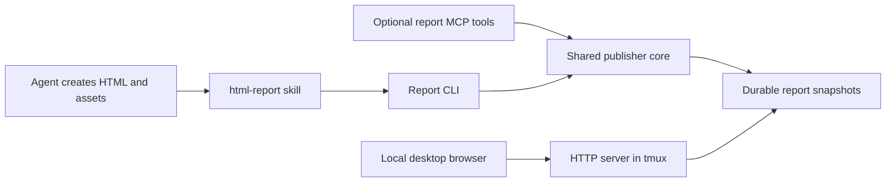

# HTML report design and implementation plan

Design baseline, 2026-10-13, against source `6a04536`. The standalone component
is now implemented and qualified in isolated installations; fleet activation
remains separate. See the [usage guide](html-report-usage.md) and
[execution evidence](html-report-results.md). The existing watch/peer runtime
preview and its deployment gates remain independently owned.

Read the [v1 implementation plan](html-report-plan.md) for concrete configuration,
interfaces, retry/recovery semantics, proposed limits and execution gates. Its
decision table supersedes provisional implementation details in this overview.

## Everyday outcome

Ask an agent to explain findings, compare options or present a result. When HTML
helps, it creates a report, publishes it and returns a short, clickable link.
The same link opens from the desktop whether the agent runs locally, over SSH,
inside tmux or without an attached TUI. Opening the report requires no per-report
port selection, tunnel setup or knowledge of its filesystem location.

The agent chooses the presentation: narrative, tables, diagrams, plots or
client-side controls. A skill supplies delivery guidance and optional examples;
it does not impose a dashboard template or make every answer an HTML report.
Chat retains a brief explanation of the useful result and a descriptive link.

Bryan selected these first-version boundaries:

- Return a reliable link that he opens locally. Automatic browser opening is later.
- Publish static HTML with its assets. Client-side JavaScript, SVG, JSON data,
  filtering and interactive charts fit this scope.

Live development servers, backend APIs, websocket streams and remote browser
control are later capabilities. The first publisher copies existing output; it
does not run a build, execute uploaded code on the host or start a report server
for each agent invocation.

## Proposed defaults

| Decision | Proposed first-version behavior |
| --- | --- |
| Source | One HTML file or an explicitly prepared report directory |
| Hosting | One plain HTTP server per host in the codex-report-server tmux session |
| Network | Host-addressed tailnet URLs; v1 URL mode is recorded in the implementation plan |
| Publication | A separate immutable snapshot and URL for each publish |
| Retention | Keep snapshots until explicitly deleted |
| Discovery | Bounded local inventory; URL identifies its publishing host |
| Browser catalog | Optional static index at `/reports/`, covering that host's published reports |
| Opening | User opens the returned URL through the local terminal/browser |
| Agent integration | Shared skill and CLI; a thin, independent report MCP adapter |
| Distribution | A report component in codex-plus, installed through chezmoi |

These defaults describe the implementation baseline. The two
scope selections above are the user's confirmed choices.

## Consolidation and optional index

Use one shared serving endpoint on each host for all projects and agent sessions.
Project A and project B publish into separate report directories under the same
store and serving route. Publication does not allocate a port, create a server
process or tie report availability to its originating session. The detached
codex-report-server tmux session supplies the selected plain HTTP serving process.
The optional built-in server uses Python and tmux; external HTTP/HTTPS servers
can serve the same public directory.

Existing per-project development servers remain relevant to live applications.
They are independently owned; adopting the report publisher is not permission to
stop them or migrate their running content. Static report exports use the shared
endpoint when created through this capability.

Recommend a small optional index at the report service's root, `/reports/`:

- Descriptive title, optional project label, publication date and report link.
- Project sections with counts, newest first within each. Sections with recent
  publications lead; a project selector and text search combine.
- Shareable fragment views restore project/search state through browser
  navigation. Unlabeled reports have a distinct Uncategorized view.
- Generated from committed report metadata on publish/delete, using a host-local
  lock and atomic index replacement so concurrent publishers do not lose entries.
- A host setting controls whether the catalog is shown. Direct report links
  remain usable when it is disabled; a minimal non-listing landing page prevents
  a fallback to raw filesystem directory listings.

The index exposes only the intended catalog fields. Original paths, conversation
IDs and private registry details stay outside the served tree. It is a static
read-only library, without browser-side deletion or an API backend. If generation
fails, preserve the previous complete index, disclose stale catalog state and
retain the independently valid report publication. Doctor should identify that
state and an explicit rebuild can repair it.

On a dedicated report port, an optional landing page at `/` can link to
`/reports/`. When sharing an existing HTTPS endpoint, leave its unrelated root
route alone. The first index covers its own host; aggregating other hosts is a
separate feature.

## Components and ownership



The publisher core owns bundle validation, snapshot creation, metadata, listing
and removal. CLI and MCP adapters use the same implementation. The shared HTTP server owns
the configured endpoint and serving lifetime. There is no background
report coordinator or model turn needed to keep a static report available.

The existing `model_server.py` calls `native_context`, resolves an existing Codex
socket and creates `ModelAPI` on every tool call. Its thread/turn checks protect
peer and watch operations. Reports must not require those operations or weaken
their checks. Use a separate report entry point that works without Codex running
and without Codex-specific caller metadata. Any recorded conversation label is
optional provenance, not an authentication or access-control identity.

Provider-neutral skill instructions and the CLI are the baseline integration.
A report-only MCP adapter can expose the same operations to Codex and Claude;
client configuration/loading is qualified separately. Plugin packaging bundles
that skill and adapter for convenient installation. A plugin does not supply
HTTP hosting or desktop browser access by itself.

## Publishing interface

Proposed CLI name: `codex-plus-report`. Proposed skill name: `html-report`.

```sh
rtk proxy codex-plus-report publish --source /absolute/path/report.html --title "SSH findings"
rtk proxy codex-plus-report publish --source /absolute/path/report-bundle --entrypoint index.html --title "Run comparison"
```

The equivalent MCP operation is `report_publish(source, title, entrypoint?, project?)`.
HTML is authored into files using the agent's ordinary tools; the call carries
paths and metadata, rather than embedding the whole report in tool arguments.
An optional project label is display metadata for the index, not a filesystem
path or an instruction to inspect conversation history.
Use a stable repository name or a user's existing label across sessions/hosts.
Receipts expose current `catalog_url` and `project_url` views when enabled;
immutable report URLs remain unchanged. Agents can link relevant earlier reports
in a new result after inspecting exact project-filtered inventory. Project
membership does not imply an automatic revision or replacement relationship.

| Operation | Behavior |
| --- | --- |
| `report_publish` | Validate and copy one explicit source into a new snapshot; return a publication receipt |
| `report_get` | Read a selected report's metadata and URL; optionally perform a bounded serving check |
| `report_list` | Return bounded local inventory, newest first, with title, date and URL |
| `report_delete` | Remove exactly the selected published snapshot, retain a private deletion record and preserve source files |
| CLI `doctor` | Inspect installation, configured route and serving health without changing them |

Listing and metadata reads do not create state, start services or inspect agent
histories. Delete is a write/destructive operation; the adapter declares that
effect accurately and follows the calling client's existing authorization.
There is no automatic bulk cleanup or cross-host SSH control in these tools.

A receipt includes the report ID, title, entrypoint, origin host, local snapshot
location, expected URL when configured, bundle hash/count/size and serving-check
result. Routine chat shows the descriptive link and any material delivery limit,
without UUIDs, helper commands or raw JSON.

Successful storage and successful delivery are distinct facts:

- **Stored:** a complete local snapshot and its metadata exist.
- **URL configured:** a hosting route supplies its expected browser URL.
- **Serving checked:** a bounded request retrieved the expected entrypoint bytes.
  Record where that request ran; a check on the publishing host does not prove
  desktop connectivity or visual quality.

If hosting is unconfigured or unreachable, retain and report the stored snapshot
and the specific delivery problem. Do not substitute a remote `localhost` URL,
claim the browser opened, change the tailnet or invent a successful health check.

## Bundle and update semantics

A single-file source should be self-contained. A directory source must be a
dedicated report export, with an explicit entrypoint and its intended assets.
Publishing the current project directory implicitly is not an acceptable shortcut.

Use relative asset URLs so the bundle works below its report URL. The publisher
does not rewrite arbitrary HTML/JavaScript or silently collect files from parent
directories. Clearly missing local dependencies are reported. A bounded dependency
check is useful evidence; it cannot prove every runtime JavaScript fetch succeeds.
Prefer bundled dependencies; disclose any deliberate external dependencies.

Accept regular files and directories within configured size/count bounds. Reject
symlinks, path traversal, special files and an entrypoint outside the selected
bundle. Copy into staging outside the served root, validate the snapshot, and
expose it through an atomic directory rename. Never present partially copied
reports as successful publication. Failure/crash recovery must distinguish
incomplete staging, stored snapshots and committed receipts.

Each distinct bundle and public-metadata snapshot receives an opaque report ID.
Publishing identical output again reuses its verified snapshot and URL. Editing
the original files does not change an existing snapshot. Changed output produces
a new URL; the older link continues to identify the older result. Optional
predecessor metadata can connect revisions without a mutable `latest` alias.
Concurrent publishes cannot overwrite each other's files or metadata.

For authoring, follow the project's existing generated-report convention when
the report belongs with its artifacts. Otherwise a dedicated scratch export, for
example under `~/.cache/codex-plus/report-drafts`, keeps ad hoc reports out of the
project's source inventory. Authoring location is a model/project choice.

Published copies always go into a durable per-user store under
`$XDG_DATA_HOME/codex-plus/reports`, defaulting to this layout:

```text
~/.local/share/codex-plus/reports/
  public/                    # mapped to the URL prefix /reports/
    index.html               # optional catalog, or non-listing landing page
    <report-id>/
      index.html
      assets/...
  metadata/                  # private publication records
  staging/                   # incomplete copies, never served
```

Only the `public` subtree is served. The catalog can project title, project, date
and URL from registry records; original paths, conversation provenance and
internal hashes remain private. Published links continue working if the original
project is moved, its scratch directory disappears or its authoring session ends.
The report directory is runtime data, outside release archives and chezmoi's
managed `exact` trees. Same-user processes are the local trust boundary; a
conversation label does not create an isolated security principal.

## Hosting and browser behavior

Every returned URL names the publishing host, including when the agent and
browser currently run on that same host. Do not switch published links to
`localhost` based on the current viewer: it would change meaning when opened from
another desktop. The selected short-hostname HTTP shape is:

```text
http://starship:8787/reports/                 # optional catalog
http://starship:8787/reports/<report-id>/     # index.html entrypoint
http://snap:8787/reports/<report-id>/         # report published on Snap
```

Full-name HTTPS remains a configurable option:

```text
https://<publishing-host>.<tailnet>.ts.net/reports/<report-id>/
```

Use a browser-resolvable hostname. Tailscale MagicDNS provides machine names and
fully qualified names; an alias that exists only in SSH configuration is not
browser DNS. Prefer the reported Tailscale name over guessing from the operating
system hostname. Starship's earlier local loopback alias was changed to its
Tailscale address so the same short URL works on both publishing and viewing
hosts. [MagicDNS naming](https://tailscale.com/docs/features/magicdns).

The selected plain HTTP server reads the public subtree, mounts the configured
URL prefix and disables directory listings and symlink traversal. Explicit tmux
start/status/attach/restart/stop controls revalidate their owned session/process.
Generic delivery and hosting checks execute HTTP requests, not Tailscale commands.
External HTTP/HTTPS hosting can use the same directory and base URL contract.

Changing a URL alone cannot expose a service bound only to loopback. The selected
serving endpoint must accept traffic over the tailnet, and the viewing desktop
must resolve/reach it. A loopback address is fine for an internal proxy backend;
the user-facing URL remains host-addressed. The host profiles use dedicated port
8787; Starship already has an unrelated listener on port 8000. Roaming preserves the URL as the
viewing device changes networks or desktops; it does not make an offline
publishing host available.

With `server_autostart = true`, publication starts or reuses the shared owned
tmux HTTP server. The standalone default is false for external hosting; chezmoi
enables it on this fleet. Read-only discovery/get/list/doctor do not start it.
Publication leaves the server running, with no automatic shutdown. Startup failure
retains the report and returns a separate server receipt. Inspect port/bind and firewall
requirements first, retaining unrelated rules and project servers. The named tmux
session persists across SSH/terminal closure; after host reboot the next publish
starts it again, or the user can start it manually. Report files survive independently. Existing project server retirement is
a separate migration because project navigation refresh or live behavior may
need preserving.

## Lifetime and removal

Reports persist until explicitly deleted. They are independent of turn activity,
TUI attachment, tmux, daemon thread unload timers and MCP process lifetime. A
hosting outage does not delete the snapshot or silently republish it elsewhere.

Do not evict older reports automatically to make a new publish succeed. Enforce
configured storage bounds and return a clear capacity error. Local inventory and
exact-report deletion provide the first cleanup controls. Choose initial storage
limits from representative report fixtures before installation.

No TTL or scheduled pruning is promised in v1. If retention is added later,
distinguish a cleanup schedule from a guaranteed access deadline: serving static
directories directly does not enforce expiry before a cleanup job removes them.
Deletion removes future server availability; it cannot retract browser-cached or
downloaded copies.

## Skill behavior

The skill applies when the user requests an HTML report, or the task benefits from
a substantial browser presentation. Ordinary concise answers remain concise.
It can be invoked explicitly and discovered normally; preserve the explicit-only
policies of unrelated worker skills.

The workflow is: author a dedicated report, check its meaningful interactions and
assets, publish it, assess the delivery receipt, and return the useful result with
the link. The model retains choice of structure, visuals and depth. Templates,
if supplied later, are optional starting points. Generating a report is not proof
that its underlying analysis is correct, or that its browser presentation passed.

## Repository and distribution plan

Keep implementation in codex-plus, with small report-core/CLI modules, an optional
report MCP entry point, `skills/html-report` and focused behavioral tests. Update
the explicit source inventory deliberately. Keep report tests separate from
native watch/peer acceptance.

Define the report component's own compatibility and package inventory. The current
runtime artifact declares Codex 0.162.1 and an existing native Unix daemon as
requirements; those requirements must not become report dependencies. Reuse
package verification and immutable-selection mechanics where they fit, without
changing the already published preview artifact/tag.

Qualify skill and MCP loading in each intended client. Plugin manifests are thin
distribution wrappers around the same skill/core, not alternative implementations.
For the fleet, chezmoi owns installed code selection, skill discovery wiring and
per-host application configuration. Host firewall and HTTP server
ownership need an explicit deployment step after inspection; report publication
must not perform that setup. Preserve unrelated source and live configuration.

## Implementation slices and acceptance

1. **Publish core and CLI.** Dedicated file/directory exports, immutable snapshots,
   receipts, bounded list/get/delete and doctor. Verify single-file and multi-asset
   reports, concurrent publishers/index updates, interrupted copies, path escapes,
   capacity failure and deletion that preserves sources/other reports. No native daemon
   or MCP dependency is allowed in these tests.
2. **One-host hosting qualification.** Inspect bind/port/firewall and tmux session
   ownership. Use isolated report content to qualify the configured route, relative
   assets, hostname resolution, configured HTTP/HTTPS mode, optional index behavior,
   exact fetched bytes and persistence after publisher/client exit. Installing
   a real route is a separately requested deployment action.
3. **Agent integration.** Add the skill and report-only MCP adapter where useful.
   Verify ordinary requests, honest unavailable-hosting receipts, readable links
   and the absence of native Codex owner calls during discovery/publication. Test
   the actual installed client versions; no model-study rerun or live peer actions.
4. **Desktop acceptance.** Open a report generated on another host, inspect its
   interactive controls/assets, and verify Kitty local opening from an SSH TUI.
   Cover the actual tmux path separately, especially hidden hyperlink handling.
   HTTP retrieval alone does not close this gate.
5. **Release and fleet installation.** Publish verified report-component bytes,
   prepare coordinated chezmoi pins/configuration/checks and scoped dry-runs, then
   apply the requested hosts and verify installed files and desktop delivery.
   Starship, Snap and Carbon require individual evidence; an offline host remains
   pending rather than inheriting another host's success.

The next pass should settle the proposed per-host backend, immutable URLs and
explicit retention, then execute the core/CLI slice. Automatic opening, live apps,
central hosting, mutable aliases, richer report-library UI and scheduled cleanup
can follow demonstrated need. This document authorizes no service activation,
tailnet change, deployment, daemon restart or source publication by itself.

## Review refinement

Report preview 5 selects the default tmux socket explicitly, independent of the
calling client attachment, and uses the controller attach command for inspection.
An interrupted physical deletion preserves its trash identity and capacity until
explicit delete retry or repair completes; both publication admission and final
commit recheck that state. Completed snapshot files may use `.write-*` names;
HTTP hides temporary index files only at the public root. Regression coverage
includes alternate socket callers, deletion racing a copy, exact cleanup retry,
capacity release, and entrypoint/asset delivery.
