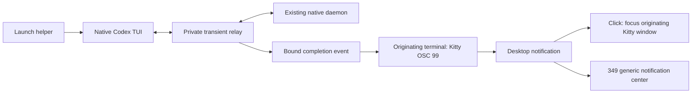

# Terminal-associated rich notification launcher

Date: 2026-10-15. Status: implementation and private native qualification in
progress under the selected goal loop. Bryan accepts a
launch helper to preserve unfocused-only notifications and originating-terminal
focus. The existing relay is a prototype, not a finished daily-use launcher.
Installed selection, native configuration and live services remain unchanged at
the source checkpoint below; desktop and managed-rollout gates are still open.

## User experience and ownership

The target is ordinary local and SSH terminal use of the native Codex TUI and
its existing daemon. Start with an explicit `codex-notify run` pilot. Recommended
eventual integration keeps typing `codex` through a managed interactive-shell
entry point; this is the working assumption for the goal loop. Explicit
native executable invocation remains available. CLI utilities and automation
retain their native argument, stdin/stdout and exit behavior.

| Owner | Responsibility |
| --- | --- |
| codex-plus | Launcher, terminal-associated completion publication, metadata and scoped native inspector |
| Chezmoi | Host-scoped launcher integration, independent helper pin, notification preferences and rollback |
| Kitty | Unfocused-only presentation and activation of the originating terminal window |
| 349d | Generic mirroring plus optional host labels and proved superseded-card removal |

The helper is independent of Agent Observer, monitoring/report workers and
physical displays. The existing USB notification/close protocol is sufficient.
The 349's unavailable DMS Open provider is a separate integration issue.

Bryan verified desktop clicks focus Kitty with daemon-backed Codex both while
viewing a session and while showing Command Center. This establishes window
focus as the baseline. V1 Open focuses that same terminal; thread selection
inside Command Center remains a native TUI interaction. With tmux, activation
targets the containing Kitty terminal; selecting an inactive tmux pane/window
is not assumed by the notification action.

## Selected publication path

Use the existing `notification_run` / `notification_stream` prototype as the
starting point. Relay native bytes unchanged. Observe only the bounded metadata
needed for successful root-thread bindings, completed turns and final text.
Publication uses the launch's exact terminal route, including supported tmux
passthrough. SSH naturally carries the output back to the originating desktop;
no fixed destination host or desktop receiver is required for this route.

Keep observer state bounded and in memory; do not log prompts, transcripts or
raw native traffic. Use a private transient socket/directory and verify the
existing listener's user/process/socket identity before attaching. Revalidate
source incarnation at reconnect rather than following a stale owner. The helper
never starts or replaces a native owner to make rich delivery available.

The relay is the completion publisher for a wrapped client. Leave server-side
`notify=[]` and the global native completion/approval recovery selected on the
supported hosts. Disable only native completion publication for the wrapped
client after its route is ready; retain native approvals/questions and all other
configured event types. A TUI `notify` override cannot disable a server hook.
Unexpected configured server hooks must be reported before choosing rich mode,
rather than silently creating two completion publishers.

Loaded threads may retain earlier hook settings even when disk config now has
`notify=[]`. Qualify fresh threads and already-loaded thread resume separately;
disk configuration alone is insufficient evidence of one publisher. The safe
adoption design must preserve existing user threads without forced unload or
daemon restart. Unresolved hook ownership blocks daily-launcher promotion for
that context, rather than being treated as a harmless configuration difference.

The daemon hook remains available for other explicit integrations. It is not a
required companion to this launch path. Native basic alerts remain the publisher
for ordinary unwrapped clients and supported pre-launch fallback.

## Binding and notification rules

- Bind exact source host, configured native instance and thread IDs from
  successful native start/resume responses on this client connection. Require
  positive supported user-root classification; exclude internal/title/subagent
  work. A roster entry, title, working directory or process environment cannot
  establish a route.
- Retain valid bindings while this TUI shows Command Center or another thread.
  Use each event's thread/turn IDs, not the currently displayed thread. Specify
  removal on native detachment, closure and connection replacement from actual
  protocol evidence. Starting a fresh Command Center does not bind every listed
  session automatically.
- Publish one completion per episode per client connection. Preserve paragraphs,
  bounded UTF-8 body text, source host and the existing v1 identity envelope.
  Keep final-answer selection separate from intermediate assistant messages.
- Apply unfocused-only delivery through the originating Kitty route. Foreground
  behavior follows the native terminal baseline, including Command Center.
- Define V1 focus and publication per terminal viewer. Two independently attached
  eligible viewers may each publish an episode; there is no claimed global
  single-alert arbitration. The 349 deduplicates copies by episode without
  renewing attention, retention or brightness. Test multiple viewers explicitly.
- Reconnection clears old route authority. Rebind through fresh native evidence;
  history reads must not replay old completion notifications. Closing a viewer
  ends its publication route while the daemon and its work retain native lifetime.

Command Center needs a dedicated native coverage check. The prototype observes
explicit start/resume bindings; broader background-session coverage must be
proved against the TUI's own subscription/routing behavior before promotion.
Do not grant authority to all sessions merely to make a test produce an alert.

## Launcher dispatch and failure behavior

| Situation | Planned behavior |
| --- | --- |
| Qualified interactive default/resume launch | Prepare private route, then launch native TUI with completion publication assigned to relay |
| `exec`, review, app-server, authentication, help/version and other CLI utilities | Invoke the native executable directly with exact argv and exit status |
| Explicit `--no-daemon`, unsupported remote endpoint, fork or unqualified native version | Preserve native behavior; rich mode is outside the initial qualified scope |
| Helper, existing daemon, usable terminal or supported protocol unavailable before TUI launch | Use the native basic path without changing global preferences; explicit rich invocation reports why it cannot qualify |
| Final response missing but a supported bound completion exists | Publish a bounded generic completion body with exact identity |
| Observation becomes unavailable while native traffic still works | Keep traffic forwarding, issue one clear degraded-status notice through the known terminal route, and stop claiming rich coverage |
| Relay transport or process fails after launch | Preserve owning daemon/work; native TUI disconnection/recovery behavior must be qualified. Never automatically relaunch or resubmit a prompt |

Pre-launch fallback and mid-session failure are different guarantees. Once a
client has disabled native completion alerts, the prototype cannot currently
restore them live. Do not claim automatic basic fallback for every later failure.
If the degraded behavior cannot be made clear and acceptable, keep the launcher
opt-in until a stronger recovery path is qualified.

Dispatch must parse actual native invocation structure: an argument or prompt
containing a subcommand's name must not change routing. Resolve a native
executable independently of the managed shell entry point to avoid recursion.
Keep shell completion, quoting, working directory, job control, Ctrl-C, exit
status and native startup/daemon policy intact. Interactive-shell integration
must not change noninteractive scripts or raw protocol stdout.

## Execution and acceptance

| Step | Deliverable | Exit evidence |
| --- | --- | --- |
| 1. Freeze semantics and native scope | Selected entry point, publication policy, ownership/detachment rules and supported native version | Review against current native protocol and this plan; no live settings change |
| 2. Harden the explicit launcher | Correct dispatch, classification, content, bounds, signal handling and honest degradation | Existing suites plus targeted regressions; private native TUI fixture preserves bytes/behavior and excludes unrelated/internal threads |
| 3. Qualify desktop daily use | Explicit installed local and Snap SSH launches | One useful completion with Codex sender, separate title/body and host; foreground suppression; actual desktop click focuses the originating window in session and Command Center views |
| 4. Qualify lifecycle edges | Switching, two threads, multiple viewers, reconnect, viewer closure and errors | No wrong-thread publication, stale replay or unrelated-owner signal; native approvals/questions remain usable; exact declared fallback/degraded behavior |
| 5. Recheck optional 349 behavior | Existing rich consumer plus delayed-arrival correction | Local/SSH cache admission, retention after panel presentation expiry, exact newer-turn removal, duplicate handling and physically observed readability/removal |
| 6. Prepare managed daily entry point | Independent release/manifest and scoped chezmoi candidate | Fetched bytes, current source convergence, narrow dry-run/apply, installed readback and rollback/reselection; switch only fresh launches |

Step 3 must cover a TUI returning to Command Center while its bound turn completes,
and switching to another bound thread before the first finishes. Include direct
Kitty and supported tmux, local and SSH, focus-away/back, no-body/error cases and
closing the window while the native turn continues. Keep actual window-focus
observation distinct from packet and serial evidence. Use owned disposable
threads; existing user sessions and daemon incarnations remain untouched.

The review found a 349 delayed-first-arrival gap: an unseen old completion can
reach the board before polling proves supersession. Fix or explicitly revise
that display guarantee before accepting step 5. The alternate desktop transport
also has an uncaught subprocess-exit timeout; track that separately when that
route is changed. It is not a dependency of the selected terminal relay path.

Roll out explicit mode first, then the selected daily entry point on one host,
then the second host after desktop acceptance. Retain native recovery and prior
helper selection. Rollback changes only fresh-launch selection; it neither
restarts active TUIs/daemons nor closes unrelated sessions. Canonical chezmoi
source must incorporate the candidate before a broad apply can be considered
consistent with the installed state.

The first managed scope is Starship and Snap. Preserve other hosts' existing
helper entry points and notification preferences, as well as independent
codex-plus worker, monitoring and report selections.

Source review, artifact publication, installed-byte acceptance, desktop behavior
and physical 349 acceptance remain separate checkpoints. Panel Open through DMS
has its own investigation and acceptance; it does not gate desktop click-to-focus
or authorize a DMS/349d restart in this plan.

## Source checkpoint: 2026-10-15

- `launch` dispatches unsupported/noninteractive invocations to the native binary;
  qualified `run` checks the existing listener, native version, configured hook
  and focus policy without changing configuration. Only completion is removed
  from the client's native event filter. Other configured events are retained.
- Positive user-root classification, exact resume-ID checks, native alias resume,
  unsubscribe/close revocation, per-viewer Kitty IDs, Codex sender and bounded
  degraded status are implemented. Native signal exit handling is retained.
- Forty-nine notification tests and five inventory-validator tests pass, including
  real owned subprocess/Unix-socket checks of byte forwarding, argv, exit status
  and one degraded notice after observation failure. Source inventory passes.
- Private stock 0.162.1 TUI/server plus loopback model passed completion in Command
  Center, creating a second root before the first completes, and resuming an
  already-loaded thread with the legacy terminal helper. Exact body/metadata
  association, Codex app name and absence of native OSC 9 duplication passed.
  All fixture processes were reaped; no real provider or desktop was involved.
- The 349 source now holds configured rich arrivals in a bounded queue for native
  inspection before display. Proved stale first arrivals emit no device packet;
  generic arrivals bypass slow inspection. Replacement and replay checks pass.
  Full host/tooling validation passed 433 tests; three live desktop tests skipped.

Private evidence is under `~/.cache/codex-notify-launcher-20261015`. The first
Command Center harness needed separate typing/Enter events to avoid native paste
coalescing; the loaded-thread fixture needed a persisted first turn before resume.
Only completed corrected runs support the claims above. Actual installed
local/SSH desktop arrival, focus, failure/lifetime acceptance and managed rollout
remain open; packet/private checks do not establish those gates. Arbitrary custom
hooks on already-loaded threads remain outside the legacy/no-hook qualification.
