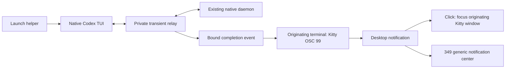

# Terminal-associated rich notification launcher

## Current selection: native notifications

As of 2026-10-15, ordinary launches use native completion and approval alerts.
The rich relay launcher and external completion hook are disabled by default in
chezmoi on Snap and Starship, including Snap's work and OSS entry points. Keep
`notify = []` and native `tui.notifications = ["agent-turn-complete", "approval-requested"]`.
The helper stays installed for explicit experiments; installing it does not enable
its launcher or hook. No daemon restart is required. Existing wrapped TUIs keep
their relay until exit; use a fresh shell and native launch for the new behavior.

The relay uses `--remote` even for its local Unix socket. Native Codex 0.162.1
therefore disables the empty-prompt Left shortcut to Command Center and applies
other remote connection semantics. Earlier acceptance below covered entry and
rich delivery, not transparent preservation of all local TUI behavior. Historical
launcher selections below are superseded by this default. Notification design
will continue on Starship without changing monitoring or reports.

Date: 2026-10-15. Status: preview 6 is installed through the scoped daily entry
point on Starship and Snap. Local/SSH delivery, originating-window Open, viewer
lifetime, native session cwd and the live 349 admission queue have installed
qualification. Bryan accepts the launch helper to preserve unfocused-only
notifications and originating-terminal focus. A subsequent user-observed physical
smoke check confirms 349 readability, visible retirement and touch on the paired
board; its scope and remaining unsupported contexts are recorded below.
Native basic alerts remain the pre-launch fallback. The scoped 349d activation
preserved the board boot and pairing; native Codex owners and existing sessions
were not restarted. The dated checkpoints below retain their original source
identities and acceptance limits.

## User experience and ownership

The target is ordinary local and SSH terminal use of the native Codex TUI and
its existing daemon. Start with an explicit `codex-notify run` pilot. Recommended
eventual integration keeps typing `codex` through a managed interactive-shell
entry point; this is the working assumption for the goal loop. Explicit
native executable invocation remains available. CLI utilities and automation
retain their native argument, stdin/stdout and exit behavior.

| Owner | Responsibility |
| --- | --- |
| codex-plus | Launcher, terminal-associated completion publication, metadata and scoped native inspector |
| Chezmoi | Host-scoped launcher integration, independent helper pin, notification preferences and rollback |
| Kitty | Unfocused-only presentation and activation of the originating terminal window |
| 349d | Generic mirroring plus optional host labels and proved superseded-card removal |

The helper is independent of Agent Observer, monitoring/report workers and
physical displays. The existing USB notification/close protocol is sufficient.
The 349's unavailable DMS Open provider is a separate integration issue.

Bryan verified desktop clicks focus Kitty with daemon-backed Codex both while
viewing a session and while showing Command Center. This establishes window
focus as the baseline. V1 Open focuses that same terminal; thread selection
inside Command Center remains a native TUI interaction. With tmux, activation
targets the containing Kitty terminal; selecting an inactive tmux pane/window
is not assumed by the notification action.

## Selected publication path

Use the existing `notification_run` / `notification_stream` prototype as the
starting point. Relay native bytes unchanged. Observe only the bounded metadata
needed for successful root-thread bindings, completed turns and final text.
Publication uses the launch's exact terminal route, including supported tmux
passthrough. SSH naturally carries the output back to the originating desktop;
no fixed destination host or desktop receiver is required for this route.

Keep observer state bounded and in memory; do not log prompts, transcripts or
raw native traffic. Use a private transient socket/directory and verify the
existing listener's user/process/socket identity before attaching. Revalidate
source incarnation at reconnect rather than following a stale owner. The helper
never starts or replaces a native owner to make rich delivery available.

The relay is the completion publisher for a wrapped client. Leave server-side
`notify=[]` and the global native completion/approval recovery selected on the
supported hosts. Disable only native completion publication for the wrapped
client after its route is ready; retain native approvals/questions and all other
configured event types. A TUI `notify` override cannot disable a server hook.
Unexpected configured server hooks must be reported before choosing rich mode,
rather than silently creating two completion publishers.

Loaded threads may retain earlier hook settings even when disk config now has
`notify=[]`. Qualify fresh threads and already-loaded thread resume separately;
disk configuration alone is insufficient evidence of one publisher. The safe
adoption design must preserve existing user threads without forced unload or
daemon restart. Unresolved hook ownership blocks daily-launcher promotion for
that context, rather than being treated as a harmless configuration difference.

The daemon hook remains available for other explicit integrations. It is not a
required companion to this launch path. Native basic alerts remain the publisher
for ordinary unwrapped clients and supported pre-launch fallback.

## Binding and notification rules

- Bind exact source host, configured native instance and thread IDs from
  successful native start/resume responses on this client connection. Require
  positive supported user-root classification; exclude internal/title/subagent
  work. A roster entry, title, working directory or process environment cannot
  establish a route.
- Retain valid bindings while this TUI shows Command Center or another thread.
  Use each event's thread/turn IDs, not the currently displayed thread. Specify
  removal on native detachment, closure and connection replacement from actual
  protocol evidence. Starting a fresh Command Center does not bind every listed
  session automatically.
- Publish one completion per episode per client connection. Preserve paragraphs,
  bounded UTF-8 body text, source host and the existing v1 identity envelope.
  Keep final-answer selection separate from intermediate assistant messages.
- Apply unfocused-only delivery through the originating Kitty route. Foreground
  behavior follows the native terminal baseline, including Command Center.
- Define V1 focus and publication per terminal viewer. Two independently attached
  eligible viewers may each publish an episode; there is no claimed global
  single-alert arbitration. The 349 deduplicates copies by episode without
  renewing attention, retention or brightness. Test multiple viewers explicitly.
- Reconnection clears old route authority. Rebind through fresh native evidence;
  history reads must not replay old completion notifications. Closing a viewer
  ends its publication route while the daemon and its work retain native lifetime.

Command Center needs a dedicated native coverage check. The prototype observes
explicit start/resume bindings; broader background-session coverage must be
proved against the TUI's own subscription/routing behavior before promotion.
Do not grant authority to all sessions merely to make a test produce an alert.

## Launcher dispatch and failure behavior

| Situation | Planned behavior |
| --- | --- |
| Qualified interactive default/resume launch | Prepare private route, then launch native TUI with completion publication assigned to relay |
| `exec`, review, app-server, authentication, help/version and other CLI utilities | Invoke the native executable directly with exact argv and exit status |
| Explicit `--no-daemon`, unsupported remote endpoint, fork or unqualified native version | Preserve native behavior; rich mode is outside the initial qualified scope |
| Helper, existing daemon, usable terminal or supported protocol unavailable before TUI launch | Use the native basic path without changing global preferences; explicit rich invocation reports why it cannot qualify |
| Final response missing but a supported bound completion exists | Publish a bounded generic completion body with exact identity |
| Observation becomes unavailable while native traffic still works | Keep traffic forwarding, issue one clear degraded-status notice through the known terminal route, and stop claiming rich coverage |
| Relay transport or process fails after launch | Preserve owning daemon/work; native TUI disconnection/recovery behavior must be qualified. Never automatically relaunch or resubmit a prompt |

Pre-launch fallback and mid-session failure are different guarantees. Once a
client has disabled native completion alerts, the prototype cannot currently
restore them live. Do not claim automatic basic fallback for every later failure.
If the degraded behavior cannot be made clear and acceptable, keep the launcher
opt-in until a stronger recovery path is qualified.

Dispatch must parse actual native invocation structure: an argument or prompt
containing a subcommand's name must not change routing. Resolve a native
executable independently of the managed shell entry point to avoid recursion.
Keep shell completion, quoting, working directory, job control, Ctrl-C, exit
status and native startup/daemon policy intact. Interactive-shell integration
must not change noninteractive scripts or raw protocol stdout.

## Execution and acceptance

| Step | Deliverable | Exit evidence |
| --- | --- | --- |
| 1. Freeze semantics and native scope | Selected entry point, publication policy, ownership/detachment rules and supported native version | Review against current native protocol and this plan; no live settings change |
| 2. Harden the explicit launcher | Correct dispatch, classification, content, bounds, signal handling and honest degradation | Existing suites plus targeted regressions; private native TUI fixture preserves bytes/behavior and excludes unrelated/internal threads |
| 3. Qualify desktop daily use | Explicit installed local and Snap SSH launches | One useful completion with Codex sender, separate title/body and host; foreground suppression; actual desktop click focuses the originating window in session and Command Center views |
| 4. Qualify lifecycle edges | Switching, two threads, multiple viewers, reconnect, viewer closure and errors | No wrong-thread publication, stale replay or unrelated-owner signal; native approvals/questions remain usable; exact declared fallback/degraded behavior |
| 5. Recheck optional 349 behavior | Existing rich consumer plus delayed-arrival correction | Local/SSH cache admission, retention after panel presentation expiry, exact newer-turn removal, duplicate handling and physically observed readability/removal |
| 6. Prepare managed daily entry point | Independent release/manifest and scoped chezmoi candidate | Fetched bytes, current source convergence, narrow dry-run/apply, installed readback and rollback/reselection; switch only fresh launches |

Step 3 must cover a TUI returning to Command Center while its bound turn completes,
and switching to another bound thread before the first finishes. Include direct
Kitty and supported tmux, local and SSH, focus-away/back, no-body/error cases and
closing the window while the native turn continues. Keep actual window-focus
observation distinct from packet and serial evidence. Use owned disposable
threads; existing user sessions and daemon incarnations remain untouched.

The review found a 349 delayed-first-arrival gap: an unseen old completion can
reach the board before polling proves supersession. Fix or explicitly revise
that display guarantee before accepting step 5. The alternate desktop transport
also had an uncaught subprocess-exit timeout. The source checkpoint normalizes it
to the existing quiet hook error path; it is not a dependency of the selected
terminal relay path.

Roll out explicit mode first, then the selected daily entry point on one host,
then the second host after desktop acceptance. Retain native recovery and prior
helper selection. Rollback changes only fresh-launch selection; it neither
restarts active TUIs/daemons nor closes unrelated sessions. Canonical chezmoi
source must incorporate the candidate before a broad apply can be considered
consistent with the installed state.

The first managed scope is Starship and Snap. Preserve other hosts' existing
helper entry points and notification preferences, as well as independent
codex-plus worker, monitoring and report selections.

Source review, artifact publication, installed-byte acceptance, desktop behavior
and physical 349 acceptance remain separate checkpoints. Panel Open through DMS
has its own investigation and acceptance; it does not gate desktop click-to-focus
or authorize a DMS/349d restart in this plan.

## Source checkpoint: 2026-10-15

- `launch` dispatches unsupported/noninteractive invocations to the native binary;
  qualified `run` checks the existing listener, native version, configured hook
  and focus policy without changing configuration. Only completion is removed
  from the client's native event filter. Other configured events are retained.
- Positive user-root classification, exact resume-ID checks, native alias resume,
  unsubscribe/close revocation, per-viewer Kitty IDs, Codex sender and bounded
  degraded status are implemented. Native signal exit handling is retained.
- Forty-nine notification tests and five inventory-validator tests pass, including
  real owned subprocess/Unix-socket checks of byte forwarding, argv, exit status
  and one degraded notice after observation failure. Source inventory passes.
- Private stock 0.162.1 TUI/server plus loopback model passed completion in Command
  Center, creating a second root before the first completes, and resuming an
  already-loaded thread with the legacy terminal helper. Exact body/metadata
  association, Codex app name and absence of native OSC 9 duplication passed.
  All fixture processes were reaped; no real provider or desktop was involved.
- The 349 source now holds configured rich arrivals in a bounded queue for native
  inspection before display. Proved stale first arrivals emit no device packet;
  generic arrivals bypass slow inspection. Replacement and replay checks pass.
  Full host/tooling validation passed 433 tests; three live desktop tests skipped.

Private evidence is under `~/.cache/codex-notify-launcher-20261015`. The first
Command Center harness needed separate typing/Enter events to avoid native paste
coalescing; the loaded-thread fixture needed a persisted first turn before resume.
Only completed corrected runs support the claims above. At that source checkpoint,
installed desktop and managed-rollout gates were open; the later checkpoint below
records new evidence without promoting packet/private checks to GUI acceptance. Arbitrary custom
hooks on already-loaded threads remain outside the legacy/no-hook qualification.

## Installed explicit-pilot checkpoint: 2026-10-15

The published [preview 2](https://github.com/byebyebryan/codex-plus/releases/tag/codex-notify-v0.1.0-preview.2)
selects `a41365cdcf3dfd34576ed4a935b95bb55a4371e1`, source archive SHA-256
`03be5f680e62eb27f488a6a5d35cfdcaa4e0360ee9d9ce4e3dd52873d93b2e50`.
Chezmoi helper-only dry-run/apply, fourteen-file hash/mode readback and rollback
to preview 1 followed by reselection pass on Starship and Snap. Worker/report
selectors, native notification preferences, shell files and protected service
identities remain at their starting state. This selection makes explicit `run`
available; it does not replace ordinary `codex` launches.

Actual stock 0.162.1 native owners were used with owned disposable threads and
temporary loopback Responses providers. No external model requests or credentials
were used. The native TUI saved trust entries for the owned test directories;
only those exact entries were removed afterward, guarded by restoration of each
host's original complete configuration hash. Owned threads were archived, test
windows/SSH forwards/private servers reaped, and native PID/start ticks unchanged.

| Case | Actual desktop evidence | Actual 349 evidence |
| --- | --- | --- |
| Direct local Kitty | Foreground completion suppressed; one Codex notification in Command Center with `Codex @ starship`, separate body and exact metadata | Card `100106` retained after 31 seconds, then removed after a newer exact turn |
| Snap through ordinary SSH to Kitty | Same checks with `Codex @ 80H1VV3`; no fixed desktop receiver | Card `100108` retained after 31 seconds, then removed after a newer exact turn |
| Local Kitty with an owned tmux server | Same suppression, Command Center and body/metadata delivery through tmux passthrough | Card `100110` retained after 31 seconds, then removed after a newer exact turn |

Direct local and SSH checks closed only their owned viewer while a subsequent
turn was waiting at the loopback provider. Native readback still showed that
exact turn in progress; it then completed after the provider was released with
no viewer. The tmux case also passed, then its owned tmux server was removed.
These checks establish daemon/work lifetime, not automatic recovery of a dead
relay or restoration of native completion filtering inside a surviving client.

A local click-window probe recorded the intended Kitty window gaining focus
while showing Command Center. The input action was not captured, so this is
window-focus evidence, not confirmed notification-click attribution. The SSH
probe received its notification but recorded no focus during its observation
window. User click confirmation remains pending for both contexts; no click
failure is inferred from an unobserved test. Session-view rich clicks have not
been separately accepted.

An additional private native two-viewer check passed: both real TUIs resumed the
same owned thread, neither replayed its completed history, and each emitted one
completion with the same episode and distinct Kitty action identifiers. It had
no desktop and does not claim global exactly-one delivery.

The 349 admission fix at `a46ccc8` also passed an integration check using both
installed inspectors and actual native history from the owned local/SSH cases.
Delayed old completions were proved superseded before admission and emitted zero
fake-wire packets. This strengthens the source tests but is not live activation:
existing 349d, firmware and DMS remain unchanged. All six 349 CI jobs passed,
including both firmware builds. Physical panel readability/removal is unobserved;
the unavailable DMS panel Open provider remains separate.

Chezmoi's daily interactive Zsh entry point is prepared and host-gated. Both host
activation switches remain false. Render checks cover selected/disabled/unknown
hosts; an owned PTY check preserves spaces, newlines, literal shell syntax and
exit status, while noninteractive/no-TTY use stays native. The full distribution
checker passes. Canonical checkout convergence and scoped shell activation remain
release gates after desktop acceptance; no global PATH shim was installed.

Private receipts are under `~/.cache/codex-notify-launcher-20261015`. Only completed
corrected fixtures support this table. Earlier harness attempts exposed test-only
trace selection, TTY forwarding, trust-prompt and monitor issues; overlapping GUI
fixtures were stopped and the SSH lifecycle case rerun sequentially with exact
thread filtering. No production source change was needed for these corrections.

## Startup-policy review follow-up

The preview 3 follow-up preserves native daemon policy in automatic dispatch.
Native 0.162.1 uses embedded mode when `daemon_auto_start` is false, even if an
unrelated shared listener already exists. Automatic `launch` now requires an
effective true value; explicit `run` still selects its requested existing
endpoint. CLI overrides for daemon-owned features (`daemon_auto_start`,
`worktrees`, `transcript_v2`, `realtime_conversation`, `standalone_web_search`)
stay native, including quoted/dotted TOML keys and feature-table overrides.
Other feature overrides retain their native arguments through the relay.

Fifty notification tests pass after this review correction, including exact
native argv fallback and effective configuration checks. The selected explicit
route, content, packet, inspection and wire behavior are unchanged from preview
2's installed qualification. The follow-up does not activate daily shell mode,
restart an owner, or claim the pending click/physical acceptance gates.

## Desktop acceptance and rollout preparation follow-up

Preview 3's actual local session-view popup was visually inspected: Codex sender,
host title, final body and separate paragraph were present. A corrected passive
monitor correlated DMS acceptance with desktop IDs 566, 567 and 568 for owned
test episodes. An earlier monitor incorrectly allowed the client library to
answer observed method calls; that disconnected the monitor and hid replies.
This was a fixture error, not a missing DMS acknowledgement.

One-shot virtual-pointer attempts produced no corresponding ActionInvoked signal
or accepted originating-window focus. Their input path has not been qualified,
so they establish neither successful clicks nor a helper focus failure. Manual
local/SSH clicks in session and Command Center views remain required. A fixture
that correlates the exact returned desktop ID, actual owner action signal and
intended window focus is prepared; no further visible test is staged without an
available observer. Owned test windows/threads were cleaned up, known test
desktop IDs closed and exact native configuration restored.

Both canonical chezmoi checkouts have been fast-forwarded locally to the reviewed
notification source; GitHub main remains unmerged. No broad apply ran and daily
host selection stays false. A scoped 349d activation/rollback plan is prepared
under the private evidence directory: candidate and prior reviewed host archives,
hash manifests, exact config/service/pairing backups and verified isolated imports.
The running Python service has no source revision stamp; the rollback target is
the prior reviewed commit, not a claimed dump of its loaded objects. Activating
the new queue requires a 349d-only restart. Repository instructions require user
authorization for that live service change, and authorization has been requested.
Native owners, DMS, Observer, RLCD, Mesh and report services remain untouched.

## Visible Open action follow-up

An owned fullscreen terminal independently confirmed that the virtual pointer
delivers real press/release events. DMS 1.6.3 source and the live false
`notificationPopupBodyInvokesAction` preference then explained the earlier
non-action: long card bodies expand on click. Kitty labels its default action
with a space, leaving no discoverable named Open button in this context.

The next producer candidate adds one visible Open button through OSC 99's
standard button payload. Title, body and button are collected before the sole
completion marker, producing one desktop Notify call. Kitty's normal focus
action activates the launch's exact terminal; no global DMS preference, launcher
guessing or extra receiver is needed. Clicking card body text continues to follow
the notification center's expansion/text policy. The explicit Open action is the
qualified terminal activation gesture.

The source pilot passed a real local session-view click: DMS accepted notification
578, the visible Open button emitted its exact action 1, and originating Kitty
window 86 gained focus. Foreground suppression, sender/body/metadata and one
publication also passed. The native owner was unchanged and the owned thread
archived. Fifty notification tests pass, including unchanged native relay bytes
and a sole final marker after the button. Packaged local Command Center and SSH
acceptance are the next gates; this source pilot alone does not establish them.

## Installed Open and shell selection follow-up

Installed preview 4 passed actual desktop Open in local and Snap SSH session
views and Command Center. Each case correlated one native episode with its
returned DMS notification ID, visible action 1 and the originating Kitty window
gaining focus. Command Center detection matched its header, not its help text.
The local ordinary `codex` shell entry also passed this correlation in Command
Center. Owned threads were archived and owner identity was unchanged within
each accepted run. This establishes graphical desktop activation; physical 349
rendering/touch and the separate unavailable DMS panel Open provider remain open.

Fresh interactive user shells now select the helper on both hosts. Actual PTY
checks preserve native dispatch in agent and noninteractive shells. Exact scoped
shell apply, rollback and reselection passed for both hosts. Only `.zshrc` and
the notification shell snippet were selected; no global PATH shim or broad apply
was used. Unrelated Observer source changes were preserved. An independently
stopped RLCD service was observed and left stopped.

## Native version compatibility follow-up

The native managed servers independently transitioned to 0.163.0 during
qualification while `/usr/bin/codex` remained 0.162.1. No daemon restart command
was issued by this work, and the transition's cause was not established. Preview
4 correctly falls back to native behavior for this unqualified server pair.
The next candidate qualifies explicit TUI/server pairs 0.162.1/0.162.1,
0.162.1/0.163.0 and 0.163.0/0.163.0; other combinations remain native.

Private real-native checks with a loopback model passed Command Center for
0.163.0/0.163.0 and a switch between two running roots for 0.162.1/0.163.0.
Exact body/metadata association, visible Open payloads and absence of native
OSC 9 duplication passed. With global auto-start enabled, the private listener's
PID/start ticks remained unchanged; only a harmless startup lock was created.
All owned processes were reaped. These checks had no real provider or desktop.

Matching native source confirms that an explicit `--remote` endpoint bypasses
daemon management. No extra daemon-policy override is needed. Native remote
mode rejects additional workspace roots, so `--add-dir` and explicit
`sandbox_workspace_write` overrides now preserve exact native dispatch instead.
Fifty-one notification tests pass, covering the pair allowlist and these argv
fallbacks. Installed qualification against the current server and updated
release selection remain separate from the private checks above.

## Preview 5 installed checkpoint

Published preview 5 selects `8d1fea8e5f25bb71e0ef18ff424a73d7578ac8c0`, archive
SHA-256 `01ac786f61b57372f1c8417483ca71b1f1a30cb17a9f30e7c6c1cd2801e307a6`.
Both hosts passed scoped helper dry-run/apply, exact fourteen-file hash/mode
readback, rollback to preview 4 and reselection. Fresh baselines preserve the
current 0.163.0 owners, active shell selection and unrelated selectors/services;
historical 0.162.1 receipts were retained rather than rewritten. Full distribution
and independent pin checks pass.

Fresh ordinary `codex` launches in actual local and SSH terminals delivered one
rich completion from Command Center on the current owners, with exact metadata,
Codex sender, host title and separate body. Local desktop ID 608 and Snap ID 607 were explicit delivery-only cases. Local ID 606 established delivery before its click assertion
failed: no ActionInvoked signal was captured. That repeat's cause is unresolved;
it does not replace the earlier preview 4 Open evidence with current-server click
acceptance. An earlier local attempt also stopped on OCR marker recognition.
Neither failed fixture is reported as an overall acceptance pass.

Owned threads were archived and native-created test trust entries removed with
exact original configuration hash restoration. Current native PID/start ticks
and protected service identities remained unchanged. The live 349d admission
queue still needs user authorization for its service restart; physical readability,
visible retirement and touch remain unobserved. No firmware or live host service
change was performed by this work.

## Current-owner desktop Open follow-up

Installed preview 5 now passes actual daily-shell Open on both current 0.163.0
servers with the 0.162.1 TUI, in both session view and Command Center:

| Source | Native view | Desktop notification | Originating Kitty window |
| --- | --- | --- | --- |
| Starship | Command Center | 611 | 105 |
| Snap SSH | Command Center | 613 | 108 |
| Starship | Session | 614 | 109 |
| Snap SSH | Session | 615 | 110 |

Each owned case starts ordinary `codex` in a fresh interactive Zsh terminal,
delivers one rich completion with the exact episode/host/body, correlates action
1 from the actual DMS owner with its returned notification ID, and observes the
exact originating window gaining focus. These are actual GUI checks with private
loopback providers, without real model requests or credentials. Foreground
suppression remains the earlier preview 4 qualification; it was not repeated here.

The corrected fixture holds one pointer connection across hover and click and
restricts exact marker recognition to the popup. A separate owned terminal
confirmed button delivery; the earlier SSH OCR attempt had matched both the popup
and background terminal text. Original failed receipts remain available and are
not counted as passes. No producer change was needed for the successful repeats.

Owned threads were archived, test-folder trust entries removed with exact original
configuration hash restoration, and both native PID/start-tick identities stayed
unchanged. This closes the current-server desktop Open gate. Physical panel
acceptance and user authorization for the 349d-only admission-queue restart remain
outstanding. No live service or firmware change was made.

## Resource-cost checkpoint

On Starship with TUI/server 0.162.1/0.163.0, the private two-root fixture measured
the relay Python process at 27.6 MiB RSS and 15.3 MiB PSS. No additional CPU ticks
were observed over a ten-second idle interval or the subsequent two-completion
publication interval (0.101 seconds); `/proc` CPU accounting has ten-millisecond
tick granularity, so this is not a claim of zero CPU cost. The fixture includes
diagnostic trace writes and excludes the native TUI/server. It passed exact
body/identity association, two rich completions without native OSC 9 duplicates,
unchanged private owner identity and owned-process cleanup. No real model or
desktop was involved.

Installed inspector measurements used one exact owned historical card per source,
three calls per host at the consumer's five-second cadence, and native
supersession readback. CPU and peak RSS are for the short-lived inspector child:

| Source | CPU per call | Helper wall time | Peak RSS | Mean CPU at five-second cadence |
| --- | --- | --- | --- | --- |
| Starship | 107-114 ms | 110-117 ms | 26.0 MiB | 2.20% of one core |
| Snap | 91-99 ms | 95-103 ms | 26.0 MiB | 1.91% of one core |

Observed end-to-end wall time was 189-194 ms locally and 478-516 ms over SSH;
those figures also include measurement-wrapper startup. Inspector CPU/RSS exclude
the wrapper, native server and SSH processes. These bounded samples establish
ordinary one-card cost, not maximum-batch throughput or whole-stack overhead.
No inspector command runs without matching outstanding cards; batches share one
native connection and read each requested thread once. The relay remains one
process per wrapped viewer, and inspection remains transient. Python's standard
library and the existing SSH route are sufficient; Observer is not required.

Private results are `private-resource-1/result.json`, `inspector-resource-5s.json`
and `resource-cost-summary.json` under the existing evidence directory. All reads
were restricted to owned test identities, with native owners and services intact.

## Live 349 admission checkpoint

The scoped 349d-only activation is complete: Starship's service PID changed from
775545 to 69987, the admission queue is visible in status, and board boot ID
162624908 and pairing identity are unchanged. Native owners and all other sampled
service identities remained unchanged, including the independently running RLCD
service. Config/unit/pairing files and both hosts' protected selectors match their
pre-activation snapshots. No firmware was flashed.

Installed daily local and Snap SSH lifecycle checks passed with cards 100005 and
100007: one rich completion in Command Center, retained device history beyond
31 seconds, then exact removal when a separate client starts a newer turn.
Closing the viewer left native work running and it completed without that viewer.
Owned threads were archived and native-created test trust entries removed with
exact configuration restoration.

Live delayed local/SSH notifications entered the pending queue and were rejected
after one native inspection each, with no new device card observed. A generic
notification was admitted without native inspection and its own desktop close
removed the exact card. These serial/cache observations complement the zero
fake-wire integration checks; they do not claim a packet trace or physical view.
The [consumer checkpoint](https://github.com/byebyebryan/esp32-349/blob/feat/rich-notifications/projects/notification-panel/docs/notification-launcher-acceptance-2026-10-15.md)
records exact receipts, prepared 349 rollback and the remaining physical/touch
acceptance. The separate DMS panel Open provider remains unavailable.

## Fresh-session working-directory correction

An ordinary wrapped launch from a project previously added `--remote` without
`--cd`. The TUI then sent `thread/start` with `cwd=null`, and the daemon selected
its own home directory. Earlier probes used explicit cwd flags and missed this
plain-launch path.

The relay now passes the absolute local cwd for a fresh session. Explicit
`-C`/`--cd` values are resolved locally and retain their option form; other
arguments remain unchanged. A resume without an explicit cwd flag receives no
implicit override, so native saved-directory policy stays in control. Unsupported
automatic invocations still execute the original native argv directly.

Fifty-four notification tests pass, covering the fresh default, relative/absolute
cwd option forms, literal arguments after `--`, resume policy and child-process
argv alongside unchanged native bytes, signal/exit handling and degradation.
A real 0.162.1 TUI/private 0.163.0 daemon fixture reproduced the old null-cwd/home
behavior before the fix. Corrected native fresh, short/long explicit cwd,
relative cwd and saved-directory resume cases all pass with distinct caller,
daemon and saved-session directories. Fresh/resume cases also pass for the
0.162.1/0.162.1 and 0.163.0/0.163.0 pairs. Owned private processes were reaped.

Against the actual running Starship daemon, a fresh TUI from the already trusted
349 project sent that exact absolute cwd; native thread-start and thread-read
responses agreed. No prompt or model turn was submitted, the owned empty thread
was archived, and native owner/configuration stayed unchanged. Installed-helper
qualification and the next release selection are recorded separately. Physical
panel acceptance remains unobserved and separate from this cwd correction.

Preview 6 publishes `e77601b593f85e8fa004add1e1f54ccb97423f6b`, archive SHA-256
`7fdec339dcea7dc0d8925b1b5ee74cd4cc84a648662e20e0a842b73ca89eaad3`.
Both hosts passed helper-only dry-run/apply, fourteen-file hash/mode readback,
rollback to preview 5 and reselection. Fresh baselines preserve concurrent native
configuration changes rather than restoring an older configuration snapshot.
The full distribution checker passes.

Using the installed automatic `launch` entry point with no cwd argument and no
prompt, real fresh TUIs against both running daemons sent the caller's directory:
the trusted 349 project on Starship and `/home/bryan/code/mesh-plus` on Snap.
Native thread-start and thread-read cwd values matched. No model turn started;
both owned threads were archived. Native owners, current config, shell bytes and
protected services remained unchanged. This closes the cwd correction's installed
qualification; physical acceptance and the separate DMS panel Open gap remain
unchanged.

## User-observed 349 physical checkpoint — 2026-10-15

Bryan confirmed readability of `Codex @ starship` / `PHYSICAL_PANEL_CHECK`,
vertical navigation to a generic reference card and dismissal of only that
reference with ×. After a separate client started the next owned native turn,
the exact Codex card disappeared visibly while other cards remained. Cache
readback corroborated presence before and absence after native supersession.

This smoke check used an owned native thread and loopback provider, with a
desktop stimulus carrying the installed preview-6 utility's v1 metadata. It
qualifies the shared desktop-to-panel rendering/touch/lifecycle path, alongside
the earlier installed local/Snap SSH native TUI/relay evidence; it does not
relabel those earlier automated tests as physical observations. Board boot ID
1394715752 followed an independent USB reconnect. Firmware reports build
`b9046f4` / SHA `8f5ae24ba`; the 349d process and native daemon were unchanged.
Only the owned desktop notifications and disposable thread were cleaned up;
native configuration hashes were unchanged and no external model was used.

The [consumer acceptance record](https://github.com/byebyebryan/esp32-349/blob/feat/rich-notifications/projects/notification-panel/docs/notification-launcher-acceptance-2026-10-15.md#observed-physical-smoke-check--2026-10-15)
records the exact stimulus, user reports and limits. Physical observations are
separate from the stimulus runner's protocol/cache receipt. The DMS panel Open
provider remains unavailable and outside this completed check. Source reviews
remain drafts; broader hardware/native/UI contexts retain their declared limits.

## Interactive agents entry point

The launcher recognizes the native `agents` Command Center, preserving its
configuration, directory and alternate-screen options. Generated remote endpoint
and notification settings belong after the subcommand, avoiding the independent
root-TUI option fields. A bare `agents` receives the caller's directory for new
tasks; explicit directories are resolved locally. Explicit remote destinations,
unsupported options, utilities and noninteractive calls retain the native path.
List membership grants no publication route: successful start/resume responses
remain required for each root. Alternate home selection remains the caller's
`CODEX_HOME` responsibility; no machine-specific launcher names are assumed.

The source pass has 56 passing notification tests plus the public bundle
inventory check. A stock 0.162.1 TUI launched directly into `agents` through the
relay against an owned 0.163.0 server and a loopback Responses fixture. Creating
a root task used the caller directory; returning to Command Center before
completion produced one rich notification with matching body/thread metadata
and no native OSC 9 duplicate. Internal title work was excluded. All owned
processes were reaped; no real provider or desktop was involved. The first
fixture sent a key while the initial list was loading and failed to submit;
its failed receipt is retained separately from the corrected successful run.
Installed delivery for this new entry point remains a separate rollout gate.

## Agents preview 7 installed checkpoint

[Preview 7](https://github.com/byebyebryan/codex-plus/releases/tag/codex-notify-v0.1.0-preview.7)
publishes source `84ca9beea7ec3200342f74cc35f69678e444a961`. The attached source
archive SHA-256 is `d562616d429cfb24bfd388d270db9df6090c95f745e16648eba488c180bd57f9`;
the attached manifest defines the independently distributed fourteen-file utility.

Scoped chezmoi installation verified every selected file hash/executable flag
and the helper selector. The installed artifact passed stock 0.162.1 TUI /
0.163.0 daemon tests for default and `agents` launches using both the ordinary
interactive-shell entry and a local alternate-home wrapper. Each retained its
new-task directory and source identity, produced one matching rich completion
while viewing Command Center, and emitted no native OSC 9 duplicate. Fixtures
used private homes, loopback Responses providers and PTYs, with owned cleanup.
No real provider or desktop notification was used for this regression pass.

The configured downstream SSH inspector route separately recognized an owned
completed episode on the running alternate-home daemon as current, then as
superseded behind a newer interrupted turn. Only owned test threads were archived.
Early harness failures from querying unpersisted history and observing turn
admission before activation are retained privately; final lifecycle evidence
comes from authoritative persisted history and the exact configured route.
Physical panel rendering and graphical focus were not repeated by this pass.
